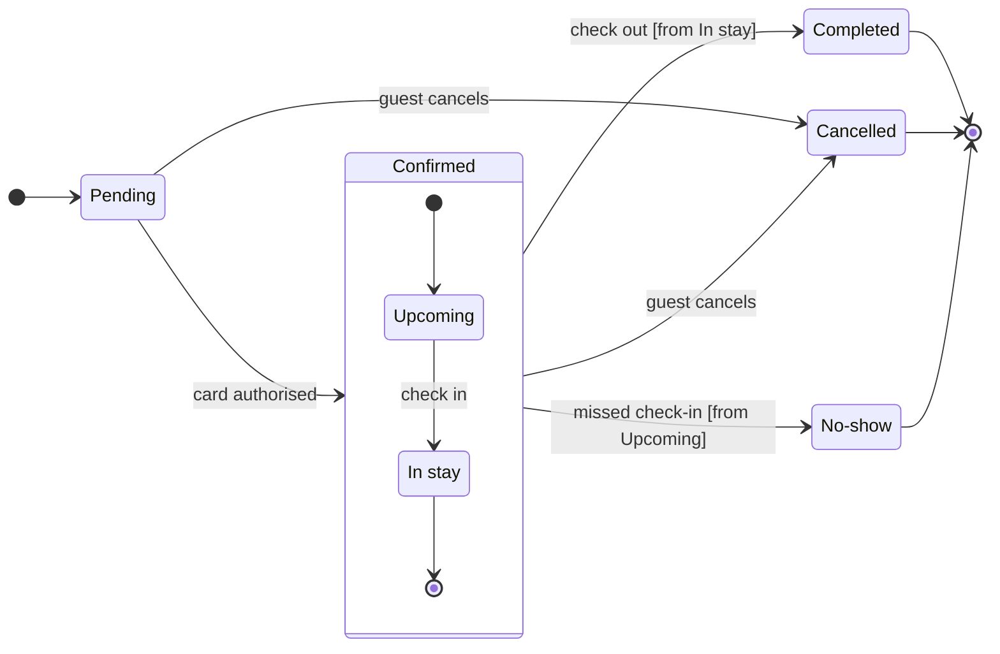

# FJ-017 turn 2 transcript

**User:** Yes, that reading is right.

**Tool call:** `ToolSearch` `{"query": "select:mcp__figma-remote__whoami,mcp__figma-remote__create_new_file,mcp__figma-remote__create_session,mcp__figma-remote__use_figma,mcp__figma-remote__get_figjam,mcp__figma-remote__get_screenshot", "max_results": 6}`

**Tool result:** `ToolSearch`

```text
[{"type": "tool_reference", "tool_name": "mcp__figma-remote__whoami"}, {"type": "tool_reference", "tool_name": "mcp__figma-remote__create_new_file"}, {"type": "tool_reference", "tool_name": "mcp__figma-remote__create_session"}, {"type": "tool_reference", "tool_name": "mcp__figma-remote__use_figma"}, {"type": "tool_reference", "tool_name": "mcp__figma-remote__get_figjam"}, {"type": "tool_reference", "tool_name": "mcp__figma-remote__get_screenshot"}]
```

**Tool call:** `Bash` `{"command": "mktemp -d", "description": "Create scratch folder for model and composed code"}`

**Tool result:** `Bash`

```text
"/var/folders/3c/zfqcqsts0kn19cgblj82gqhm0000gn/T/tmp.eHUSnNbTNl"
```

**Tool call:** `Read` `{"file_path": "/private/tmp/claude-501/-Users-michelkerkmeester-MEGA-Development-AI-Systems/348b59cb-58a2-4b49-8147-c40143312bc1/scratchpad/r046run/tmp/FJ-017/devin-compare-bench/FJ-017/sk-create-figjam/references/style-guide.md"}`

**Tool result:** `Read`

```text
"1\t---\n2\ttitle: \"FigJam Diagram Style Guide\"\n3\tdescription: \"The colour every composed FigJam board draws by kind in the shipped design, the type scale and the 8 pixel grid, the palette pairs the check accepts with their measured contrast, and the spacing bands, translated from sk-design-diagram's style guide and derivation record.\"\n4\tcontextType: implementation\n5\timportance_tier: important\n6\ttrigger_phrases:\n7\t  - \"figjam style guide\"\n8\t  - \"figjam palette\"\n9\t  - \"figjam colour by kind\"\n10\t  - \"figjam type scale\"\n11\t  - \"palette derivation record\"\n12\t  - \"figjam contrast\"\n13\tversion: 1.0.6.0\n14\t---\n15\t\n16\t# FigJam Diagram Style Guide\n17\t\n18\tThe rules for colour, type and spacing on a FigJam board. The composer in `assets/compose-board.js` draws every board in the design `assets/figjam-design.md` holds, which ships as the tables below record, and every hex a model, a design or a note extension uses comes from the palette in Section 3. `scripts/flow_check.py` refuses any other.\n19\t\n20\t**Loading Condition:** CONDITIONAL, before the gate on every Flow route, and when a model or a note extension uses colour\n21\t**Purpose:** Names the colour each kind draws in, the type scale, the grid, the palette pairs the check accepts and the measured contrast record\n22\t**Scope:** The composed board, Mermaid `style`, `classDef` and `linkStyle` colours, sticky and pin colours for notes, and the contrast record the self-test re-measures\n
```

**Tool call:** `Write` `{"file_path": "/var/folders/3c/zfqcqsts0kn19cgblj82gqhm0000gn/T/tmp.eHUSnNbTNl/model.md", "content": "```mermaid\nstateDiagram-v2\n    %% title: Booking status\n    %% subtitle: Every status a Roamstay booking passes through, what moves it on and who sets Cancelled and No-show\n    %% source: Source: the request, with no bookings doc. Left out: a note on Completed, who else can cancel, the timing of No-show.\n    %% focus: Cancelled\n    %% notes: Cancelled, NoShow\n    direction LR\n    state \"In stay\" as InStay\n    state \"No-show\" as NoShow\n    [*] --> Pending\n    Pending --> Confirme`

**Tool result:** `Write`

```text
"File created successfully at: /var/folders/3c/zfqcqsts0kn19cgblj82gqhm0000gn/T/tmp.eHUSnNbTNl/model.md (file state is current in your context \u2014 no need to Read it back)"
```

**Tool call:** `mcp__figma-remote__whoami` `{}`

**Tool result:** `mcp__figma-remote__whoami`

```text
"{\"whoami\":{\"user_id\":\"<redacted>\",\"handle\":\"<redacted>\",\"email\":\"<email>\",\"code_layers_enabled\":true,\"plans\":[{\"name\":\"<figma-plan-3>\",\"seat\":\"View\",\"tier\":\"starter\",\"key\":\"team::<plan-id>\",\"role\":\"admin\",\"specs_enabled\":true,\"code_layers_enabled\":true},{\"name\":\"<figma-plan-1>\",\"seat\":\"Full\",\"tier\":\"pro\",\"key\":\"team::<plan-id>\",\"role\":\"admin\",\"specs_enabled\":false,\"code_layers_enabled\":true},{\"name\":\"<figma-plan-2>\",\"seat\":\"Full\",\"tier\":\"pro\",\"key\":\"team::<plan-id>\",\"role\":\"member\",\"specs_enabled\":false,\"code_layers_enabled\":true}]},\"instructions\":\"For more details on rate limits and access, refer to https://developers.figma.com/docs/figma-mcp-server/rate-limits-access/\"}"
```

**Tool call:** `Bash` `{"command": "cd /private/tmp/claude-501/-Users-michelkerkmeester-MEGA-Development-AI-Systems/348b59cb-58a2-4b49-8147-c40143312bc1/scratchpad/r046run/tmp/FJ-017/devin-compare-bench/FJ-017/sk-create-figjam && python3 -I scripts/flow_check.py /var/folders/3c/zfqcqsts0kn19cgblj82gqhm0000gn/T/tmp.eHUSnNbTNl/model.md --notes Cancelled,NoShow 2>&1 | head -50", "description": "Run pre-write check on the state model"}`

**Tool result:** `Bash`

```text
"  diagram 1, state: ok, 7 states and 12 transitions\nSides: Cancelled takes its sticky right\nSides: No-show takes its sticky right\nPASSED 1 diagram(s) in model.md"
```

**Tool call:** `Bash` `{"command": "python3 -I scripts/compose_board.py /var/folders/3c/zfqcqsts0kn19cgblj82gqhm0000gn/T/tmp.eHUSnNbTNl/model.md --diagram 1 --out /var/folders/3c/zfqcqsts0kn19cgblj82gqhm0000gn/T/tmp.eHUSnNbTNl/board1.js 2>&1 | head -20; wc -c /var/folders/3c/zfqcqsts0kn19cgblj82gqhm0000gn/T/tmp.eHUSnNbTNl/board1.js", "description": "Compose the board code from the checked model"}`

**Tool result:** `Bash`

```text
"COMPOSED diagram 1, 7 states and 12 transitions: 12 nodes and 12 connectors to read back, 42519 characters in /var/folders/3c/zfqcqsts0kn19cgblj82gqhm0000gn/T/tmp.eHUSnNbTNl/board1.js, drawn in the design FigJam default\n   42519 /var/folders/3c/zfqcqsts0kn19cgblj82gqhm0000gn/T/tmp.eHUSnNbTNl/board1.js"
```

**Assistant:**

Question: which statuses does a Roamstay booking pass through, what moves it on, and who sets Cancelled and No-show?
Outcome: support can read the lifecycle and knows whether to ask the guest or the hotel about a Cancelled or No-show booking.

**First glance:** Pending, the light blue first state where every booking starts.
**Second glance:** Upcoming and In stay, the states inside Confirmed, read with the section that frames them.
**Last glance:** Cancelled, the end state the board exists to explain, marked by the pink outline where it is drawn. Completed and No-show follow as the other end states, in light gray with their heavy outline.

**Sketch:** the checked model below. The check printed `PASSED` for it, with 7 states and 12 transitions, and both notes have room on their right.



**Eye first:** Pending, since the layout always shows the first state first. Cancelled, the state the board is about, is marked where it is drawn, and that is the state I'd most want a reader to land on.
**Reads second:** Upcoming and In stay inside Confirmed, which carry a booking from payment to the stay.
**Could miss:** No-show, which would hide that the hotel, not the guest, ends a missed booking.
**Remove next:** In stay, which stays because check-out leaves from it.

**Plan:** <figma-plan-1>, the <figma-plan-5> team plan on your account (a Pro plan, Full seat). Your plan list has no plan named Roamstay Product, so I'm taking your clarification that the <figma-plan-5> team plan is the target.
**File:** a new FigJam file named "Booking status", created in that plan's drafts with no project.
**Writes:** one composed board with 7 states and 12 transitions, a title, a key and a source line, at the Laptop reading distance, with detail balanced and the audience mixed.
**Extensions:** two single notes. One sits beside Cancelled and reads "Set by the guest, while Pending or Confirmed". The other sits beside No-show and reads "Set by the hotel after a missed check-in".
**Left out:** a note on Completed, who else can cancel, the timing of No-show and who triggers check-in, because your message doesn't state them. Check in is drawn as the Upcoming to In stay event on my recommendation, and the source line says the board rests on your message alone.
**Calls:** create_new_file, create_session, one use_figma to compose the board, one use_figma for the two notes and one get_figjam read-back.
**Rollback:** delete the new file. If only the notes go wrong, I delete just the two note ids the write returns.

Write it?
