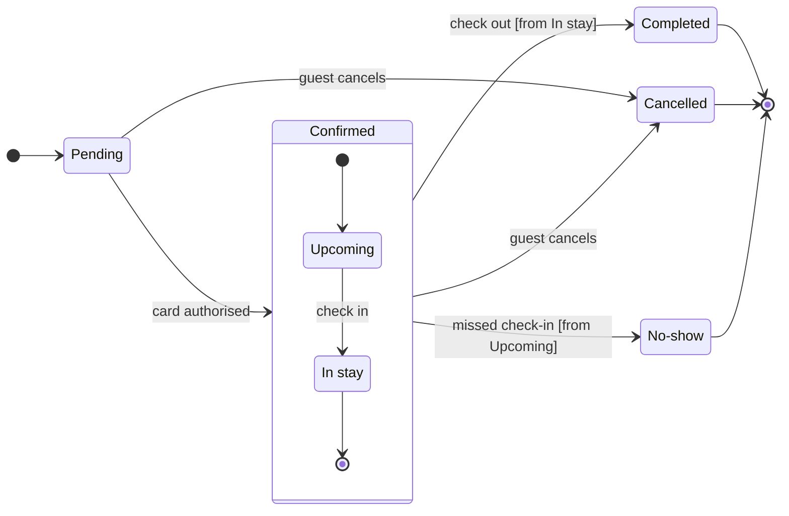

Question: which statuses does a Roamstay booking pass through, what moves it on, and who sets Cancelled and No-show?
Outcome: support can read the lifecycle and knows whether to ask the guest or the hotel about a Cancelled or No-show booking.

**First glance:** Pending, the light blue first state where every booking starts.
**Second glance:** Upcoming and In stay, the states inside Confirmed, read with the section that frames them.
**Last glance:** Cancelled, the end state the board exists to explain, marked by the pink outline where it is drawn. Completed and No-show follow as the other end states, in light gray with their heavy outline.

**Sketch:** the checked model below. The check printed `PASSED` for it, with 7 states and 12 transitions, and both notes have room on their right.

**Eye first:** Pending, since the layout always shows the first state first. Cancelled, the state the board is about, is marked where it is drawn, and that is the state I'd most want a reader to land on.
**Reads second:** Upcoming and In stay inside Confirmed, which carry a booking from payment to the stay.
**Could miss:** No-show, which would hide that the hotel, not the guest, ends a missed booking.
**Remove next:** In stay, which stays because check-out leaves from it.

**Plan:** <figma-plan-1>, the <figma-plan-5> team plan on your account (a Pro plan, Full seat). Your plan list has no plan named Roamstay Product, so I'm taking your clarification that the <figma-plan-5> team plan is the target.
**File:** a new FigJam file named "Booking status", created in that plan's drafts with no project.
**Writes:** one composed board with 7 states and 12 transitions, a title, a key and a source line, at the Laptop reading distance, with detail balanced and the audience mixed.
**Extensions:** two single notes. One sits beside Cancelled and reads "Set by the guest, while Pending or Confirmed". The other sits beside No-show and reads "Set by the hotel after a missed check-in".
**Left out:** a note on Completed, who else can cancel, the timing of No-show and who triggers check-in, because your message doesn't state them. Check in is drawn as the Upcoming to In stay event on my recommendation, and the source line says the board rests on your message alone.
**Calls:** create_new_file, create_session, one use_figma to compose the board, one use_figma for the two notes and one get_figjam read-back.
**Rollback:** delete the new file. If only the notes go wrong, I delete just the two note ids the write returns.

Write it?