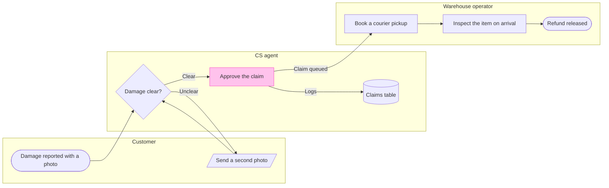

# FJ-023 turn 2 transcript

**User:** Yes, that reading is right.

**Tool call:** `Read` `{"file_path": "/private/tmp/claude-501/-Users-michelkerkmeester-MEGA-Development-AI-Systems/348b59cb-58a2-4b49-8147-c40143312bc1/scratchpad/r046run/tmp/FJ-023/devin-compare-bench/FJ-023/sk-create-figjam/references/quality-rubric.md"}`

**Tool result:** `Read`

```text
"1\t---\n2\ttitle: \"FigJam Diagram Quality Rubric\"\n3\tdescription: \"The taste gate a FigJam model passes before the write gate, translated from sk-design-diagram's success criteria: type fit, the remove test, signal, the check, the board, the design rubric that scores a composed board and the reply.\"\n4\tcontextType: implementation\n5\timportance_tier: important\n6\ttrigger_phrases:\n7\t  - \"figjam quality rubric\"\n8\t  - \"diagram taste gate\"\n9\t  - \"remove test\"\n10\t  - \"figjam review checklist\"\n11\t  - \"figjam design rubric\"\n12\tversion: 1.0.9.0\n13\t---\n14\t\n15\t# FigJam Diagram Quality Rubric\n16\t\n17\tThe script checks what a script can see. This rubric is the rest: whether the diagram should exist, whether every node earns its place and whether the reader can trust what lands on the board. Walk it after the check passes and before the write gate.\n18\t\n19\t**Loading Condition:** CONDITIONAL, on every Flow route before the write gate\n20\t**Purpose:** The judgement pass between the pre-write check and the gate\n21\t**Scope:** The model, the provenance table, the planned extensions and, after the write, the board and the reply\n22\t\n23\t---\n24\t\n25\t## 1. TYPE FIT\n26\t\n27\t- [ ] The type answers the reader's question, as `references/flow-mode.md` Section 3 maps it\n28\t- [ ] A table, a list or a paragraph would not do the same job. If it would, say so and offer that instead\n29\t- [ ] The type's reference in `references/types/` was loaded and i
```

**Tool call:** `Read` `{"file_path": "/private/tmp/claude-501/-Users-michelkerkmeester-MEGA-Development-AI-Systems/348b59cb-58a2-4b49-8147-c40143312bc1/scratchpad/r046run/tmp/FJ-023/devin-compare-bench/FJ-023/sk-create-figjam/references/style-guide.md"}`

**Tool result:** `Read`

```text
"1\t---\n2\ttitle: \"FigJam Diagram Style Guide\"\n3\tdescription: \"The colour every composed FigJam board draws by kind in the shipped design, the type scale and the 8 pixel grid, the palette pairs the check accepts with their measured contrast, and the spacing bands, translated from sk-design-diagram's style guide and derivation record.\"\n4\tcontextType: implementation\n5\timportance_tier: important\n6\ttrigger_phrases:\n7\t  - \"figjam style guide\"\n8\t  - \"figjam palette\"\n9\t  - \"figjam colour by kind\"\n10\t  - \"figjam type scale\"\n11\t  - \"palette derivation record\"\n12\t  - \"figjam contrast\"\n13\tversion: 1.0.6.0\n14\t---\n15\t\n16\t# FigJam Diagram Style Guide\n17\t\n18\tThe rules for colour, type and spacing on a FigJam board. The composer in `assets/compose-board.js` draws every board in the design `assets/figjam-design.md` holds, which ships as the tables below record, and every hex a model, a design or a note extension uses comes from the palette in Section 3. `scripts/flow_check.py` refuses any other.\n19\t\n20\t**Loading Condition:** CONDITIONAL, before the gate on every Flow route, and when a model or a note extension uses colour\n21\t**Purpose:** Names the colour each kind draws in, the type scale, the grid, the palette pairs the check accepts and the measured contrast record\n22\t**Scope:** The composed board, Mermaid `style`, `classDef` and `linkStyle` colours, sticky and pin colours for notes, and the contrast record the self-test re-measures\n
```

**Tool call:** `ToolSearch` `{"query": "select:mcp__figma-remote__create_session,mcp__figma-remote__get_figjam,mcp__figma-remote__use_figma,mcp__figma-remote__get_screenshot,mcp__figma-remote__whoami", "max_results": 5}`

**Tool result:** `ToolSearch`

```text
[{"type": "tool_reference", "tool_name": "mcp__figma-remote__create_session"}, {"type": "tool_reference", "tool_name": "mcp__figma-remote__get_figjam"}, {"type": "tool_reference", "tool_name": "mcp__figma-remote__use_figma"}, {"type": "tool_reference", "tool_name": "mcp__figma-remote__get_screenshot"}, {"type": "tool_reference", "tool_name": "mcp__figma-remote__whoami"}]
```

**Tool call:** `mcp__figma-remote__create_session` `{"fileKey": "<draft-file-key>", "description": "Add a process board for the Fernhouse damaged-item refund to the existing FigJam file, after reading the file once and a gated write"}`

**Tool call:** `Bash` `{"command": "mktemp -d /tmp/fj-refund.XXXXXX", "description": "Create scratch folder for model"}`

**Tool result:** `mcp__figma-remote__create_session`

```text
"{\"sessionId\":\"5b6bf3c6-1a54-4708-9188-d0948f4e39a7\"}"
```

**Tool result:** `Bash`

```text
"/tmp/fj-refund.FNfi3x"
```

**Tool call:** `mcp__figma-remote__get_figjam` `{"fileKey": "<draft-file-key>", "nodeId": "0:1", "sessionId": "5b6bf3c6-1a54-4708-9188-d0948f4e39a7"}`

**Tool result:** `mcp__figma-remote__get_figjam`

```text
[{"type": "text", "text": "<canvas id=\"0:1\" name=\"Page 1\" x=\"0\" y=\"0\" width=\"0\" height=\"0\" />"}, {"type": "image", "source": {"type": "base64", "media_type": "image/png", "data": "iVBORw0KGgoAAAANSUhEUgAAAAEAAAABCAYAAAAfFcSJAAAACXBIWXMAAAsTAAALEwEAmpwYAAAAAXNSR0IArs4c6QAAAARnQU1BAACxjwv8YQUAAAAOdEVYdFNvZnR3YXJlAEZpZ21hnrGWYwAAABBJREFUeAEBBQD6/wAAAAAAAAUAAWR4lTgAAAAASUVORK5CYII="}}, {"type": "text", "text": "[Image: source: /Users/michelkerkmeester/.claude/projects/-private-tmp-claude-501--Users-michelkerkmeester-MEGA-Development-AI-Systems-348b59cb-58a2-4b49-8147-c40143312bc1-scratchpad-r046run-tmp-FJ-023-devin-compare-bench-FJ-023/802b6794-e3ef-484b-bdfa-7a9e099813b3/tool-results/mcp-figma-remote-blob-1793139962445-ru2ld8.png]"}]
```

**Tool call:** `Write` `{"file_path": "/tmp/fj-refund.FNfi3x/model.md", "content": "```mermaid\n%% type: process\nflowchart LR\n    %% title: Damaged-item refund\n    %% subtitle: How a damaged-item claim moves between the customer, CS and the warehouse, with the handoff to the warehouse marked\n    %% source: Source: the support runbook. Every decision is logged in the claims table. Left out: pickup skipped under 20 euros, a pilot that is not live. No exit is stated for a denied claim or a failed inspection.\n    %% goal: refund\n    subgraph customer [\"Customer\"]\n        report([Damage reported with a photo])\n `

**Tool result:** `Write`

```text
"File created successfully at: /tmp/fj-refund.FNfi3x/model.md (file state is current in your context \u2014 no need to Read it back)"
```

**Tool call:** `Bash` `{"command": "python3 -I sk-create-figjam/scripts/flow_check.py /tmp/fj-refund.FNfi3x/model.md; echo \"exit $?\"; python3 -I sk-create-figjam/scripts/compose_board.py /tmp/fj-refund.FNfi3x/model.md --diagram 1 --out /tmp/fj-refund.FNfi3x/compose.js; echo \"exit $?\"", "description": "Run pre-write check and compose dry run"}`

**Tool result:** `Bash`

```text
"  diagram 1, process: ok, 8 nodes and 8 connectors, widest rank 2 steps, longest path 6 steps, 1.0 connectors per step, labels average 19 characters, 0 crossing pairs\nLabel: Send a second photo leaves 'photo' alone on its last line, so shorten it when a shorter label keeps the source's words\nLabel: Damage clear? leaves 'clear?' alone on its last line, so shorten it when a shorter label keeps the source's words\nLabel: Book a courier pickup leaves 'pickup' alone on its last line, so shorten it when a shorter label keeps the source's words\nLabel: Inspect the item on arrival leaves 'arrival' alone on its last line, so shorten it when a shorter label keeps the source's words\nPASSED 1 diagram(s) in model.md\nexit 0\nCOMPOSED diagram 1, 8 nodes and 8 connectors, widest rank 2 steps, longest path 6 steps, 1.0 connectors per step, labels average 19 characters, 0 crossing pairs: 8 nodes and 8 connectors to read back, 42331 characters in /tmp/fj-refund.FNfi3x/compose.js, drawn in the design FigJam default\nexit 0"
```

**Tool call:** `Bash` `{"command": "sed -e 's/Send a second photo/Send second photo/' -e 's/Damage clear?/Is the damage clear?/' -e 's/Book a courier pickup/Book courier pickup/' -e 's/Inspect the item on arrival/Inspect item on arrival/' /tmp/fj-refund.FNfi3x/model.md > /tmp/fj-refund.FNfi3x/model2.md && python3 -I sk-create-figjam/scripts/flow_check.py /tmp/fj-refund.FNfi3x/model2.md", "description": "Check shortened label variants"}`

**Tool result:** `Bash`

```text
"  diagram 1, process: ok, 8 nodes and 8 connectors, widest rank 2 steps, longest path 6 steps, 1.0 connectors per step, labels average 19 characters, 0 crossing pairs\nLabel: Send second photo leaves 'photo' alone on its last line, so shorten it when a shorter label keeps the source's words\nLabel: Is the damage clear? leaves 'clear?' alone on its last line, so shorten it when a shorter label keeps the source's words\nLabel: Book courier pickup leaves 'pickup' alone on its last line, so shorten it when a shorter label keeps the source's words\nLabel: Inspect item on arrival leaves 'arrival' alone on its last line, so shorten it when a shorter label keeps the source's words\nPASSED 1 diagram(s) in model2.md"
```

**Assistant:**

The check passed, and the target file is empty, so no section there shares the board's title. I'm now trying shorter labels, because four of them wrap with one word alone on the last line.

**Tool call:** `Bash` `{"command": "sed -e 's/Send a second photo/Second photo sent/' -e 's/Damage clear?/Damage clear or unclear?/' -e 's/Book a courier pickup/Courier pickup booked/' -e 's/Inspect the item on arrival/Item inspected on arrival/' /tmp/fj-refund.FNfi3x/model.md > /tmp/fj-refund.FNfi3x/model3.md && python3 -I sk-create-figjam/scripts/flow_check.py /tmp/fj-refund.FNfi3x/model3.md", "description": "Check a second set of label variants"}`

**Tool result:** `Bash`

```text
"  diagram 1, process: ok, 8 nodes and 8 connectors, widest rank 2 steps, longest path 6 steps, 1.0 connectors per step, labels average 20 characters, 0 crossing pairs\nLabel: Second photo sent leaves 'sent' alone on its last line, so shorten it when a shorter label keeps the source's words\nLabel: Damage clear or unclear? leaves 'unclear?' alone on its last line, so shorten it when a shorter label keeps the source's words\nLabel: Courier pickup booked leaves 'booked' alone on its last line, so shorten it when a shorter label keeps the source's words\nLabel: Item inspected on arrival leaves 'arrival' alone on its last line, so shorten it when a shorter label keeps the source's words\nPASSED 1 diagram(s) in model3.md"
```

**Tool call:** `Bash` `{"command": "sed -e 's/Send a second photo/Send a second photo of the damage/' -e 's/Damage clear?/Is the damage clear enough?/' -e 's/Book a courier pickup/Book a courier pickup for the item/' -e 's/Inspect the item on arrival/Inspect the item when it arrives/' /tmp/fj-refund.FNfi3x/model.md > /tmp/fj-refund.FNfi3x/model4.md && python3 -I sk-create-figjam/scripts/flow_check.py /tmp/fj-refund.FNfi3x/model4.md", "description": "Check longer label variants"}`

**Tool result:** `Bash`

```text
"  diagram 1, process: ok, 8 nodes and 8 connectors, widest rank 2 steps, longest path 6 steps, 1.0 connectors per step, labels average 25 characters, 0 crossing pairs\nLabel: Damage reported with a photo leaves 'photo' alone on its last line, so shorten it when a shorter label keeps the source's words\nLabel: Send a second photo of the damage leaves 'damage' alone on its last line, so shorten it when a shorter label keeps the source's words\nPASSED 1 diagram(s) in model4.md"
```

**Assistant:**

The check passed and the board composes, so this is the gate. The file was empty on the read, so no section there shares the title "Damaged-item refund".

**Question:** who handles a damaged-item refund, and where does the approved claim pass from CS to the warehouse?
**Outcome:** a reader can see which team owns each step and where the approved claim leaves CS for the warehouse queue.
**First glance:** Approve the claim, the handoff to the warehouse that you asked to mark.
**Second glance:** Damage reported with a photo, the light blue entry, then Damage clear?, Book a courier pickup, Inspect the item on arrival and Refund released, the goal, in path order across the lanes.
**Last glance:** Send a second photo, the loop back to the customer, then the Claims table, where every decision is logged.

**Sketch:**



The check printed `PASSED 1 diagram(s)`, read as a process with 8 nodes, 8 connectors and 0 crossing pairs. The composer printed `COMPOSED`, and the code fits one `use_figma` call.

**Eye first:** Approve the claim, which is the node the board most needs read.
**Reads second:** the main path from Damage reported with a photo to Refund released, which shows who holds the claim at each step.
**Could miss:** Send a second photo, the loop back to the customer, which would hide that an unclear photo returns the claim to the customer before any handoff.
**Remove next:** the Claims table, kept because every decision is logged there.

**Plan and file:** the existing FigJam file `<draft-file-key>`, which you say sits in the Fernhouse Product plan. I did not verify the plan, because the Figma tools report which plans your account holds and not which one owns a file.
**Writes:** one composed board section named "Damaged-item refund", with 3 lanes, 8 nodes, 8 connectors, a title, a key and a source line, at the Laptop reading distance. The page was empty, so nothing already there is touched.
**Left out:** pickup skipped under 20 euros, a proposal because the pilot is not live. No exit is stated for a denied claim, a second photo that is still unclear or a failed inspection, so none is drawn.
**Extensions:** none.
**Assumed:** the second photo returns to the same check, plus balanced detail, a mixed audience and a laptop read.
**Label wrap:** four labels may wrap with one word alone on the last line: Send a second photo, Damage clear?, Book a courier pickup and Inspect the item on arrival. Shorter wordings did not fix it without dropping the runbook's words, so I kept them. I will check the screenshot and report any that wrap.
**Calls:** one more `use_figma` and one `get_figjam` read-back. The `create_session` call and one `get_figjam` read are already spent. A Starter plan or a View or Collab seat allows six tool calls a month, and I have not checked your seat.
**Rollback:** delete the one board section the write returns, which I would do only on its own yes to a question that names it.

Write it?
