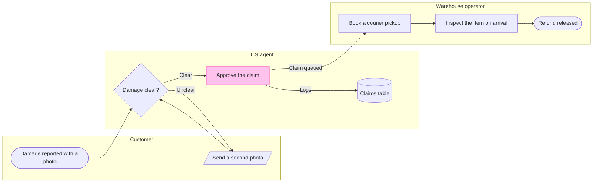

The check passed and the board composes, so this is the gate. The file was empty on the read, so no section there shares the title "Damaged-item refund".

**Question:** who handles a damaged-item refund, and where does the approved claim pass from CS to the warehouse?
**Outcome:** a reader can see which team owns each step and where the approved claim leaves CS for the warehouse queue.
**First glance:** Approve the claim, the handoff to the warehouse that you asked to mark.
**Second glance:** Damage reported with a photo, the light blue entry, then Damage clear?, Book a courier pickup, Inspect the item on arrival and Refund released, the goal, in path order across the lanes.
**Last glance:** Send a second photo, the loop back to the customer, then the Claims table, where every decision is logged.

**Sketch:**

The check printed `PASSED 1 diagram(s)`, read as a process with 8 nodes, 8 connectors and 0 crossing pairs. The composer printed `COMPOSED`, and the code fits one `use_figma` call.

**Eye first:** Approve the claim, which is the node the board most needs read.
**Reads second:** the main path from Damage reported with a photo to Refund released, which shows who holds the claim at each step.
**Could miss:** Send a second photo, the loop back to the customer, which would hide that an unclear photo returns the claim to the customer before any handoff.
**Remove next:** the Claims table, kept because every decision is logged there.

**Plan and file:** the existing FigJam file `<draft-file-key>`, which you say sits in the Fernhouse Product plan. I did not verify the plan, because the Figma tools report which plans your account holds and not which one owns a file.
**Writes:** one composed board section named "Damaged-item refund", with 3 lanes, 8 nodes, 8 connectors, a title, a key and a source line, at the Laptop reading distance. The page was empty, so nothing already there is touched.
**Left out:** pickup skipped under 20 euros, a proposal because the pilot is not live. No exit is stated for a denied claim, a second photo that is still unclear or a failed inspection, so none is drawn.
**Extensions:** none.
**Assumed:** the second photo returns to the same check, plus balanced detail, a mixed audience and a laptop read.
**Label wrap:** four labels may wrap with one word alone on the last line: Send a second photo, Damage clear?, Book a courier pickup and Inspect the item on arrival. Shorter wordings did not fix it without dropping the runbook's words, so I kept them. I will check the screenshot and report any that wrap.
**Calls:** one more `use_figma` and one `get_figjam` read-back. The `create_session` call and one `get_figjam` read are already spent. A Starter plan or a View or Collab seat allows six tool calls a month, and I have not checked your seat.
**Rollback:** delete the one board section the write returns, which I would do only on its own yes to a question that names it.

Write it?