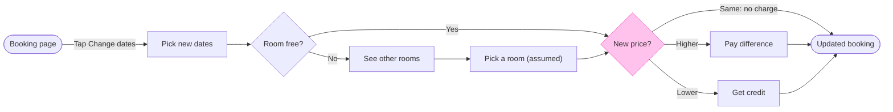

# FJ-036 turn 4 transcript

**User:** Yes, that reading is right.

**Tool call:** `Read` `{"file_path": "/private/tmp/claude-501/-Users-michelkerkmeester-MEGA-Development-AI-Systems/348b59cb-58a2-4b49-8147-c40143312bc1/scratchpad/r046run/tmp/FJ-036/devin-compare-bench/FJ-036/sk-create-figjam/references/quality-rubric.md"}`

**Tool result:** `Read`

```text
"1\t---\n2\ttitle: \"FigJam Diagram Quality Rubric\"\n3\tdescription: \"The taste gate a FigJam model passes before the write gate, translated from sk-design-diagram's success criteria: type fit, the remove test, signal, the check, the board, the design rubric that scores a composed board and the reply.\"\n4\tcontextType: implementation\n5\timportance_tier: important\n6\ttrigger_phrases:\n7\t  - \"figjam quality rubric\"\n8\t  - \"diagram taste gate\"\n9\t  - \"remove test\"\n10\t  - \"figjam review checklist\"\n11\t  - \"figjam design rubric\"\n12\tversion: 1.0.9.0\n13\t---\n14\t\n15\t# FigJam Diagram Quality Rubric\n16\t\n17\tThe script checks what a script can see. This rubric is the rest: whether the diagram should exist, whether every node earns its place and whether the reader can trust what lands on the board. Walk it after the check passes and before the write gate.\n18\t\n19\t**Loading Condition:** CONDITIONAL, on every Flow route before the write gate\n20\t**Purpose:** The judgement pass between the pre-write check and the gate\n21\t**Scope:** The model, the provenance table, the planned extensions and, after the write, the board and the reply\n22\t\n23\t---\n24\t\n25\t## 1. TYPE FIT\n26\t\n27\t- [ ] The type answers the reader's question, as `references/flow-mode.md` Section 3 maps it\n28\t- [ ] A table, a list or a paragraph would not do the same job. If it would, say so and offer that instead\n29\t- [ ] The type's reference in `references/types/` was loaded and i
```

**Tool call:** `Read` `{"file_path": "/private/tmp/claude-501/-Users-michelkerkmeester-MEGA-Development-AI-Systems/348b59cb-58a2-4b49-8147-c40143312bc1/scratchpad/r046run/tmp/FJ-036/devin-compare-bench/FJ-036/sk-create-figjam/references/style-guide.md"}`

**Tool result:** `Read`

```text
"1\t---\n2\ttitle: \"FigJam Diagram Style Guide\"\n3\tdescription: \"The colour every composed FigJam board draws by kind in the shipped design, the type scale and the 8 pixel grid, the palette pairs the check accepts with their measured contrast, and the spacing bands, translated from sk-design-diagram's style guide and derivation record.\"\n4\tcontextType: implementation\n5\timportance_tier: important\n6\ttrigger_phrases:\n7\t  - \"figjam style guide\"\n8\t  - \"figjam palette\"\n9\t  - \"figjam colour by kind\"\n10\t  - \"figjam type scale\"\n11\t  - \"palette derivation record\"\n12\t  - \"figjam contrast\"\n13\tversion: 1.0.6.0\n14\t---\n15\t\n16\t# FigJam Diagram Style Guide\n17\t\n18\tThe rules for colour, type and spacing on a FigJam board. The composer in `assets/compose-board.js` draws every board in the design `assets/figjam-design.md` holds, which ships as the tables below record, and every hex a model, a design or a note extension uses comes from the palette in Section 3. `scripts/flow_check.py` refuses any other.\n19\t\n20\t**Loading Condition:** CONDITIONAL, before the gate on every Flow route, and when a model or a note extension uses colour\n21\t**Purpose:** Names the colour each kind draws in, the type scale, the grid, the palette pairs the check accepts and the measured contrast record\n22\t**Scope:** The composed board, Mermaid `style`, `classDef` and `linkStyle` colours, sticky and pin colours for notes, and the contrast record the self-test re-measures\n
```

**Tool call:** `ToolSearch` `{"query": "select:mcp__figma-remote__create_session,mcp__figma-remote__get_figjam,mcp__figma-remote__use_figma,mcp__figma-remote__get_screenshot,mcp__figma-remote__whoami", "max_results": 5}`

**Tool result:** `ToolSearch`

```text
[{"type": "tool_reference", "tool_name": "mcp__figma-remote__create_session"}, {"type": "tool_reference", "tool_name": "mcp__figma-remote__get_figjam"}, {"type": "tool_reference", "tool_name": "mcp__figma-remote__use_figma"}, {"type": "tool_reference", "tool_name": "mcp__figma-remote__get_screenshot"}, {"type": "tool_reference", "tool_name": "mcp__figma-remote__whoami"}]
```

**Tool call:** `Bash` `{"command": "mktemp -d && python3 sk-create-figjam/scripts/flow_check.py --help 2>&1 | head -30 && python3 sk-create-figjam/scripts/compose_board.py --help 2>&1 | head -30", "description": "Make scratch folder and show check usage"}`

**Tool result:** `Bash`

```text
"/var/folders/3c/zfqcqsts0kn19cgblj82gqhm0000gn/T/tmp.8p5TwlJcj1\nmermaid_extract: --help: not a Mermaid file\nUNREADABLE --help: the extractor refused it\n\n  compose_board.py <model.md> [--diagram N] [--out path]  -> 0 the filled code is written, 1 the model fails\n                                                             the check, 2 unreadable or no such diagram\n  compose_board.py <model.md> --model                      -> print the MODEL as JSON instead of the code\n  compose_board.py --template                              -> print the compact code with its MODEL and THEME\n                                                             placeholders, the text the Project's composer\n                                                             Knowledge file carries\n  compose_board.py --design-check                          -> print the design a board is drawn in, what it\n                                                             changes, its measures and the THEME it sends: 0 the\n                                                             design reads with no warning, 1 one or more warnings\n  compose_board.py --self-test                             -> prove every shipped model composes, its counts\n                                                             match the check, the code fits one use_figma call and\n                                                             the board it draws keeps its geometry and its design"
```

**Tool call:** `Bash` `{"command": "D=/var/folders/3c/zfqcqsts0kn19cgblj82gqhm0000gn/T/tmp.8p5TwlJcj1; cat > $D/model.md <<'EOF'\n# Change booking dates\n\n```mermaid\nflowchart LR\n    %% title: Change booking dates\n    %% subtitle: How a Roamstay guest changes the dates of a booking in the app, from the booking page to the updated booking\n    %% source: Source: the product description in the request. Left out: failed payments, backing out and cancelling\n    %% goal: updatedBooking\n    bookingPage([Booking page]) -->|Tap Change dates| pickDates[Pick new dates]\n    pickDates --> roomFree{Room free?}\n    roomFr`

**Tool result:** `Bash`

```text
"  diagram 1, user flow: ok, 9 nodes and 11 connectors, widest rank 2 steps, longest path 8 steps, 1.2 connectors per step, labels average 16 characters, 0 crossing pairs\nLabel: Pick a room (assumed) leaves '(assumed)' alone on its last line, so shorten it when a shorter label keeps the source's words\nLabel: Pay the difference leaves 'difference' alone on its last line, so shorten it when a shorter label keeps the source's words\nLabel: Get the difference as credit leaves 'credit' alone on its last line, so shorten it when a shorter label keeps the source's words\nPASSED 1 diagram(s) in model.md\nexit 0"
```

**Tool call:** `Bash` `{"command": "D=/var/folders/3c/zfqcqsts0kn19cgblj82gqhm0000gn/T/tmp.8p5TwlJcj1; cd /private/tmp/claude-501/-Users-michelkerkmeester-MEGA-Development-AI-Systems/348b59cb-58a2-4b49-8147-c40143312bc1/scratchpad/r046run/tmp/FJ-036/devin-compare-bench/FJ-036\nsed -i '' -e 's/\"Pick a room (assumed)\"/\"Pick a room (assumed)\"/' $D/model.md\nfor v in \"Pay difference|Get difference as credit|Pick room (assumed)\" \"Pay balance|Get credit|Pick a room (assumed)\" \"Pay the extra|Get credit back|Pick a room (assumed)\"; do\nIFS='|' read a b c <<< \"$v\"\nsed -e \"s/Pay the difference/$a/\" -e \"s/Get t`

**Tool result:** `Bash`

```text
"== Pay difference|Get difference as credit|Pick room (assumed)\nLabel: Pick room (assumed) leaves '(assumed)' alone on its last line, so shorten it when a shorter label keeps the source's words\nLabel: Get difference as credit leaves 'credit' alone on its last line, so shorten it when a shorter label keeps the source's words\nPASSED 1 diagram(s) in try.md\n== Pay balance|Get credit|Pick a room (assumed)\nLabel: Pick a room (assumed) leaves '(assumed)' alone on its last line, so shorten it when a shorter label keeps the source's words\nPASSED 1 diagram(s) in try.md\n== Pay the extra|Get credit back|Pick a room (assumed)\nLabel: Pick a room (assumed) leaves '(assumed)' alone on its last line, so shorten it when a shorter label keeps the source's words\nPASSED 1 diagram(s) in try.md"
```

**Tool call:** `Bash` `{"command": "D=/var/folders/3c/zfqcqsts0kn19cgblj82gqhm0000gn/T/tmp.8p5TwlJcj1; cd /private/tmp/claude-501/-Users-michelkerkmeester-MEGA-Development-AI-Systems/348b59cb-58a2-4b49-8147-c40143312bc1/scratchpad/r046run/tmp/FJ-036/devin-compare-bench/FJ-036\nsed -i '' -e 's/Pay the difference/Pay difference/' -e 's/Get the difference as credit/Get credit/' $D/model.md; rm $D/try.md\npython3 sk-create-figjam/scripts/flow_check.py $D/model.md; echo \"exit $?\"\npython3 sk-create-figjam/scripts/compose_board.py $D/model.md --diagram 1 --out $D/code.js; echo \"exit $?\"; wc -c $D/code.js", "descriptio`

**Tool result:** `Bash`

```text
"  diagram 1, user flow: ok, 9 nodes and 11 connectors, widest rank 2 steps, longest path 8 steps, 1.2 connectors per step, labels average 13 characters, 0 crossing pairs\nLabel: Pick a room (assumed) leaves '(assumed)' alone on its last line, so shorten it when a shorter label keeps the source's words\nPASSED 1 diagram(s) in model.md\nexit 0\nCOMPOSED diagram 1, 9 nodes and 11 connectors, widest rank 2 steps, longest path 8 steps, 1.2 connectors per step, labels average 13 characters, 0 crossing pairs: 9 nodes and 11 connectors to read back, 42300 characters in /var/folders/3c/zfqcqsts0kn19cgblj82gqhm0000gn/T/tmp.8p5TwlJcj1/code.js, drawn in the design FigJam default\nexit 0\n   42300 /var/folders/3c/zfqcqsts0kn19cgblj82gqhm0000gn/T/tmp.8p5TwlJcj1/code.js"
```

**Tool call:** `mcp__figma-remote__create_session` `{"fileKey": "<draft-file-key>", "description": "Read the existing FigJam file, then (after the user's yes) add a user flow board \"Change booking dates\" as a new section beside existing content"}`

**Tool result:** `mcp__figma-remote__create_session`

```text
"{\"sessionId\":\"cc52ad50-939f-4fae-9a73-d8c264af9910\"}"
```

**Assistant:**

The model passes the check and the board code is composed. Next I'm reading the target file once, so I can see what it holds and whether a section already shares the title.

**Tool call:** `mcp__figma-remote__get_figjam` `{"fileKey": "<draft-file-key>", "nodeId": "0:1", "includeImagesOfNodes": false, "sessionId": "cc52ad50-939f-4fae-9a73-d8c264af9910"}`

**Tool result:** `mcp__figma-remote__get_figjam`

```text
[{"type": "text", "text": "<canvas id=\"0:1\" name=\"Page 1\" x=\"0\" y=\"0\" width=\"0\" height=\"0\" />"}]
```

**Tool call:** `Bash` `{"command": "D=/var/folders/3c/zfqcqsts0kn19cgblj82gqhm0000gn/T/tmp.8p5TwlJcj1; cd /private/tmp/claude-501/-Users-michelkerkmeester-MEGA-Development-AI-Systems/348b59cb-58a2-4b49-8147-c40143312bc1/scratchpad/r046run/tmp/FJ-036/devin-compare-bench/FJ-036\npython3 sk-create-figjam/scripts/compose_board.py $D/model.md --diagram 1 --model | python3 -c \"\nimport json,sys\nm=json.load(sys.stdin)\nprint(list(m.keys()))\nfor k in ('spine','main','rows','ranks','goal'):\n    if k in m: print(k, m[k])\nfor n in m.get('nodes',[]): print(n)\n\"", "description": "Inspect the composed model for the main ro`

**Tool result:** `Bash`

```text
"COMPOSED diagram 1, 9 nodes and 11 connectors, widest rank 2 steps, longest path 8 steps, 1.2 connectors per step, labels average 13 characters, 0 crossing pairs: 9 nodes and 11 connectors to read back, 2263 characters, drawn in the design FigJam default\n['type', 'profile', 'direction', 'zoneMode', 'zones', 'nodes', 'edges', 'edgeStyles', 'expect', 'title', 'subtitle', 'source']\n{'id': 'bookingPage', 'label': 'Booking page', 'kind': 'start', 'zone': None}\n{'id': 'pickDates', 'label': 'Pick new dates', 'kind': 'screen', 'zone': None}\n{'id': 'roomFree', 'label': 'Room free?', 'kind': 'decision', 'zone': None}\n{'id': 'priceCheck', 'label': 'New price?', 'kind': 'decision', 'zone': None, 'accent': True}\n{'id': 'otherRooms', 'label': 'See other rooms', 'kind': 'screen', 'zone': None}\n{'id': 'pickRoom', 'label': 'Pick a room (assumed)', 'kind': 'screen', 'zone': None}\n{'id': 'payDifference', 'label': 'Pay difference', 'kind': 'screen', 'zone': None}\n{'id': 'creditDifference', 'label': 'Get credit', 'kind': 'screen', 'zone': None}\n{'id': 'updatedBooking', 'label': 'Updated booking', 'kind': 'success', 'zone': None}"
```

**Assistant:**

The model passes the check and the board code is composed. The file you named holds no content, so the board will be its only section, with no same-titled section to collide with and nothing to compare against after the write. Nothing has been written yet.

Sketch, checked: `PASSED`, user flow, 9 nodes and 11 connectors, 0 crossing pairs, composed with 9 nodes and 11 connectors to read back.



Three label changes from the reading:
- "Pay the difference" is now "Pay difference", and "Get the difference as credit" is now "Get credit". The longer labels would wrap with one word alone on the last line
- "Pick a room (assumed)" will wrap with "(assumed)" on its own line. I kept it because an assumed step carries its status in the label
- I re-read your description for the two connectors around Pick a room. It states neither, so both stay marked by that label

Glance lines
- First glance: New price?
- Second glance: the main row in path order, from Booking page through Pick new dates, Room free?, See other rooms and Pick a room (assumed) to one of the two paid outcomes and Updated booking. The composer picks which of the two equal-length outcomes sits on the row, and the read-back will say which
- Last glance: the other paid outcome, which sits beside the main row

The four critique questions
- Where the eye goes first: the New price? diamond, light yellow under the heavy pink outline. It is the node the board most needs read, because the three price outcomes are the logic you listed
- What it reads second: the main row through the other-rooms detour. That advances the first glance by showing how a guest reaches the price check
- What a reader could miss: the "Same: no charge" label on the connector straight to Updated booking, since that outcome has no node of its own. Missing it costs the reader the no-charge case
- What the remove test would cut next: merging See other rooms with Pick a room. It stays because the pick is the assumed step and should show as its own node

The write
- File: <draft-file-key>, which you said is in Roamstay Product. I take the plan from you, since the tools do not report which plan owns a file
- What lands: one new board section titled "Change booking dates", with the subtitle, the flow, the key and the source line you approved in the reading. No extensions
- Calls: the session and the file read are done. The write is one `use_figma` call, then one `get_figjam` read-back, plus a `get_screenshot` only if a node needs its own view. Figma limits a Starter plan and a View or Collab seat to six tool calls a month, and read calls count. If you are on either, this board could use most of it
- Rollback: delete the one board section the write returns, through `use_figma`, on your separate yes. The file was empty, so that returns it to empty

Left out: failed payments, backing out and cancelling, by your scope answer. What the guest sees when no other room is free, because your description does not say.

Should I write this board into <draft-file-key> now?
