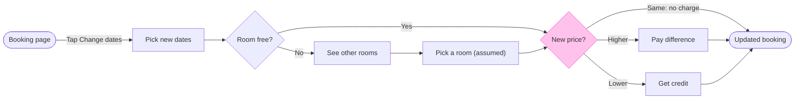

The model passes the check and the board code is composed. The file you named holds no content, so the board will be its only section, with no same-titled section to collide with and nothing to compare against after the write. Nothing has been written yet.

Sketch, checked: `PASSED`, user flow, 9 nodes and 11 connectors, 0 crossing pairs, composed with 9 nodes and 11 connectors to read back.

Three label changes from the reading:
- "Pay the difference" is now "Pay difference", and "Get the difference as credit" is now "Get credit". The longer labels would wrap with one word alone on the last line
- "Pick a room (assumed)" will wrap with "(assumed)" on its own line. I kept it because an assumed step carries its status in the label
- I re-read your description for the two connectors around Pick a room. It states neither, so both stay marked by that label

Glance lines
- First glance: New price?
- Second glance: the main row in path order, from Booking page through Pick new dates, Room free?, See other rooms and Pick a room (assumed) to one of the two paid outcomes and Updated booking. The composer picks which of the two equal-length outcomes sits on the row, and the read-back will say which
- Last glance: the other paid outcome, which sits beside the main row

The four critique questions
- Where the eye goes first: the New price? diamond, light yellow under the heavy pink outline. It is the node the board most needs read, because the three price outcomes are the logic you listed
- What it reads second: the main row through the other-rooms detour. That advances the first glance by showing how a guest reaches the price check
- What a reader could miss: the "Same: no charge" label on the connector straight to Updated booking, since that outcome has no node of its own. Missing it costs the reader the no-charge case
- What the remove test would cut next: merging See other rooms with Pick a room. It stays because the pick is the assumed step and should show as its own node

The write
- File: <draft-file-key>, which you said is in Roamstay Product. I take the plan from you, since the tools do not report which plan owns a file
- What lands: one new board section titled "Change booking dates", with the subtitle, the flow, the key and the source line you approved in the reading. No extensions
- Calls: the session and the file read are done. The write is one `use_figma` call, then one `get_figjam` read-back, plus a `get_screenshot` only if a node needs its own view. Figma limits a Starter plan and a View or Collab seat to six tool calls a month, and read calls count. If you are on either, this board could use most of it
- Rollback: delete the one board section the write returns, through `use_figma`, on your separate yes. The file was empty, so that returns it to empty

Left out: failed payments, backing out and cancelling, by your scope answer. What the guest sees when no other room is free, because your description does not say.

Should I write this board into <draft-file-key> now?