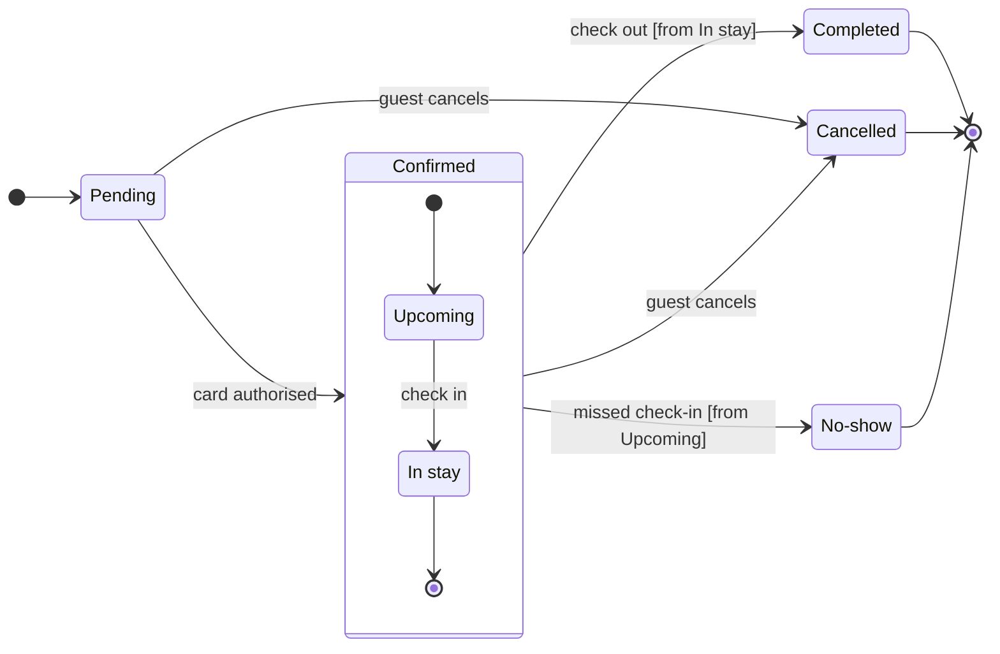

# FJ-017 turn 3 transcript

**User:** Yes, that reading is right.

**Tool call:** `Bash` `{"command": "mktemp -d /tmp/figjam-roamstay.XXXXXX", "description": "Create scratch folder for the model"}`

**Tool result:** `Bash`

```text
"/tmp/figjam-roamstay.QRxq4U"
```

**Tool call:** `Read` `{"file_path": "/private/tmp/claude-501/-Users-michelkerkmeester-MEGA-Development-AI-Systems/348b59cb-58a2-4b49-8147-c40143312bc1/scratchpad/r047run/tmp/FJ-017/devin-compare-bench/FJ-017/sk-create-figjam/references/quality-rubric.md"}`

**Tool result:** `Read`

```text
"1\t---\n2\ttitle: \"FigJam Diagram Quality Rubric\"\n3\tdescription: \"The taste gate a FigJam model passes before the write gate, translated from sk-design-diagram's success criteria: type fit, the remove test, signal, the check, the board, the design rubric that scores a composed board and the reply.\"\n4\tcontextType: implementation\n5\timportance_tier: important\n6\ttrigger_phrases:\n7\t  - \"figjam quality rubric\"\n8\t  - \"diagram taste gate\"\n9\t  - \"remove test\"\n10\t  - \"figjam review checklist\"\n11\t  - \"figjam design rubric\"\n12\tversion: 1.0.10.0\n13\t---\n14\t\n15\t# FigJam Diagram Quality Rubric\n16\t\n17\tThe script checks what a script can see. This rubric is the rest: whether the diagram should exist, whether every node earns its place and whether the reader can trust what lands on the board. Walk it after the check passes and before the write gate.\n18\t\n19\t**Loading Condition:** CONDITIONAL, on every Flow route before the write gate\n20\t**Purpose:** The judgement pass between the pre-write check and the gate\n21\t**Scope:** The model, the provenance table, the planned extensions and, after the write, the board and the reply\n22\t\n23\t---\n24\t\n25\t## 1. TYPE FIT\n26\t\n27\t- [ ] The type answers the reader's question, as `references/flow-mode.md` Section 3 maps it\n28\t- [ ] A table, a list or a paragraph would not do the same job. If it would, say so and offer that instead\n29\t- [ ] The type's reference in `references/types/` was loaded and 
```

**Tool call:** `ToolSearch` `{"query": "select:mcp__figma-remote__whoami,mcp__figma-remote__create_new_file,mcp__figma-remote__create_session,mcp__figma-remote__use_figma,mcp__figma-remote__get_figjam", "max_results": 5}`

**Tool result:** `ToolSearch`

```text
[{"type": "tool_reference", "tool_name": "mcp__figma-remote__whoami"}, {"type": "tool_reference", "tool_name": "mcp__figma-remote__create_new_file"}, {"type": "tool_reference", "tool_name": "mcp__figma-remote__create_session"}, {"type": "tool_reference", "tool_name": "mcp__figma-remote__use_figma"}, {"type": "tool_reference", "tool_name": "mcp__figma-remote__get_figjam"}]
```

**Tool call:** `mcp__figma-remote__whoami` `{}`

**Tool result:** `mcp__figma-remote__whoami`

```text
"{\"whoami\":{\"user_id\":\"<redacted>\",\"handle\":\"<redacted>\",\"email\":\"<email>\",\"code_layers_enabled\":true,\"plans\":[{\"name\":\"<figma-plan-3>\",\"seat\":\"View\",\"tier\":\"starter\",\"key\":\"team::<plan-id>\",\"role\":\"admin\",\"specs_enabled\":true,\"code_layers_enabled\":true},{\"name\":\"<figma-plan-1>\",\"seat\":\"Full\",\"tier\":\"pro\",\"key\":\"team::<plan-id>\",\"role\":\"admin\",\"specs_enabled\":false,\"code_layers_enabled\":true},{\"name\":\"<figma-plan-2>\",\"seat\":\"Full\",\"tier\":\"pro\",\"key\":\"team::<plan-id>\",\"role\":\"member\",\"specs_enabled\":false,\"code_layers_enabled\":true}]},\"instructions\":\"For more details on rate limits and access, refer to https://developers.figma.com/docs/figma-mcp-server/rate-limits-access/\"}"
```

**Tool call:** `Write` `{"file_path": "/tmp/figjam-roamstay.QRxq4U/model.md", "content": "```mermaid\nstateDiagram-v2\n    %% title: Roamstay booking status\n    %% subtitle: Every status a booking passes through, and who sets Cancelled and No-show\n    %% source: Source: the booking status description in the request. Left out: a failed card authorisation, a Pending booking that expires, a hotel or system cancellation and a refund.\n    %% focus: Cancelled\n    %% notes: Cancelled, NoShow\n    direction LR\n    state \"In stay\" as InStay\n    state \"No-show\" as NoShow\n    [*] --> Pending\n    Pending --> Confirme`

**Tool result:** `Write`

```text
"File created successfully at: /tmp/figjam-roamstay.QRxq4U/model.md (file state is current in your context \u2014 no need to Read it back)"
```

**Tool call:** `Read` `{"file_path": "/private/tmp/claude-501/-Users-michelkerkmeester-MEGA-Development-AI-Systems/348b59cb-58a2-4b49-8147-c40143312bc1/scratchpad/r047run/tmp/FJ-017/devin-compare-bench/FJ-017/sk-create-figjam/references/style-guide.md", "limit": 200}`

**Tool result:** `Read`

```text
"1\t---\n2\ttitle: \"FigJam Diagram Style Guide\"\n3\tdescription: \"The colour every composed FigJam board draws by kind in the shipped design, the type scale and the 8 pixel grid, the palette pairs the check accepts with their measured contrast, and the spacing bands, translated from sk-design-diagram's style guide and derivation record.\"\n4\tcontextType: implementation\n5\timportance_tier: important\n6\ttrigger_phrases:\n7\t  - \"figjam style guide\"\n8\t  - \"figjam palette\"\n9\t  - \"figjam colour by kind\"\n10\t  - \"figjam type scale\"\n11\t  - \"palette derivation record\"\n12\t  - \"figjam contrast\"\n13\tversion: 1.0.6.0\n14\t---\n15\t\n16\t# FigJam Diagram Style Guide\n17\t\n18\tThe rules for colour, type and spacing on a FigJam board. The composer in `assets/compose-board.js` draws every board in the design `assets/figjam-design.md` holds, which ships as the tables below record, and every hex a model, a design or a note extension uses comes from the palette in Section 3. `scripts/flow_check.py` refuses any other.\n19\t\n20\t**Loading Condition:** CONDITIONAL, before the gate on every Flow route, and when a model or a note extension uses colour\n21\t**Purpose:** Names the colour each kind draws in, the type scale, the grid, the palette pairs the check accepts and the measured contrast record\n22\t**Scope:** The composed board, Mermaid `style`, `classDef` and `linkStyle` colours, sticky and pin colours for notes, and the contrast record the self-test re-measures\n
```

**Tool call:** `Bash` `{"command": "python3 sk-create-figjam/scripts/flow_check.py /tmp/figjam-roamstay.QRxq4U/model.md --notes Cancelled,NoShow", "description": "Run the pre-write check on the state model"}`

**Tool result:** `Bash`

```text
"  diagram 1, state: ok, 7 states and 12 transitions\nSides: Cancelled takes its sticky below, left aligned\nSides: No-show takes its sticky left, centred\nPASSED 1 diagram(s) in model.md"
```

**Tool call:** `Bash` `{"command": "python3 sk-create-figjam/scripts/compose_board.py /tmp/figjam-roamstay.QRxq4U/model.md --diagram 1 --out /tmp/figjam-roamstay.QRxq4U/board1.js; echo \"exit $?\"; wc -c /tmp/figjam-roamstay.QRxq4U/board1.js", "description": "Compose the board code from the checked model"}`

**Tool result:** `Bash`

```text
"COMPOSED diagram 1, 7 states and 12 transitions: 12 nodes and 12 connectors to read back, 42555 characters in /tmp/figjam-roamstay.QRxq4U/board1.js, drawn in the design FigJam default\nexit 0\n   42555 /tmp/figjam-roamstay.QRxq4U/board1.js"
```

**Assistant:**

The model passes the check and composes into one `use_figma` call of 42,555 characters, under the 50,000 limit. The sketch is below.

**Question:** which statuses does a Roamstay booking pass through, and who sets Cancelled and No-show?
**Outcome:** support can name who to ask for a Cancelled or a No-show booking.

**First glance:** Pending, the light blue first state where every booking starts.
**Second glance:** Upcoming and In stay, the states inside Confirmed, read with the section that frames them.
**Last glance:** Cancelled, marked with the pink outline where it is drawn, then Completed and No-show, the other final states in light gray. The two stickies sit beside Cancelled and No-show.

**Sketch**

```text
  diagram 1, state: ok, 7 states and 12 transitions
Sides: Cancelled takes its sticky below, left aligned
Sides: No-show takes its sticky left, centred
PASSED 1 diagram(s) in model.md
```

**Provenance.** The states, card authorised, guest cancels and the Completed move quote your message. I re-read these four rows against it, and each is inferred:

| Item | Reason |
|---|---|
| Upcoming to In stay: check in | Your message names only "a missed check-in", so the check-in move is inferred |
| Check out [from In stay] | You said check-out ends it, not from which inner state |
| Missed check-in [from Upcoming] | A missed check-in can only happen before check-in |
| Guest cancels from Confirmed as a whole | You said Confirmed, which includes In stay |

**Eye first:** Pending, because the layout always shows the first state first. The pink outline on Cancelled is the heaviest line on the board but sits at the far end.
**Reads second:** Upcoming and In stay inside Confirmed, which carry the booking from authorisation to check-out.
**Could miss:** the "from Upcoming" guard on No-show. Without it a reader could think the hotel can mark a guest No-show during the stay.
**Remove next:** In stay, which stays because check-out leaves from it and the cancel move reaches it.

**Plan:** <figma-plan-1>, the <figma-plan-5> team plan on this account (Full seat, Pro tier). It is the only plan with that name, and Roamstay Product is not a plan on the account.
**File:** a new FigJam file named "Roamstay booking status", created in that plan's drafts with no project.
**Writes:** one composed board of 7 states and 12 transitions with a title, a key and a source line, at the Laptop reading distance.
**Extensions:** two single stickies, "Set by the guest, while the booking is Pending or Confirmed" below Cancelled and "Set by the hotel, after a missed check-in" left of No-show.
**Left out:** a failed card authorisation, a Pending booking that expires, a hotel or system cancellation and a refund, because your description does not cover them.
**Calls:** `create_new_file`, `create_session`, one `use_figma` for the board, one `use_figma` for the stickies and `get_figjam` reads of the result.
**Rollback:** delete the new file. For the stickies alone, delete the ids the notes call returns.

Write it?
