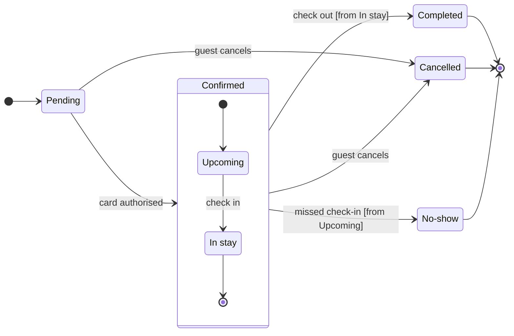

The model passes the check and composes into one `use_figma` call of 42,555 characters, under the 50,000 limit. The sketch is below.

**Question:** which statuses does a Roamstay booking pass through, and who sets Cancelled and No-show?
**Outcome:** support can name who to ask for a Cancelled or a No-show booking.

**First glance:** Pending, the light blue first state where every booking starts.
**Second glance:** Upcoming and In stay, the states inside Confirmed, read with the section that frames them.
**Last glance:** Cancelled, marked with the pink outline where it is drawn, then Completed and No-show, the other final states in light gray. The two stickies sit beside Cancelled and No-show.

**Sketch**

```text
  diagram 1, state: ok, 7 states and 12 transitions
Sides: Cancelled takes its sticky below, left aligned
Sides: No-show takes its sticky left, centred
PASSED 1 diagram(s) in model.md
```

**Provenance.** The states, card authorised, guest cancels and the Completed move quote your message. I re-read these four rows against it, and each is inferred:

| Item | Reason |
|---|---|
| Upcoming to In stay: check in | Your message names only "a missed check-in", so the check-in move is inferred |
| Check out [from In stay] | You said check-out ends it, not from which inner state |
| Missed check-in [from Upcoming] | A missed check-in can only happen before check-in |
| Guest cancels from Confirmed as a whole | You said Confirmed, which includes In stay |

**Eye first:** Pending, because the layout always shows the first state first. The pink outline on Cancelled is the heaviest line on the board but sits at the far end.
**Reads second:** Upcoming and In stay inside Confirmed, which carry the booking from authorisation to check-out.
**Could miss:** the "from Upcoming" guard on No-show. Without it a reader could think the hotel can mark a guest No-show during the stay.
**Remove next:** In stay, which stays because check-out leaves from it and the cancel move reaches it.

**Plan:** <figma-plan-1>, the <figma-plan-5> team plan on this account (Full seat, Pro tier). It is the only plan with that name, and Roamstay Product is not a plan on the account.
**File:** a new FigJam file named "Roamstay booking status", created in that plan's drafts with no project.
**Writes:** one composed board of 7 states and 12 transitions with a title, a key and a source line, at the Laptop reading distance.
**Extensions:** two single stickies, "Set by the guest, while the booking is Pending or Confirmed" below Cancelled and "Set by the hotel, after a missed check-in" left of No-show.
**Left out:** a failed card authorisation, a Pending booking that expires, a hotel or system cancellation and a refund, because your description does not cover them.
**Calls:** `create_new_file`, `create_session`, one `use_figma` for the board, one `use_figma` for the stickies and `get_figjam` reads of the result.
**Rollback:** delete the new file. For the stickies alone, delete the ids the notes call returns.

Write it?