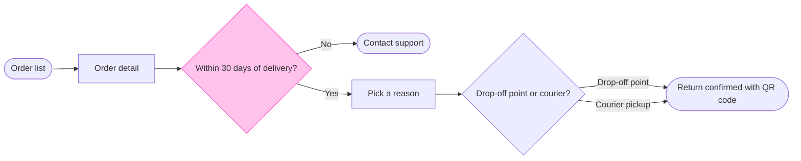

# FJ-022 turn 2 transcript

**User:** Yes, that reading is right.

**Tool call:** `Read` `{"file_path": "/private/tmp/claude-501/-Users-michelkerkmeester-MEGA-Development-AI-Systems/348b59cb-58a2-4b49-8147-c40143312bc1/scratchpad/r047run/tmp/FJ-022/devin-compare-bench/FJ-022/sk-create-figjam/references/quality-rubric.md"}`

**Tool result:** `Read`

```text
"1\t---\n2\ttitle: \"FigJam Diagram Quality Rubric\"\n3\tdescription: \"The taste gate a FigJam model passes before the write gate, translated from sk-design-diagram's success criteria: type fit, the remove test, signal, the check, the board, the design rubric that scores a composed board and the reply.\"\n4\tcontextType: implementation\n5\timportance_tier: important\n6\ttrigger_phrases:\n7\t  - \"figjam quality rubric\"\n8\t  - \"diagram taste gate\"\n9\t  - \"remove test\"\n10\t  - \"figjam review checklist\"\n11\t  - \"figjam design rubric\"\n12\tversion: 1.0.10.0\n13\t---\n14\t\n15\t# FigJam Diagram Quality Rubric\n16\t\n17\tThe script checks what a script can see. This rubric is the rest: whether the diagram should exist, whether every node earns its place and whether the reader can trust what lands on the board. Walk it after the check passes and before the write gate.\n18\t\n19\t**Loading Condition:** CONDITIONAL, on every Flow route before the write gate\n20\t**Purpose:** The judgement pass between the pre-write check and the gate\n21\t**Scope:** The model, the provenance table, the planned extensions and, after the write, the board and the reply\n22\t\n23\t---\n24\t\n25\t## 1. TYPE FIT\n26\t\n27\t- [ ] The type answers the reader's question, as `references/flow-mode.md` Section 3 maps it\n28\t- [ ] A table, a list or a paragraph would not do the same job. If it would, say so and offer that instead\n29\t- [ ] The type's reference in `references/types/` was loaded and 
```

**Tool call:** `ToolSearch` `{"query": "select:mcp__figma-remote__create_session,mcp__figma-remote__get_figjam,mcp__figma-remote__use_figma,mcp__figma-remote__get_screenshot", "max_results": 4}`

**Tool result:** `ToolSearch`

```text
[{"type": "tool_reference", "tool_name": "mcp__figma-remote__create_session"}, {"type": "tool_reference", "tool_name": "mcp__figma-remote__get_figjam"}, {"type": "tool_reference", "tool_name": "mcp__figma-remote__use_figma"}, {"type": "tool_reference", "tool_name": "mcp__figma-remote__get_screenshot"}]
```

**Tool call:** `mcp__figma-remote__create_session` `{"fileKey": "<draft-file-key>", "description": "Read the existing FigJam file once before the write gate, to plan a new Start a return user flow board section beside its content"}`

**Tool result:** `mcp__figma-remote__create_session`

```text
"{\"sessionId\":\"7b7afe5f-aa56-4c0d-b5ad-25ed6f170419\"}"
```

**Tool call:** `mcp__figma-remote__get_figjam` `{"fileKey": "<draft-file-key>", "nodeId": "0:1", "includeImagesOfNodes": false, "sessionId": "7b7afe5f-aa56-4c0d-b5ad-25ed6f170419"}`

**Tool result:** `mcp__figma-remote__get_figjam`

```text
[{"type": "text", "text": "<canvas id=\"0:1\" name=\"Page 1\" x=\"0\" y=\"0\" width=\"0\" height=\"0\" />"}]
```

**Tool call:** `Bash` `{"command": "S=$(mktemp -d); echo \"$S\"\ncat > \"$S/model.md\" <<'EOF'\n```mermaid\nflowchart LR\n    %% goal: confirmed\n    %% title: Start a return\n    %% subtitle: How a Fernhouse customer starts a return in the app, from the order list to a confirmed return\n    %% source: Sources: the app and the returns doc. Left out: free pickup over 100 euros, a proposal under review.\n    %% zone: Find the order: orders, detail\n    %% zone: Request the return: window, support, reason, method\n    %% zone: Done: confirmed\n    orders([Order list]) --> detail[Order detail]\n    detail --> window{Wit`

**Tool result:** `Bash`

```text
"/var/folders/3c/zfqcqsts0kn19cgblj82gqhm0000gn/T/tmp.IUW6K37MrF\n  diagram 1, user flow: ok, 7 nodes and 7 connectors, widest rank 2 steps, longest path 6 steps, 1.0 connectors per step, labels average 18 characters, 0 crossing pairs\nLabel: Drop-off or pickup? leaves 'pickup?' alone on its last line, so shorten it, or reword it in the source's words, when that keeps the meaning\nGlance: Within 30 days of delivery? (accent) > Order list > Order detail > Pick a reason > Contact support > Drop-off or pickup? > Return confirmed with QR code (goal)\nPASSED 1 diagram(s) in model.md\nCOMPOSED diagram 1, 7 nodes and 7 connectors, widest rank 2 steps, longest path 6 steps, 1.0 connectors per step, labels average 18 characters, 0 crossing pairs: 7 nodes and 7 connectors to read back, 42197 characters in /var/folders/3c/zfqcqsts0kn19cgblj82gqhm0000gn/T/tmp.IUW6K37MrF/code.js, drawn in the design FigJam default\n   42197 /var/folders/3c/zfqcqsts0kn19cgblj82gqhm0000gn/T/tmp.IUW6K37MrF/code.js"
```

**Tool call:** `Bash` `{"command": "S=/var/folders/3c/zfqcqsts0kn19cgblj82gqhm0000gn/T/tmp.IUW6K37MrF\ncd /private/tmp/claude-501/-Users-michelkerkmeester-MEGA-Development-AI-Systems/348b59cb-58a2-4b49-8147-c40143312bc1/scratchpad/r047run/tmp/FJ-022/devin-compare-bench/FJ-022/sk-create-figjam\nfor L in \"How do you return it?\" \"Drop-off point or courier?\" \"Where is it returned?\"; do sed \"s/Drop-off or pickup?/$L/\" \"$S/model.md\" > \"$S/try.md\"; echo \"== $L\"; python3 scripts/flow_check.py \"$S/try.md\" 2>&1 | grep -E \"Label|PASSED|FAILED\"; done; rm \"$S/try.md\"", "description": "Try alternative decision`

**Tool result:** `Bash`

```text
"== How do you return it?\nPASSED 1 diagram(s) in try.md\n== Drop-off point or courier?\nPASSED 1 diagram(s) in try.md\n== Where is it returned?\nLabel: Where is it returned? leaves 'returned?' alone on its last line, so shorten it, or reword it in the source's words, when that keeps the meaning\nPASSED 1 diagram(s) in try.md"
```

**Assistant:**

I'm settling the decision label so it wraps cleanly, then recomposing the board code. Nothing is written yet.

**Tool call:** `Bash` `{"command": "S=/var/folders/3c/zfqcqsts0kn19cgblj82gqhm0000gn/T/tmp.IUW6K37MrF\ncd /private/tmp/claude-501/-Users-michelkerkmeester-MEGA-Development-AI-Systems/348b59cb-58a2-4b49-8147-c40143312bc1/scratchpad/r047run/tmp/FJ-022/devin-compare-bench/FJ-022/sk-create-figjam\nsed -i '' 's/Drop-off or pickup?/Drop-off point or courier?/' \"$S/model.md\"\npython3 scripts/flow_check.py \"$S/model.md\" 2>&1; python3 scripts/compose_board.py \"$S/model.md\" --diagram 1 --out \"$S/code.js\" 2>&1 | tail -3; cat \"$S/model.md\"", "description": "Recheck the final model and recompose the board code"}`

**Tool result:** `Bash`

```text
"  diagram 1, user flow: ok, 7 nodes and 7 connectors, widest rank 2 steps, longest path 6 steps, 1.0 connectors per step, labels average 19 characters, 0 crossing pairs\nGlance: Within 30 days of delivery? (accent) > Order list > Order detail > Pick a reason > Contact support > Drop-off point or courier? > Return confirmed with QR code (goal)\nPASSED 1 diagram(s) in model.md\nCOMPOSED diagram 1, 7 nodes and 7 connectors, widest rank 2 steps, longest path 6 steps, 1.0 connectors per step, labels average 19 characters, 0 crossing pairs: 7 nodes and 7 connectors to read back, 42204 characters in /var/folders/3c/zfqcqsts0kn19cgblj82gqhm0000gn/T/tmp.IUW6K37MrF/code.js, drawn in the design FigJam default\n```mermaid\nflowchart LR\n    %% goal: confirmed\n    %% title: Start a return\n    %% subtitle: How a Fernhouse customer starts a return in the app, from the order list to a confirmed return\n    %% source: Sources: the app and the returns doc. Left out: free pickup over 100 euros, a proposal under review.\n    %% zone: Find the order: orders, detail\n    %% zone: Request the return: window, support, reason, method\n    %% zone: Done: confirmed\n    orders([Order list]) --> detail[Order detail]\n    detail --> window{Within 30 days of delivery?}\n    window -->|No| support([Contact support])\n    window -->|Yes| reason[Pick a reason]\n    reason --> method{Drop-off point or courier?}\n    method -->|Drop-off point| confirmed([Return confirmed with QR code])\n    method -->|Couri
```

**Assistant:**

Question: which screens does a Fernhouse customer pass through to start a return in the app, and where do they choose?
Outcome: a reader can follow a return from the order list to a confirmed return and see where the 30 day window ends it.
First glance: Within 30 days of delivery?, the accented decision where a return can end early.
Second glance: Order list, Order detail, Pick a reason, Contact support (the exit drawn below the row), Drop-off point or courier? and Return confirmed with QR code, the goal, in the order the check's Glance line prints.
Last glance: the key and the source line, since the goal comes last.

Sketch, the checked model in full:



Check: `PASSED 1 diagram(s) in model.md`, with 7 nodes, 7 connectors, 0 crossing pairs and no label warning. I reworded the method decision from "Drop-off or pickup?" because the check showed `pickup?` alone on its last line.

Eye first: Within 30 days of delivery?, the outlined decision, and it is the node the board most needs read.
Reads second: the row from Order list to Return confirmed with QR code, column by column, which carries the reader past the window to the goal.
Could miss: Contact support below the row, which would hide that a return after 30 days ends in support and not in a refusal.
Remove next: Order detail, kept because it holds the Start a return button your description names.

Plan: Fernhouse Product, as you stated. I did not verify it, because the file key alone does not show which plan owns the file.
File: the existing FigJam file `<draft-file-key>`. I read it once and it is empty, so no section shares this title and nothing already on it can change.
Writes: one composed board section named "Start a return", with 7 nodes and 7 connectors in three zones, a title, a key and a source line, at the Laptop reading distance.
Left out: free pickup over 100 euros, a proposal under review. Also any screen between the method choice and the confirmation, because nothing you gave describes one.
Extensions: none.
Calls: one `use_figma` and one `get_figjam` read-back. If the file's plan is Starter, Figma allows six tool calls a month and the read already spent one.
Rollback: delete the one board section the write returns, which I would do only after a separate yes that names it.

Write it?
