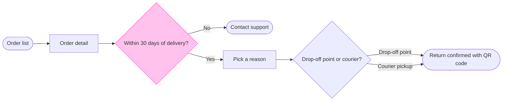

Question: which screens does a Fernhouse customer pass through to start a return in the app, and where do they choose?
Outcome: a reader can follow a return from the order list to a confirmed return and see where the 30 day window ends it.
First glance: Within 30 days of delivery?, the accented decision where a return can end early.
Second glance: Order list, Order detail, Pick a reason, Contact support (the exit drawn below the row), Drop-off point or courier? and Return confirmed with QR code, the goal, in the order the check's Glance line prints.
Last glance: the key and the source line, since the goal comes last.

Sketch, the checked model in full:

Check: `PASSED 1 diagram(s) in model.md`, with 7 nodes, 7 connectors, 0 crossing pairs and no label warning. I reworded the method decision from "Drop-off or pickup?" because the check showed `pickup?` alone on its last line.

Eye first: Within 30 days of delivery?, the outlined decision, and it is the node the board most needs read.
Reads second: the row from Order list to Return confirmed with QR code, column by column, which carries the reader past the window to the goal.
Could miss: Contact support below the row, which would hide that a return after 30 days ends in support and not in a refusal.
Remove next: Order detail, kept because it holds the Start a return button your description names.

Plan: Fernhouse Product, as you stated. I did not verify it, because the file key alone does not show which plan owns the file.
File: the existing FigJam file `<draft-file-key>`. I read it once and it is empty, so no section shares this title and nothing already on it can change.
Writes: one composed board section named "Start a return", with 7 nodes and 7 connectors in three zones, a title, a key and a source line, at the Laptop reading distance.
Left out: free pickup over 100 euros, a proposal under review. Also any screen between the method choice and the confirmation, because nothing you gave describes one.
Extensions: none.
Calls: one `use_figma` and one `get_figjam` read-back. If the file's plan is Starter, Figma allows six tool calls a month and the read already spent one.
Rollback: delete the one board section the write returns, which I would do only after a separate yes that names it.

Write it?