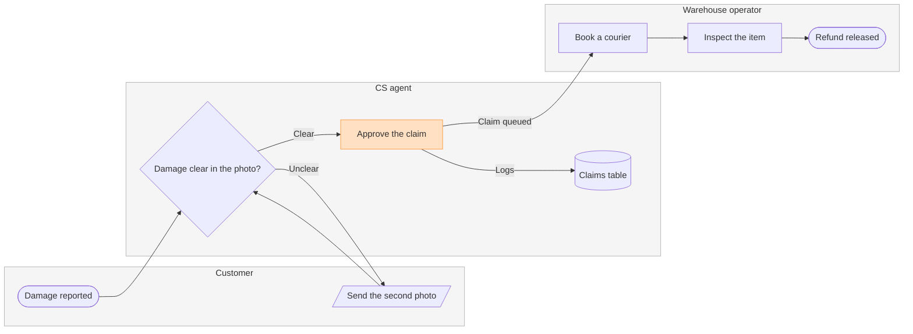

# FJ-023 turn 3 transcript

**User:** Yes, that reading is right.

**Tool call:** `Read` `{"file_path": "/private/tmp/claude-501/-Users-michelkerkmeester-MEGA-Development-AI-Systems/348b59cb-58a2-4b49-8147-c40143312bc1/scratchpad/r047run/tmp/FJ-023/devin-compare-bench/FJ-023/sk-create-figjam/references/quality-rubric.md"}`

**Tool result:** `Read`

```text
"1\t---\n2\ttitle: \"FigJam Diagram Quality Rubric\"\n3\tdescription: \"The taste gate a FigJam model passes before the write gate, translated from sk-design-diagram's success criteria: type fit, the remove test, signal, the check, the board, the design rubric that scores a composed board and the reply.\"\n4\tcontextType: implementation\n5\timportance_tier: important\n6\ttrigger_phrases:\n7\t  - \"figjam quality rubric\"\n8\t  - \"diagram taste gate\"\n9\t  - \"remove test\"\n10\t  - \"figjam review checklist\"\n11\t  - \"figjam design rubric\"\n12\tversion: 1.0.10.0\n13\t---\n14\t\n15\t# FigJam Diagram Quality Rubric\n16\t\n17\tThe script checks what a script can see. This rubric is the rest: whether the diagram should exist, whether every node earns its place and whether the reader can trust what lands on the board. Walk it after the check passes and before the write gate.\n18\t\n19\t**Loading Condition:** CONDITIONAL, on every Flow route before the write gate\n20\t**Purpose:** The judgement pass between the pre-write check and the gate\n21\t**Scope:** The model, the provenance table, the planned extensions and, after the write, the board and the reply\n22\t\n23\t---\n24\t\n25\t## 1. TYPE FIT\n26\t\n27\t- [ ] The type answers the reader's question, as `references/flow-mode.md` Section 3 maps it\n28\t- [ ] A table, a list or a paragraph would not do the same job. If it would, say so and offer that instead\n29\t- [ ] The type's reference in `references/types/` was loaded and 
```

**Tool call:** `Read` `{"file_path": "/private/tmp/claude-501/-Users-michelkerkmeester-MEGA-Development-AI-Systems/348b59cb-58a2-4b49-8147-c40143312bc1/scratchpad/r047run/tmp/FJ-023/devin-compare-bench/FJ-023/sk-create-figjam/references/style-guide.md"}`

**Tool result:** `Read`

```text
"1\t---\n2\ttitle: \"FigJam Diagram Style Guide\"\n3\tdescription: \"The colour every composed FigJam board draws by kind in the shipped design, the type scale and the 8 pixel grid, the palette pairs the check accepts with their measured contrast, and the spacing bands, translated from sk-design-diagram's style guide and derivation record.\"\n4\tcontextType: implementation\n5\timportance_tier: important\n6\ttrigger_phrases:\n7\t  - \"figjam style guide\"\n8\t  - \"figjam palette\"\n9\t  - \"figjam colour by kind\"\n10\t  - \"figjam type scale\"\n11\t  - \"palette derivation record\"\n12\t  - \"figjam contrast\"\n13\tversion: 1.0.6.0\n14\t---\n15\t\n16\t# FigJam Diagram Style Guide\n17\t\n18\tThe rules for colour, type and spacing on a FigJam board. The composer in `assets/compose-board.js` draws every board in the design `assets/figjam-design.md` holds, which ships as the tables below record, and every hex a model, a design or a note extension uses comes from the palette in Section 3. `scripts/flow_check.py` refuses any other.\n19\t\n20\t**Loading Condition:** CONDITIONAL, before the gate on every Flow route, and when a model or a note extension uses colour\n21\t**Purpose:** Names the colour each kind draws in, the type scale, the grid, the palette pairs the check accepts and the measured contrast record\n22\t**Scope:** The composed board, Mermaid `style`, `classDef` and `linkStyle` colours, sticky and pin colours for notes, and the contrast record the self-test re-measures\n
```

**Tool call:** `ToolSearch` `{"query": "select:mcp__figma-remote__create_session,mcp__figma-remote__get_figjam,mcp__figma-remote__use_figma,mcp__figma-remote__whoami", "max_results": 4}`

**Tool result:** `ToolSearch`

```text
[{"type": "tool_reference", "tool_name": "mcp__figma-remote__create_session"}, {"type": "tool_reference", "tool_name": "mcp__figma-remote__get_figjam"}, {"type": "tool_reference", "tool_name": "mcp__figma-remote__use_figma"}, {"type": "tool_reference", "tool_name": "mcp__figma-remote__whoami"}]
```

**Tool call:** `Bash` `{"command": "mktemp -d", "description": "Create scratch folder for the model"}`

**Tool result:** `Bash`

```text
"/var/folders/3c/zfqcqsts0kn19cgblj82gqhm0000gn/T/tmp.75sNjSmgrV"
```

**Tool call:** `Bash` `{"command": "S=/var/folders/3c/zfqcqsts0kn19cgblj82gqhm0000gn/T/tmp.75sNjSmgrV && cat > $S/model.md <<'EOF'\n```mermaid\n%% type: process\nflowchart LR\n    %% title: Damaged-item refund\n    %% subtitle: Who handles a damaged-item claim, from the customer's report to the released refund\n    %% source: Source: the support runbook. Every decision is logged in the claims table, so the unclear-photo decision writes it too. Left out: pickup skipped under 20 euros, a pilot that is not live. No rejection, failed inspection or end for a claim still unclear after the second photo, because the runbook`

**Tool result:** `Bash`

```text
"  diagram 1, process: ok, 8 nodes and 8 connectors, widest rank 2 steps, longest path 6 steps, 1.0 connectors per step, labels average 17 characters, 0 crossing pairs\nGlance: Approve the claim (accent) > Damage reported > Damage clear in the photo? > Send the second photo > Claims table > Book a courier > Inspect the item > Refund released (goal)\nPASSED 1 diagram(s) in model.md"
```

**Tool call:** `Bash` `{"command": "S=/var/folders/3c/zfqcqsts0kn19cgblj82gqhm0000gn/T/tmp.75sNjSmgrV && python3 -I sk-create-figjam/scripts/compose_board.py $S/model.md --diagram 1 --out $S/board1.js; echo exit=$?; wc -c $S/board1.js", "description": "Compose the board code in the scratch folder"}`

**Tool result:** `Bash`

```text
"COMPOSED diagram 1, 8 nodes and 8 connectors, widest rank 2 steps, longest path 6 steps, 1.0 connectors per step, labels average 17 characters, 0 crossing pairs: 8 nodes and 8 connectors to read back, 42389 characters in /var/folders/3c/zfqcqsts0kn19cgblj82gqhm0000gn/T/tmp.75sNjSmgrV/board1.js, drawn in the design FigJam default\nexit=0\n   42389 /var/folders/3c/zfqcqsts0kn19cgblj82gqhm0000gn/T/tmp.75sNjSmgrV/board1.js"
```

**Tool call:** `mcp__figma-remote__create_session` `{"fileKey": "<draft-file-key>", "description": "Read the existing FigJam file, then add a Damaged-item refund process board as a new section beside its current content"}`

**Tool result:** `mcp__figma-remote__create_session`

```text
"{\"sessionId\":\"d10b3b1d-eb67-47b4-9ebc-8388fe0f2135\"}"
```

**Assistant:**

Now the one pre-gate read of the named file.

**Tool call:** `mcp__figma-remote__get_figjam` `{"fileKey": "<draft-file-key>", "nodeId": "0:1", "includeImagesOfNodes": false, "sessionId": "d10b3b1d-eb67-47b4-9ebc-8388fe0f2135"}`

**Tool result:** `mcp__figma-remote__get_figjam`

```text
[{"type": "text", "text": "<canvas id=\"0:1\" name=\"Page 1\" x=\"0\" y=\"0\" width=\"0\" height=\"0\" />"}]
```

**Assistant:**

Question: who does what in a damaged-item refund, and where does the claim change hands?

Outcome: CS and warehouse leads can see which team owns each step and where a claim moves from CS to the warehouse.

First glance: Approve the claim, the handoff from CS to the warehouse that you asked to highlight.

Second glance: Damage reported, the light blue entry, then Damage clear in the photo?, Send the second photo, Claims table, Book a courier, Inspect the item and Refund released, the goal, in the order the check's Glance line prints.

Last glance: the key and the source line, since the goal comes last.

Sketch, the checked model in full:



```text
  diagram 1, process: ok, 8 nodes and 8 connectors, widest rank 2 steps, longest path 6 steps, 1.0 connectors per step, labels average 17 characters, 0 crossing pairs
Glance: Approve the claim (accent) > Damage reported > Damage clear in the photo? > Send the second photo > Claims table > Book a courier > Inspect the item > Refund released (goal)
PASSED 1 diagram(s) in model.md
```

The composer also ran on this model and printed COMPOSED with 8 nodes and 8 connectors to read back. The code is 42,389 characters, under the 50,000 one call takes.

Eye first: Approve the claim, which is the handoff you asked to highlight, and it is the node the board most needs read.

Reads second: the claim from Damage reported to Refund released, column by column across the three lanes, which shows who holds the claim at each step.

Could miss: Send the second photo and its loop back to the check. Missing it hides why a claim can sit with the customer.

Remove next: the Claims table, kept because the runbook says every decision is logged there.

Plan: Fernhouse Product, as you stated. I did not check which plan owns the file.

File: <draft-file-key>, an existing FigJam file. My read of it returned an empty page, so no section shares the title and nothing on it changes.

Writes: one composed board added as a new section, 3 lanes, 8 nodes and 8 connectors, with a title, a key and a source line, at the Laptop reading distance.

Left out:
* Pickup skipped under 20 euros, a pilot that is not live
* A rejection path, because the runbook states none
* A failed inspection path, because the runbook states none
* An end for a claim still unclear after the second photo, because the runbook states none

Extensions: none.

Calls: the session and the file read are already spent. The write adds one use_figma and one get_figjam read-back. If the plan is a Starter plan, Figma allows six tool calls a month and reads count, so this board would use most of it.

Rollback: delete the one board section the write returns. That happens only on your yes to a question that names it.

Write it?
