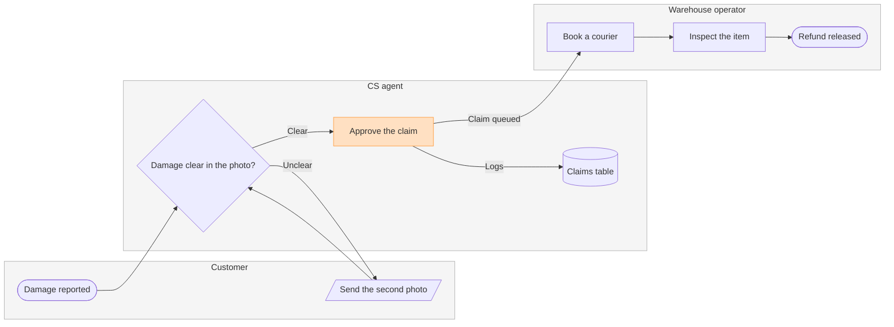

Question: who does what in a damaged-item refund, and where does the claim change hands?

Outcome: CS and warehouse leads can see which team owns each step and where a claim moves from CS to the warehouse.

First glance: Approve the claim, the handoff from CS to the warehouse that you asked to highlight.

Second glance: Damage reported, the light blue entry, then Damage clear in the photo?, Send the second photo, Claims table, Book a courier, Inspect the item and Refund released, the goal, in the order the check's Glance line prints.

Last glance: the key and the source line, since the goal comes last.

Sketch, the checked model in full:



```text
  diagram 1, process: ok, 8 nodes and 8 connectors, widest rank 2 steps, longest path 6 steps, 1.0 connectors per step, labels average 17 characters, 0 crossing pairs
Glance: Approve the claim (accent) > Damage reported > Damage clear in the photo? > Send the second photo > Claims table > Book a courier > Inspect the item > Refund released (goal)
PASSED 1 diagram(s) in model.md
```

The composer also ran on this model and printed COMPOSED with 8 nodes and 8 connectors to read back. The code is 42,389 characters, under the 50,000 one call takes.

Eye first: Approve the claim, which is the handoff you asked to highlight, and it is the node the board most needs read.

Reads second: the claim from Damage reported to Refund released, column by column across the three lanes, which shows who holds the claim at each step.

Could miss: Send the second photo and its loop back to the check. Missing it hides why a claim can sit with the customer.

Remove next: the Claims table, kept because the runbook says every decision is logged there.

Plan: Fernhouse Product, as you stated. I did not check which plan owns the file.

File: <draft-file-key>, an existing FigJam file. My read of it returned an empty page, so no section shares the title and nothing on it changes.

Writes: one composed board added as a new section, 3 lanes, 8 nodes and 8 connectors, with a title, a key and a source line, at the Laptop reading distance.

Left out:
* Pickup skipped under 20 euros, a pilot that is not live
* A rejection path, because the runbook states none
* A failed inspection path, because the runbook states none
* An end for a claim still unclear after the second photo, because the runbook states none

Extensions: none.

Calls: the session and the file read are already spent. The write adds one use_figma and one get_figjam read-back. If the plan is a Starter plan, Figma allows six tool calls a month and reads count, so this board would use most of it.

Rollback: delete the one board section the write returns. That happens only on your yes to a question that names it.

Write it?