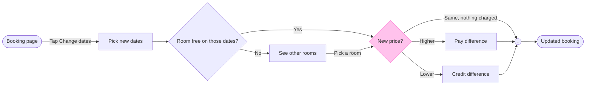

# FJ-036 turn 3 transcript

**User:** Yes, that reading is right.

**Tool call:** `Read` `{"file_path": "/private/tmp/claude-501/-Users-michelkerkmeester-MEGA-Development-AI-Systems/348b59cb-58a2-4b49-8147-c40143312bc1/scratchpad/r047run/tmp/FJ-036/devin-compare-bench/FJ-036/sk-create-figjam/references/quality-rubric.md"}`

**Tool result:** `Read`

```text
"1\t---\n2\ttitle: \"FigJam Diagram Quality Rubric\"\n3\tdescription: \"The taste gate a FigJam model passes before the write gate, translated from sk-design-diagram's success criteria: type fit, the remove test, signal, the check, the board, the design rubric that scores a composed board and the reply.\"\n4\tcontextType: implementation\n5\timportance_tier: important\n6\ttrigger_phrases:\n7\t  - \"figjam quality rubric\"\n8\t  - \"diagram taste gate\"\n9\t  - \"remove test\"\n10\t  - \"figjam review checklist\"\n11\t  - \"figjam design rubric\"\n12\tversion: 1.0.10.0\n13\t---\n14\t\n15\t# FigJam Diagram Quality Rubric\n16\t\n17\tThe script checks what a script can see. This rubric is the rest: whether the diagram should exist, whether every node earns its place and whether the reader can trust what lands on the board. Walk it after the check passes and before the write gate.\n18\t\n19\t**Loading Condition:** CONDITIONAL, on every Flow route before the write gate\n20\t**Purpose:** The judgement pass between the pre-write check and the gate\n21\t**Scope:** The model, the provenance table, the planned extensions and, after the write, the board and the reply\n22\t\n23\t---\n24\t\n25\t## 1. TYPE FIT\n26\t\n27\t- [ ] The type answers the reader's question, as `references/flow-mode.md` Section 3 maps it\n28\t- [ ] A table, a list or a paragraph would not do the same job. If it would, say so and offer that instead\n29\t- [ ] The type's reference in `references/types/` was loaded and 
```

**Tool call:** `Read` `{"file_path": "/private/tmp/claude-501/-Users-michelkerkmeester-MEGA-Development-AI-Systems/348b59cb-58a2-4b49-8147-c40143312bc1/scratchpad/r047run/tmp/FJ-036/devin-compare-bench/FJ-036/sk-create-figjam/references/style-guide.md"}`

**Tool result:** `Read`

```text
"1\t---\n2\ttitle: \"FigJam Diagram Style Guide\"\n3\tdescription: \"The colour every composed FigJam board draws by kind in the shipped design, the type scale and the 8 pixel grid, the palette pairs the check accepts with their measured contrast, and the spacing bands, translated from sk-design-diagram's style guide and derivation record.\"\n4\tcontextType: implementation\n5\timportance_tier: important\n6\ttrigger_phrases:\n7\t  - \"figjam style guide\"\n8\t  - \"figjam palette\"\n9\t  - \"figjam colour by kind\"\n10\t  - \"figjam type scale\"\n11\t  - \"palette derivation record\"\n12\t  - \"figjam contrast\"\n13\tversion: 1.0.6.0\n14\t---\n15\t\n16\t# FigJam Diagram Style Guide\n17\t\n18\tThe rules for colour, type and spacing on a FigJam board. The composer in `assets/compose-board.js` draws every board in the design `assets/figjam-design.md` holds, which ships as the tables below record, and every hex a model, a design or a note extension uses comes from the palette in Section 3. `scripts/flow_check.py` refuses any other.\n19\t\n20\t**Loading Condition:** CONDITIONAL, before the gate on every Flow route, and when a model or a note extension uses colour\n21\t**Purpose:** Names the colour each kind draws in, the type scale, the grid, the palette pairs the check accepts and the measured contrast record\n22\t**Scope:** The composed board, Mermaid `style`, `classDef` and `linkStyle` colours, sticky and pin colours for notes, and the contrast record the self-test re-measures\n
```

**Tool call:** `ToolSearch` `{"query": "select:mcp__figma-remote__get_figjam,mcp__figma-remote__create_session,mcp__figma-remote__use_figma,mcp__figma-remote__whoami", "max_results": 4}`

**Tool result:** `ToolSearch`

```text
[{"type": "tool_reference", "tool_name": "mcp__figma-remote__get_figjam"}, {"type": "tool_reference", "tool_name": "mcp__figma-remote__create_session"}, {"type": "tool_reference", "tool_name": "mcp__figma-remote__use_figma"}, {"type": "tool_reference", "tool_name": "mcp__figma-remote__whoami"}]
```

**Tool call:** `Bash` `{"command": "mktemp -d /tmp/flowwork.XXXXXX && cd \"/private/tmp/claude-501/-Users-michelkerkmeester-MEGA-Development-AI-Systems/348b59cb-58a2-4b49-8147-c40143312bc1/scratchpad/r047run/tmp/FJ-036/devin-compare-bench/FJ-036\" && python3 sk-create-figjam/scripts/flow_check.py --help 2>&1 | head -30", "description": "Create scratch folder and show check usage"}`

**Tool result:** `Bash`

```text
"/tmp/flowwork.4kUhMK\nmermaid_extract: --help: not a Mermaid file\nUNREADABLE --help: the extractor refused it"
```

**Tool call:** `mcp__figma-remote__create_session` `{"fileKey": "<draft-file-key>", "description": "Read the existing FigJam file before drawing a Change booking dates user flow board as a new section"}`

**Tool result:** `mcp__figma-remote__create_session`

```text
"{\"sessionId\":\"f1ae30e1-369b-4e47-b5eb-6f586befd02a\"}"
```

**Tool call:** `Write` `{"file_path": "/tmp/flowwork.4kUhMK/model.md", "content": "```mermaid\nflowchart LR\n    %% title: Change booking dates\n    %% subtitle: How a Roamstay guest changes the dates on a booking, and what the new price does to them\n    %% source: Sources: a written description of the app flow. Left out: cancellation, payment failure, host-side screens, change-window and fee rules.\n    %% goal: updated\n    bookingPage([Booking page]) -->|Tap Change dates| pickDates[Pick new dates]\n    pickDates --> roomFree{Room free on those dates?}\n    roomFree -->|Yes| priceCheck{New price vs current?}\n    `

**Tool result:** `Write`

```text
"File created successfully at: /tmp/flowwork.4kUhMK/model.md (file state is current in your context \u2014 no need to Read it back)"
```

**Tool call:** `Bash` `{"command": "cd \"/private/tmp/claude-501/-Users-michelkerkmeester-MEGA-Development-AI-Systems/348b59cb-58a2-4b49-8147-c40143312bc1/scratchpad/r047run/tmp/FJ-036/devin-compare-bench/FJ-036\" && python3 sk-create-figjam/scripts/flow_check.py /tmp/flowwork.4kUhMK/model.md 2>&1", "description": "Run the pre-write check on the model"}`

**Tool call:** `mcp__figma-remote__get_figjam` `{"fileKey": "<draft-file-key>", "nodeId": "0:1", "sessionId": "f1ae30e1-369b-4e47-b5eb-6f586befd02a", "includeImagesOfNodes": false}`

**Tool result:** `Bash`

```text
"  diagram 1, user flow: ok, 9 nodes and 11 connectors, widest rank 2 steps, longest path 8 steps, 1.2 connectors per step, labels average 17 characters, 0 crossing pairs\nLabel: New price vs current? leaves 'current?' alone on its last line, so shorten it, or reword it in the source's words, when that keeps the meaning\nLabel: Pay the difference may leave 'difference' alone on its last line, so shorten it, or reword it in the source's words, when that keeps the meaning\nLabel: Get the difference as credit may leave 'credit' alone on its last line, so shorten it, or reword it in the source's words, when that keeps the meaning\nGlance: New price vs current? (accent) > Booking page > Pick new dates > Room free on those dates? > See other rooms > Get the difference as credit > Pay the difference > Updated booking (goal)\nRow: the line from See other rooms to New price vs current? bends off its row, so name the break at the gate and offer a model that keeps the row straight\nPASSED 1 diagram(s) in model.md"
```

**Tool result:** `mcp__figma-remote__get_figjam`

```text
[{"type": "text", "text": "<canvas id=\"0:1\" name=\"Page 1\" x=\"0\" y=\"0\" width=\"0\" height=\"0\" />"}]
```

**Tool call:** `Bash` `{"command": "cd \"/private/tmp/claude-501/-Users-michelkerkmeester-MEGA-Development-AI-Systems/348b59cb-58a2-4b49-8147-c40143312bc1/scratchpad/r047run/tmp/FJ-036/devin-compare-bench/FJ-036\" && W=/tmp/flowwork.4kUhMK\nmk() { # name priceLabel payLabel creditLabel\ncat > $W/$1.md <<EOF\n\\`\\`\\`mermaid\nflowchart LR\n    %% title: Change booking dates\n    %% subtitle: How a Roamstay guest changes the dates on a booking, and what the new price does to them\n    %% source: Sources: a written description of the app flow. Left out: cancellation, payment failure, host-side screens, change-window a`

**Tool result:** `Bash`

```text
"== a: Price change? / Pay the difference / Get credit back\nLabel: Pay the difference may leave 'difference' alone on its last line, so shorten it, or reword it in the source's words, when that keeps the meaning\nRow: the line from See other rooms to Price change? bends off its row, so name the break at the gate and offer a model that keeps the row straight\nPASSED 1 diagram(s) in a.md\n== b: New price? / Pay difference / Credit the difference\nLabel: Credit the difference leaves 'difference' alone on its last line, so shorten it, or reword it in the source's words, when that keeps the meaning\nRow: the line from See other rooms to New price? bends off its row, so name the break at the gate and offer a model that keeps the row straight\nPASSED 1 diagram(s) in b.md\n== c: Price change? / Pay the extra / Receive credit\nRow: the line from See other rooms to Price change? bends off its row, so name the break at the gate and offer a model that keeps the row straight\nPASSED 1 diagram(s) in c.md\n== d: New price? / Pay what is owed / Get the credit\nRow: the line from See other rooms to New price? bends off its row, so name the break at the gate and offer a model that keeps the row straight\nPASSED 1 diagram(s) in d.md"
```

**Tool call:** `Bash` `{"command": "cd \"/private/tmp/claude-501/-Users-michelkerkmeester-MEGA-Development-AI-Systems/348b59cb-58a2-4b49-8147-c40143312bc1/scratchpad/r047run/tmp/FJ-036/devin-compare-bench/FJ-036\" && W=/tmp/flowwork.4kUhMK\nmk2() { # name pay credit  edgeblock\ncat > $W/$1.md <<EOF\n\\`\\`\\`mermaid\nflowchart LR\n    %% title: Change booking dates\n    %% subtitle: How a Roamstay guest changes the dates on a booking, and what the new price does to them\n    %% source: Sources: a written description of the app flow. Left out: cancellation, payment failure, host-side screens, change-window and fee ru`

**Tool result:** `Bash`

```text
"== e: Pay difference / Difference as credit\n  diagram 1, user flow: ok, 9 nodes and 11 connectors, widest rank 2 steps, longest path 8 steps, 1.2 connectors per step, labels average 14 characters, 0 crossing pairs\nLabel: Difference as credit leaves 'credit' alone on its last line, so shorten it, or reword it in the source's words, when that keeps the meaning\nGlance: New price? (accent) > Booking page > Pick new dates > Room free on those dates? > See other rooms > Difference as credit > Pay difference > Updated booking (goal)\nRow: the line from See other rooms to New price? bends off its row, so name the break at the gate and offer a model that keeps the row straight\nPASSED 1 diagram(s) in e.md\n== f: Pay difference / Credit difference\n  diagram 1, user flow: ok, 9 nodes and 11 connectors, widest rank 2 steps, longest path 8 steps, 1.2 connectors per step, labels average 14 characters, 0 crossing pairs\nGlance: New price? (accent) > Booking page > Pick new dates > Room free on those dates? > See other rooms > Credit difference > Pay difference > Updated booking (goal)\nRow: the line from See other rooms to New price? bends off its row, so name the break at the gate and offer a model that keeps the row straight\nPASSED 1 diagram(s) in f.md\n== g: Pay the difference / Credit\n  diagram 1, user flow: ok, 9 nodes and 11 connectors, widest rank 2 steps, longest path 8 steps, 1.2 connectors per step, labels average 13 characters, 0 crossing pairs\nLabel: Pay the difference m
```

**Tool call:** `Bash` `{"command": "cd \"/private/tmp/claude-501/-Users-michelkerkmeester-MEGA-Development-AI-Systems/348b59cb-58a2-4b49-8147-c40143312bc1/scratchpad/r047run/tmp/FJ-036/devin-compare-bench/FJ-036\" && W=/tmp/flowwork.4kUhMK && cp $W/f.md $W/model.md && python3 sk-create-figjam/scripts/compose_board.py $W/model.md --diagram 1 --out $W/board1.js 2>&1; wc -c $W/board1.js; cat $W/model.md", "description": "Compose the checked model into board code"}`

**Tool result:** `Bash`

```text
"COMPOSED diagram 1, 9 nodes and 11 connectors, widest rank 2 steps, longest path 8 steps, 1.2 connectors per step, labels average 14 characters, 0 crossing pairs: 9 nodes and 11 connectors to read back, 42255 characters in /tmp/flowwork.4kUhMK/board1.js, drawn in the design FigJam default\n   42255 /tmp/flowwork.4kUhMK/board1.js\n```mermaid\nflowchart LR\n    %% title: Change booking dates\n    %% subtitle: How a Roamstay guest changes the dates on a booking, and what the new price does to them\n    %% source: Sources: a written description of the app flow. Left out: cancellation, payment failure, host-side screens, change-window and fee rules.\n    %% goal: updated\n    bookingPage([Booking page]) -->|Tap Change dates| pickDates[Pick new dates]\n    pickDates --> roomFree{Room free on those dates?}\n    roomFree -->|Yes| priceCheck{New price?}\n    roomFree -->|No| otherRooms[See other rooms]\n    otherRooms -->|Pick a room| priceCheck\n    priceCheck -->|Higher| payDiff[Pay difference]\n    priceCheck -->|Lower| credit[Credit difference]\n    priceCheck -->|Same, nothing charged| merge((.))\n    payDiff --> merge\n    credit --> merge\n    merge --> updated([Updated booking])\n    style priceCheck fill:#FFC2EC,stroke:#F849C1\n```"
```

**Tool call:** `Bash` `{"command": "cd \"/private/tmp/claude-501/-Users-michelkerkmeester-MEGA-Development-AI-Systems/348b59cb-58a2-4b49-8147-c40143312bc1/scratchpad/r047run/tmp/FJ-036/devin-compare-bench/FJ-036\" && python3 sk-create-figjam/scripts/flow_check.py /tmp/flowwork.4kUhMK/model.md 2>&1", "description": "Rerun the check on the final model"}`

**Tool result:** `Bash`

```text
"  diagram 1, user flow: ok, 9 nodes and 11 connectors, widest rank 2 steps, longest path 8 steps, 1.2 connectors per step, labels average 14 characters, 0 crossing pairs\nGlance: New price? (accent) > Booking page > Pick new dates > Room free on those dates? > See other rooms > Credit difference > Pay difference > Updated booking (goal)\nRow: the line from See other rooms to New price? bends off its row, so name the break at the gate and offer a model that keeps the row straight\nPASSED 1 diagram(s) in model.md"
```

**Assistant:**

The check passed and the target file is empty. Here is the gate for the write.

**What changed since the outline:** the check flagged three labels where FigJam would strand one word on a last line. I reworded them in your words, and the meaning is the same:
- "New price vs current?" is now "New price?"
- "Pay the difference" is now "Pay difference"
- "Get the difference as credit" is now "Credit difference"

**Question and outcome**
- **Question:** what does a guest go through to change booking dates, and what does the new price do to them?
- **Outcome:** the team can see every path to the updated booking and agree what happens in each price case

**The three glances**
- **First:** the New price? decision, marked with the pink outline
- **Second:** the main row in reading order: Booking page, Pick new dates, Room free on those dates?, See other rooms, Credit difference, Pay difference, then Updated booking (goal)
- **Last:** the merge dot, the key and the source line

**Four critique questions**
- **Where the eye goes first:** the pink-outlined New price? diamond, and that is the node the board most needs read, because all three price results hang from it
- **What it reads second:** the main row left to right, which ends in the two charged outcomes and the updated booking, so it shows what each price case leads to
- **What a reader could miss:** "Same, nothing charged" is an edge label and not a node, so a reader skimming nodes sees two price outcomes and not three. The cost is a missed no-charge case. I kept it as a label because a third node would take the board past 9
- **What the remove test would cut next:** Pick new dates, since the tap and the date pick read as one step. It stays because the room check needs dates chosen first and your request names the pick as its own step

**The sketch, exactly as the check read it**



`PASSED 1 diagram(s) in model.md`

**One bend to name:** the line from See other rooms to New price? bends off the main row. The main row runs through the detour because that is the longest path, so the free-room exit sits beside it. A straight row would need the detour to rejoin somewhere else, such as back at Pick new dates, which changes what your request says. I kept the bend.

**Left out**
- Cancellation, payment failure, host-side screens, and change-window and fee rules, because you excluded them
- What the guest does if no other room suits, because the request ends at "they see other rooms". The board draws "Pick a room" as the next step

**The write**
- **Target:** the existing file <draft-file-key>, with the board added as a new section named Change booking dates. I read the file: its one page is empty, so no section shares that title and nothing on it changes. A named file needs no plan. I haven't confirmed that the file sits in Roamstay Product, and `whoami` can't show which plan owns a file
- **Written:** one section with the title, the subtitle, 9 nodes, 11 connectors, the key and the source line. There are no extensions
- **Calls the write spends:** one `use_figma` call to compose the board and one `get_figjam` call to read it back. The session and the file read already spent two. A Starter plan or a View or Collab seat is limited to six tool calls a month, with reads counted. If your seat is one of those, you may not have enough left for any retry
- **Rollback:** delete the one section the write returns, through `use_figma`, and only on your yes to a question that names it

Do you want me to write the Change booking dates board into <draft-file-key> as described?
