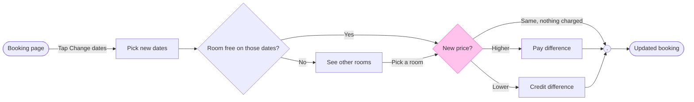

The check passed and the target file is empty. Here is the gate for the write.

**What changed since the outline:** the check flagged three labels where FigJam would strand one word on a last line. I reworded them in your words, and the meaning is the same:
- "New price vs current?" is now "New price?"
- "Pay the difference" is now "Pay difference"
- "Get the difference as credit" is now "Credit difference"

**Question and outcome**
- **Question:** what does a guest go through to change booking dates, and what does the new price do to them?
- **Outcome:** the team can see every path to the updated booking and agree what happens in each price case

**The three glances**
- **First:** the New price? decision, marked with the pink outline
- **Second:** the main row in reading order: Booking page, Pick new dates, Room free on those dates?, See other rooms, Credit difference, Pay difference, then Updated booking (goal)
- **Last:** the merge dot, the key and the source line

**Four critique questions**
- **Where the eye goes first:** the pink-outlined New price? diamond, and that is the node the board most needs read, because all three price results hang from it
- **What it reads second:** the main row left to right, which ends in the two charged outcomes and the updated booking, so it shows what each price case leads to
- **What a reader could miss:** "Same, nothing charged" is an edge label and not a node, so a reader skimming nodes sees two price outcomes and not three. The cost is a missed no-charge case. I kept it as a label because a third node would take the board past 9
- **What the remove test would cut next:** Pick new dates, since the tap and the date pick read as one step. It stays because the room check needs dates chosen first and your request names the pick as its own step

**The sketch, exactly as the check read it**

`PASSED 1 diagram(s) in model.md`

**One bend to name:** the line from See other rooms to New price? bends off the main row. The main row runs through the detour because that is the longest path, so the free-room exit sits beside it. A straight row would need the detour to rejoin somewhere else, such as back at Pick new dates, which changes what your request says. I kept the bend.

**Left out**
- Cancellation, payment failure, host-side screens, and change-window and fee rules, because you excluded them
- What the guest does if no other room suits, because the request ends at "they see other rooms". The board draws "Pick a room" as the next step

**The write**
- **Target:** the existing file <draft-file-key>, with the board added as a new section named Change booking dates. I read the file: its one page is empty, so no section shares that title and nothing on it changes. A named file needs no plan. I haven't confirmed that the file sits in Roamstay Product, and `whoami` can't show which plan owns a file
- **Written:** one section with the title, the subtitle, 9 nodes, 11 connectors, the key and the source line. There are no extensions
- **Calls the write spends:** one `use_figma` call to compose the board and one `get_figjam` call to read it back. The session and the file read already spent two. A Starter plan or a View or Collab seat is limited to six tool calls a month, with reads counted. If your seat is one of those, you may not have enough left for any retry
- **Rollback:** delete the one section the write returns, through `use_figma`, and only on your yes to a question that names it

Do you want me to write the Change booking dates board into <draft-file-key> as described?