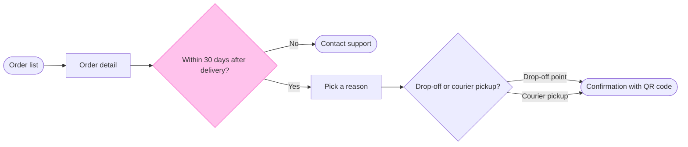

# FJ-022 turn 3 transcript

**User:** Yes, that reading is right.

**Tool call:** `Bash` `{"command": "mktemp -d /tmp/fjflow.XXXXXX", "description": "Create scratch folder outside the repo"}`

**Tool result:** `Bash`

```text
"/tmp/fjflow.N09ghu"
```

**Tool call:** `Read` `{"file_path": "/private/tmp/claude-501/-Users-michelkerkmeester-MEGA-Development-AI-Systems/348b59cb-58a2-4b49-8147-c40143312bc1/scratchpad/r048run/tmp/FJ-022/devin-compare-bench/FJ-022/sk-create-figjam/references/quality-rubric.md"}`

**Tool result:** `Read`

```text
"1\t---\n2\ttitle: \"FigJam Diagram Quality Rubric\"\n3\tdescription: \"The taste gate a FigJam model passes before the write gate, translated from sk-design-diagram's success criteria: type fit, the remove test, signal, the check, the board, the design rubric that scores a composed board and the reply.\"\n4\tcontextType: implementation\n5\timportance_tier: important\n6\ttrigger_phrases:\n7\t  - \"figjam quality rubric\"\n8\t  - \"diagram taste gate\"\n9\t  - \"remove test\"\n10\t  - \"figjam review checklist\"\n11\t  - \"figjam design rubric\"\n12\tversion: 1.0.11.0\n13\t---\n14\t\n15\t# FigJam Diagram Quality Rubric\n16\t\n17\tThe script checks what a script can see. This rubric is the rest: whether the diagram should exist, whether every node earns its place and whether the reader can trust what lands on the board. Walk it after the check passes and before the write gate.\n18\t\n19\t**Loading Condition:** CONDITIONAL, on every Flow route before the write gate\n20\t**Purpose:** The judgement pass between the pre-write check and the gate\n21\t**Scope:** The model, the provenance table, the planned extensions and, after the write, the board and the reply\n22\t\n23\t---\n24\t\n25\t## 1. TYPE FIT\n26\t\n27\t- [ ] The type answers the reader's question, as `references/flow-mode.md` Section 3 maps it\n28\t- [ ] A table, a list or a paragraph would not do the same job. If it would, say so and offer that instead\n29\t- [ ] The type's reference in `references/types/` was loaded and 
```

**Tool call:** `Read` `{"file_path": "/private/tmp/claude-501/-Users-michelkerkmeester-MEGA-Development-AI-Systems/348b59cb-58a2-4b49-8147-c40143312bc1/scratchpad/r048run/tmp/FJ-022/devin-compare-bench/FJ-022/sk-create-figjam/references/style-guide.md"}`

**Tool result:** `Read`

```text
"1\t---\n2\ttitle: \"FigJam Diagram Style Guide\"\n3\tdescription: \"The colour every composed FigJam board draws by kind in the shipped design, the type scale and the 8 pixel grid, the palette pairs the check accepts with their measured contrast, and the spacing bands, translated from sk-design-diagram's style guide and derivation record.\"\n4\tcontextType: implementation\n5\timportance_tier: important\n6\ttrigger_phrases:\n7\t  - \"figjam style guide\"\n8\t  - \"figjam palette\"\n9\t  - \"figjam colour by kind\"\n10\t  - \"figjam type scale\"\n11\t  - \"palette derivation record\"\n12\t  - \"figjam contrast\"\n13\tversion: 1.0.6.0\n14\t---\n15\t\n16\t# FigJam Diagram Style Guide\n17\t\n18\tThe rules for colour, type and spacing on a FigJam board. The composer in `assets/compose-board.js` draws every board in the design `assets/figjam-design.md` holds, which ships as the tables below record, and every hex a model, a design or a note extension uses comes from the palette in Section 3. `scripts/flow_check.py` refuses any other.\n19\t\n20\t**Loading Condition:** CONDITIONAL, before the gate on every Flow route, and when a model or a note extension uses colour\n21\t**Purpose:** Names the colour each kind draws in, the type scale, the grid, the palette pairs the check accepts and the measured contrast record\n22\t**Scope:** The composed board, Mermaid `style`, `classDef` and `linkStyle` colours, sticky and pin colours for notes, and the contrast record the self-test re-measures\n
```

**Tool call:** `ToolSearch` `{"query": "select:mcp__figma-remote__create_session,mcp__figma-remote__get_figjam,mcp__figma-remote__use_figma,mcp__figma-remote__whoami", "max_results": 4}`

**Tool result:** `ToolSearch`

```text
[{"type": "tool_reference", "tool_name": "mcp__figma-remote__create_session"}, {"type": "tool_reference", "tool_name": "mcp__figma-remote__get_figjam"}, {"type": "tool_reference", "tool_name": "mcp__figma-remote__use_figma"}, {"type": "tool_reference", "tool_name": "mcp__figma-remote__whoami"}]
```

**Tool call:** `Bash` `{"command": "cat > /tmp/fjflow.N09ghu/model.md <<'EOF'\n```mermaid\nflowchart LR\n    %% goal: confirmed\n    %% title: Start a return\n    %% subtitle: How a Fernhouse customer starts a return in the app, from the order list to a confirmed return\n    %% source: Sources: the app screens and the returns doc, as listed in the request. Left out: free pickup over 100 euros, a proposal under review.\n    %% zone: Find the order: orders, detail\n    %% zone: Request the return: window, support, reason, method\n    %% zone: Done: confirmed\n    orders([Order list]) --> detail[Order detail]\n    deta`

**Tool result:** `Bash`

```text
"  diagram 1, user flow: ok, 7 nodes and 7 connectors, widest rank 2 steps, longest path 6 steps, 1.0 connectors per step, labels average 19 characters, 0 crossing pairs\nGlance: Within 30 days after delivery? (accent) > Order list > Order detail > Pick a reason > Contact support > Drop-off or courier pickup? > Confirmation with QR code (goal)\nPASSED 1 diagram(s) in model.md\nexit=0"
```

**Tool call:** `Bash` `{"command": "python3 -I sk-create-figjam/scripts/compose_board.py /tmp/fjflow.N09ghu/model.md --diagram 1 --out /tmp/fjflow.N09ghu/board1.js; echo \"exit=$?\"; wc -c /tmp/fjflow.N09ghu/board1.js", "description": "Compose the checked model into board code"}`

**Tool result:** `Bash`

```text
"COMPOSED diagram 1, 7 nodes and 7 connectors, widest rank 2 steps, longest path 6 steps, 1.0 connectors per step, labels average 19 characters, 0 crossing pairs: 7 nodes and 7 connectors to read back, 42240 characters in /tmp/fjflow.N09ghu/board1.js, drawn in the design FigJam default\nexit=0\n   42240 /tmp/fjflow.N09ghu/board1.js"
```

**Tool call:** `mcp__figma-remote__create_session` `{"fileKey": "<draft-file-key>", "description": "Read the FigJam file before writing a new \"Start a return\" user flow board section into it"}`

**Tool result:** `mcp__figma-remote__create_session`

```text
"{\"sessionId\":\"eab15676-fe61-4d8e-8b9e-22b2d526f05a\"}"
```

**Tool call:** `mcp__figma-remote__get_figjam` `{"fileKey": "<draft-file-key>", "nodeId": "0:1", "sessionId": "eab15676-fe61-4d8e-8b9e-22b2d526f05a", "includeImagesOfNodes": false}`

**Tool result:** `mcp__figma-remote__get_figjam`

```text
[{"type": "text", "text": "<canvas id=\"0:1\" name=\"Page 1\" x=\"0\" y=\"0\" width=\"0\" height=\"0\" />"}]
```

**Assistant:**

The check passed and the composer built the board code. I read the file once and its only page is empty. That means no section shares the title "Start a return" and nothing on the file can be disturbed. This is the sketch the board will be drawn from:



```text
  diagram 1, user flow: ok, 7 nodes and 7 connectors, widest rank 2 steps, longest path 6 steps, 1.0 connectors per step, labels average 19 characters, 0 crossing pairs
Glance: Within 30 days after delivery? (accent) > Order list > Order detail > Pick a reason > Contact support > Drop-off or courier pickup? > Confirmation with QR code (goal)
PASSED 1 diagram(s) in model.md
```

**Question:** which screens does a customer pass through to start a return, and where does the 30 day window end it?
**Outcome:** a product and support team can follow a return from the order list to the confirmation and see where the window sends a customer to Contact support.
**First glance:** Within 30 days after delivery?, the decision where a return can end early.
**Second glance:** Order list, the light blue start, then Order detail, Pick a reason, Contact support (the exit, drawn below the row), Drop-off or courier pickup? and Confirmation with QR code, the goal, in the order the check prints them.
**Last glance:** the key and the source line, because the goal comes last.

**Critique questions:**
- **Eye first:** the outlined decision, and it is the node the board most needs read.
- **Reads second:** the row from Order list to the confirmation, column by column.
- **Could miss:** Contact support below the row. Missing it hides that a return can stop after 30 days.
- **Remove next:** Order detail, which stays because it holds the Start a return button.

**Plan:** Fernhouse Product, as you stated. The tools can't confirm which plan owns a file, so I'm taking that from you.
**File:** the existing FigJam file `<draft-file-key>`. No new file is created.
**Writes:** one framed board section, "Start a return", with 7 nodes and 7 connectors in three zones, a key and a source line, at Laptop distance.
**Left out:** free pickup for orders over 100 euros, a proposal under review. Anything before the order list or after the confirmation. The screen for picking a drop-off point and the one for booking a courier, because no source shows them.
**Extensions:** none.
**Calls:** one `use_figma` write and one `get_figjam` read-back. Figma allows six tool calls a month on a Starter plan or a View or Collab seat, and this work has already spent the session and one read.
**Rollback:** delete the one board section the write returns, through `use_figma`. I would ask for a separate yes before doing it.

Write it?
