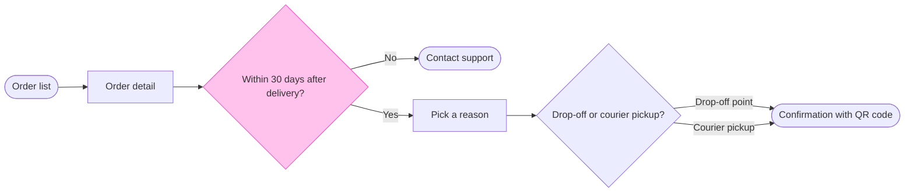

The check passed and the composer built the board code. I read the file once and its only page is empty. That means no section shares the title "Start a return" and nothing on the file can be disturbed. This is the sketch the board will be drawn from:



```text
  diagram 1, user flow: ok, 7 nodes and 7 connectors, widest rank 2 steps, longest path 6 steps, 1.0 connectors per step, labels average 19 characters, 0 crossing pairs
Glance: Within 30 days after delivery? (accent) > Order list > Order detail > Pick a reason > Contact support > Drop-off or courier pickup? > Confirmation with QR code (goal)
PASSED 1 diagram(s) in model.md
```

**Question:** which screens does a customer pass through to start a return, and where does the 30 day window end it?
**Outcome:** a product and support team can follow a return from the order list to the confirmation and see where the window sends a customer to Contact support.
**First glance:** Within 30 days after delivery?, the decision where a return can end early.
**Second glance:** Order list, the light blue start, then Order detail, Pick a reason, Contact support (the exit, drawn below the row), Drop-off or courier pickup? and Confirmation with QR code, the goal, in the order the check prints them.
**Last glance:** the key and the source line, because the goal comes last.

**Critique questions:**
- **Eye first:** the outlined decision, and it is the node the board most needs read.
- **Reads second:** the row from Order list to the confirmation, column by column.
- **Could miss:** Contact support below the row. Missing it hides that a return can stop after 30 days.
- **Remove next:** Order detail, which stays because it holds the Start a return button.

**Plan:** Fernhouse Product, as you stated. The tools can't confirm which plan owns a file, so I'm taking that from you.
**File:** the existing FigJam file `<draft-file-key>`. No new file is created.
**Writes:** one framed board section, "Start a return", with 7 nodes and 7 connectors in three zones, a key and a source line, at Laptop distance.
**Left out:** free pickup for orders over 100 euros, a proposal under review. Anything before the order list or after the confirmation. The screen for picking a drop-off point and the one for booking a courier, because no source shows them.
**Extensions:** none.
**Calls:** one `use_figma` write and one `get_figjam` read-back. Figma allows six tool calls a month on a Starter plan or a View or Collab seat, and this work has already spent the session and one read.
**Rollback:** delete the one board section the write returns, through `use_figma`. I would ask for a separate yes before doing it.

Write it?