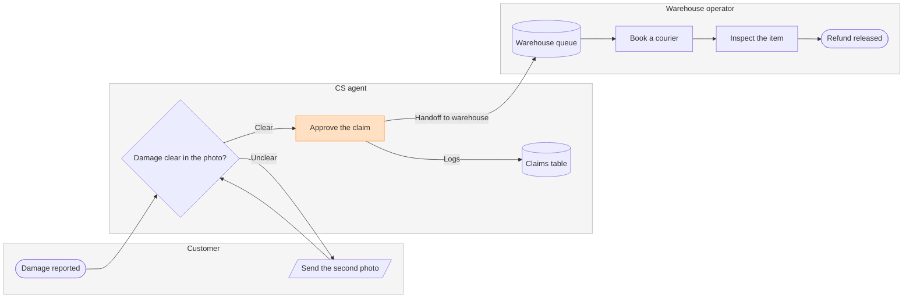

# FJ-023 turn 2 transcript

**User:** Yes, that reading is right.

**Tool call:** `Read` `{"file_path": "/private/tmp/claude-501/-Users-michelkerkmeester-MEGA-Development-AI-Systems/348b59cb-58a2-4b49-8147-c40143312bc1/scratchpad/r048run/tmp/FJ-023/devin-compare-bench/FJ-023/sk-create-figjam/references/style-guide.md"}`

**Tool result:** `Read`

```text
"1\t---\n2\ttitle: \"FigJam Diagram Style Guide\"\n3\tdescription: \"The colour every composed FigJam board draws by kind in the shipped design, the type scale and the 8 pixel grid, the palette pairs the check accepts with their measured contrast, and the spacing bands, translated from sk-design-diagram's style guide and derivation record.\"\n4\tcontextType: implementation\n5\timportance_tier: important\n6\ttrigger_phrases:\n7\t  - \"figjam style guide\"\n8\t  - \"figjam palette\"\n9\t  - \"figjam colour by kind\"\n10\t  - \"figjam type scale\"\n11\t  - \"palette derivation record\"\n12\t  - \"figjam contrast\"\n13\tversion: 1.0.6.0\n14\t---\n15\t\n16\t# FigJam Diagram Style Guide\n17\t\n18\tThe rules for colour, type and spacing on a FigJam board. The composer in `assets/compose-board.js` draws every board in the design `assets/figjam-design.md` holds, which ships as the tables below record, and every hex a model, a design or a note extension uses comes from the palette in Section 3. `scripts/flow_check.py` refuses any other.\n19\t\n20\t**Loading Condition:** CONDITIONAL, before the gate on every Flow route, and when a model or a note extension uses colour\n21\t**Purpose:** Names the colour each kind draws in, the type scale, the grid, the palette pairs the check accepts and the measured contrast record\n22\t**Scope:** The composed board, Mermaid `style`, `classDef` and `linkStyle` colours, sticky and pin colours for notes, and the contrast record the self-test re-measures\n
```

**Tool call:** `Bash` `{"command": "mktemp -d", "description": "Create scratch folder for the model"}`

**Tool result:** `Bash`

```text
"/var/folders/3c/zfqcqsts0kn19cgblj82gqhm0000gn/T/tmp.OxEhcLzOBv"
```

**Tool call:** `ToolSearch` `{"query": "select:mcp__figma-remote__get_figjam,mcp__figma-remote__create_session,mcp__figma-remote__use_figma,mcp__figma-remote__get_screenshot", "max_results": 4}`

**Tool result:** `ToolSearch`

```text
[{"type": "tool_reference", "tool_name": "mcp__figma-remote__get_figjam"}, {"type": "tool_reference", "tool_name": "mcp__figma-remote__create_session"}, {"type": "tool_reference", "tool_name": "mcp__figma-remote__use_figma"}, {"type": "tool_reference", "tool_name": "mcp__figma-remote__get_screenshot"}]
```

**Tool call:** `Write` `{"file_path": "/var/folders/3c/zfqcqsts0kn19cgblj82gqhm0000gn/T/tmp.OxEhcLzOBv/model.md", "content": "```mermaid\n%% type: process\nflowchart LR\n    %% title: Damaged-item refund\n    %% subtitle: Who handles a damaged-item claim, from the customer's report to the released refund\n    %% source: Source: the support runbook text. Left out: pickup skipped under 20 euros, a pilot that is not live. Every decision is logged in the claims table.\n    subgraph customer [\"Customer\"]\n        report([Damage reported])\n        photo[/Send the second photo/]\n    end\n    subgraph cs [\"CS agent\"]\n`

**Tool result:** `Write`

```text
"File created successfully at: /var/folders/3c/zfqcqsts0kn19cgblj82gqhm0000gn/T/tmp.OxEhcLzOBv/model.md (file state is current in your context \u2014 no need to Read it back)"
```

**Tool call:** `Bash` `{"command": "python3 sk-create-figjam/scripts/flow_check.py /var/folders/3c/zfqcqsts0kn19cgblj82gqhm0000gn/T/tmp.OxEhcLzOBv/model.md", "description": "Run the pre-write check on the model"}`

**Tool call:** `mcp__figma-remote__create_session` `{"fileKey": "<draft-file-key>", "description": "Add a Damaged-item refund process board to the existing Fernhouse Product FigJam file"}`

**Tool result:** `Bash`

```text
"  diagram 1, process: ok, 9 nodes and 9 connectors, widest rank 2 steps, longest path 7 steps, 1.0 connectors per step, labels average 17 characters, 0 crossing pairs\nGlance: Approve the claim (accent) > Damage clear in the photo? > Damage reported > Send the second photo > Claims table > Warehouse queue > Book a courier > Inspect the item > Refund released (goal)\nPASSED 1 diagram(s) in model.md"
```

**Tool result:** `mcp__figma-remote__create_session`

```text
"{\"sessionId\":\"1350efa4-5f24-49db-a7d6-fbd407ef0a85\"}"
```

**Tool call:** `mcp__figma-remote__get_figjam` `{"fileKey": "<draft-file-key>", "nodeId": "0:1", "sessionId": "1350efa4-5f24-49db-a7d6-fbd407ef0a85", "includeImagesOfNodes": false}`

**Tool result:** `mcp__figma-remote__get_figjam`

```text
[{"type": "text", "text": "<canvas id=\"0:1\" name=\"Page 1\" x=\"0\" y=\"0\" width=\"0\" height=\"0\" />"}]
```

**Tool call:** `Bash` `{"command": "python3 sk-create-figjam/scripts/compose_board.py /var/folders/3c/zfqcqsts0kn19cgblj82gqhm0000gn/T/tmp.OxEhcLzOBv/model.md --diagram 1 --out /var/folders/3c/zfqcqsts0kn19cgblj82gqhm0000gn/T/tmp.OxEhcLzOBv/board.js; echo \"exit $?\"", "description": "Compose the checked model into board code"}`

**Tool result:** `Bash`

```text
"COMPOSED diagram 1, 9 nodes and 9 connectors, widest rank 2 steps, longest path 7 steps, 1.0 connectors per step, labels average 17 characters, 0 crossing pairs: 9 nodes and 9 connectors to read back, 42346 characters in /var/folders/3c/zfqcqsts0kn19cgblj82gqhm0000gn/T/tmp.OxEhcLzOBv/board.js, drawn in the design FigJam default\nexit 0"
```

**Assistant:**

Question: who does what, and where does a damaged-item claim change hands?
Outcome: a reader can see which of the customer, CS and the warehouse owns each step of a damaged-item refund, and that the claim crosses from CS into the warehouse queue at the approval.
First glance: Approve the claim, the sending step of the handoff to the warehouse.
Second glance: Damage clear in the photo?, the decision beside it on its row, then Damage reported, the light blue entry. After that come Send the second photo, the loop back to the customer, the Claims table, the Warehouse queue, Book a courier, Inspect the item and Refund released, the goal. This is the order the check's Glance line prints.
Last glance: the key and the source line, since the goal comes last.

Sketch, the checked model in full:



```text
  diagram 1, process: ok, 9 nodes and 9 connectors, widest rank 2 steps, longest path 7 steps, 1.0 connectors per step, labels average 17 characters, 0 crossing pairs
Glance: Approve the claim (accent) > Damage clear in the photo? > Damage reported > Send the second photo > Claims table > Warehouse queue > Book a courier > Inspect the item > Refund released (goal)
PASSED 1 diagram(s) in model.md
```

The composer also printed COMPOSED for it: 9 nodes and 9 connectors to read back, 42,346 characters, which fits one `use_figma` call.

Eye first: Approve the claim, with the labelled "Handoff to warehouse" connector leaving it. That is the node and line the board most needs read.
Reads second: Damage clear in the photo? beside it, then the claim from Damage reported to Refund released, column by column across the lanes, which shows who holds the claim at each step.
Could miss: Send the second photo, the loop back to the customer, which would hide why some claims stall.
Remove next: the Claims table, kept because the runbook logs every decision there. It is drawn from the approval only, and the source line says the other decisions write to it too.

Plan: Fernhouse Product. File: <draft-file-key>, the existing file you named. I read it once and its page is empty, so no section shares this title and the title stays "Damaged-item refund".
Writes: one composed board section, 3 lanes, 9 nodes and 9 connectors, with a title, a key and a source line, at the Laptop reading distance. Nothing else on the file is touched.
Left out:
* The pickup skipped under 20 euros, a pilot that is not live and so a proposal
* An exit for damage that stays unclear after the second photo, and for an inspection that finds a problem, because the runbook text does not say what happens
Extensions: none.
Calls: one `use_figma` and one `get_figjam` read-back. Two more calls were already spent on the session and the file read. Figma limits a Starter plan and a View or Collab seat to six tool calls a month, so tell me if that applies to you. I will load Figma's `figma-use` and `figma-use-figjam` skills before the write.
Rollback: delete the one board section the write returns, which removes everything drawn inside it, and only on your yes to a question that names it.

Write it?
