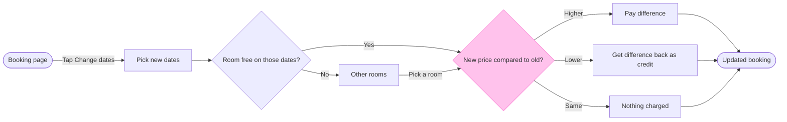

# FJ-036 turn 4 transcript

**User:** Yes, that reading is right.

**Tool call:** `Bash` `{"command": "cd /private/tmp/claude-501/-Users-michelkerkmeester-MEGA-Development-AI-Systems/348b59cb-58a2-4b49-8147-c40143312bc1/scratchpad/r048run/tmp/FJ-036/devin-compare-bench/FJ-036/sk-create-figjam && python3 scripts/flow_check.py --help 2>&1 | head -30; python3 scripts/compose_board.py --help 2>&1 | head -30; sed -n 1,200p assets/examples/user-flow-fernhouse-return.md | head -150", "description": "Read check CLI usage and the user flow example"}`

**Tool result:** `Bash`

```text
"mermaid_extract: --help: not a Mermaid file\nUNREADABLE --help: the extractor refused it\n\n  compose_board.py <model.md> [--diagram N] [--out path]  -> 0 the filled code is written, 1 the model fails\n                                                             the check, 2 unreadable or no such diagram\n  compose_board.py <model.md> --model                      -> print the MODEL as JSON instead of the code\n  compose_board.py --template                              -> print the compact code with its MODEL and THEME\n                                                             placeholders, the text the Project's composer\n                                                             Knowledge file carries\n  compose_board.py --design-check                          -> print the design a board is drawn in, what it\n                                                             changes, its measures and the THEME it sends: 0 the\n                                                             design reads with no warning, 1 one or more warnings\n  compose_board.py --self-test                             -> prove every shipped model composes, its counts\n                                                             match the check, the code fits one use_figma call and\n                                                             the board it draws keeps its geometry and its design\n---\ntitle: \"Example - User Flow - Fernhouse Return\"\ndescription: \"A worked user flow on the ficti
```

**Tool call:** `ToolSearch` `{"query": "select:mcp__figma-remote__create_session,mcp__figma-remote__get_figjam,mcp__figma-remote__use_figma", "max_results": 5}`

**Tool result:** `ToolSearch`

```text
[{"type": "tool_reference", "tool_name": "mcp__figma-remote__create_session"}, {"type": "tool_reference", "tool_name": "mcp__figma-remote__get_figjam"}, {"type": "tool_reference", "tool_name": "mcp__figma-remote__use_figma"}]
```

**Tool call:** `Bash` `{"command": "S=$(mktemp -d) && echo \"SCRATCH=$S\" && cat > \"$S/model.md\" <<'EOF'\n```mermaid\nflowchart LR\n    %% goal: updated\n    %% title: Change booking dates\n    %% subtitle: How a Roamstay guest changes the dates of a booking in the app, from the booking page to the updated booking\n    %% source: Sources: the flow as described in the request. Left out: the case where no other room is free\n    bookingPage([Booking page]) -->|Tap Change dates| pickDates[Pick new dates]\n    pickDates --> roomFree{Room free on those dates?}\n    roomFree -->|Yes| priceCompare{New price compared to o`

**Tool call:** `mcp__figma-remote__create_session` `{"fileKey": "<draft-file-key>", "description": "Read the existing FigJam file, then add a user flow board \"Change booking dates\" as a new section once approved"}`

**Tool result:** `Bash`

```text
"SCRATCH=/var/folders/3c/zfqcqsts0kn19cgblj82gqhm0000gn/T/tmp.JAVzy4AwcZ\n  diagram 1, user flow: ok, 9 nodes and 11 connectors, widest rank 3 steps, longest path 7 steps, 1.2 connectors per step, labels average 18 characters, 0 crossing pairs\nLabel: Pay the difference may leave 'difference' alone on its last line, so shorten it, or reword it in the source's words, when that keeps the meaning\nLabel: Get the difference as credit may leave 'credit' alone on its last line, so shorten it, or reword it in the source's words, when that keeps the meaning\nGlance: New price compared to old? (accent) > Booking page > Pick new dates > Room free on those dates? > Other rooms > Pay the difference > Get the difference as credit > Nothing charged > Updated booking (goal)\nRow: the line from Other rooms to New price compared to old? bends off its row, so name the break at the gate and offer a model that keeps the row straight\nPASSED 1 diagram(s) in model.md\nexit=0\nCOMPOSED diagram 1, 9 nodes and 11 connectors, widest rank 3 steps, longest path 7 steps, 1.2 connectors per step, labels average 18 characters, 0 crossing pairs: 9 nodes and 11 connectors to read back, 42332 characters in /var/folders/3c/zfqcqsts0kn19cgblj82gqhm0000gn/T/tmp.JAVzy4AwcZ/code.js, drawn in the design FigJam default\nexit=0\n   42332 /var/folders/3c/zfqcqsts0kn19cgblj82gqhm0000gn/T/tmp.JAVzy4AwcZ/code.js"
```

**Tool result:** `mcp__figma-remote__create_session`

```text
"{\"sessionId\":\"285f371b-152a-4cd0-b568-f35819d92c7f\"}"
```

**Tool call:** `Bash` `{"command": "S=/var/folders/3c/zfqcqsts0kn19cgblj82gqhm0000gn/T/tmp.JAVzy4AwcZ && for v in A B C; do\ncase $v in\nA) PAY='Pay the price difference'; CR='Credit the difference'; DIR=LR;;\nB) PAY='Pay price difference'; CR='Get credit for the difference'; DIR=LR;;\nC) PAY='Pay the difference'; CR='Get the difference as credit'; DIR=TD;;\nesac\nsed -e \"s/Pay the difference/$PAY/\" -e \"s/Get the difference as credit/$CR/\" -e \"s/flowchart LR/flowchart $DIR/\" $S/model.md > $S/v$v.md\necho \"== $v: $PAY | $CR | $DIR\"; python3 scripts/flow_check.py $S/v$v.md | grep -E \"Label|Row|PASSED|FAIL\"; `

**Tool result:** `Bash`

```text
"== A: Pay the price difference | Credit the difference | LR\nLabel: Pay the price difference leaves 'difference' alone on its last line, so shorten it, or reword it in the source's words, when that keeps the meaning\nLabel: Credit the difference leaves 'difference' alone on its last line, so shorten it, or reword it in the source's words, when that keeps the meaning\nRow: the line from Other rooms to New price compared to old? bends off its row, so name the break at the gate and offer a model that keeps the row straight\nPASSED 1 diagram(s) in vA.md\n== B: Pay price difference | Get credit for the difference | LR\nLabel: Pay price difference leaves 'difference' alone on its last line, so shorten it, or reword it in the source's words, when that keeps the meaning\nLabel: Get credit for the difference may leave 'difference' alone on its last line, so shorten it, or reword it in the source's words, when that keeps the meaning\nRow: the line from Other rooms to New price compared to old? bends off its row, so name the break at the gate and offer a model that keeps the row straight\nPASSED 1 diagram(s) in vB.md\n== C: Pay the difference | Get the difference as credit | TD\nLabel: Pay the difference may leave 'difference' alone on its last line, so shorten it, or reword it in the source's words, when that keeps the meaning\nLabel: Get the difference as credit may leave 'credit' alone on its last line, so shorten it, or reword it in the source's words, when that keeps the meaning\n
```

**Tool call:** `Bash` `{"command": "S=/var/folders/3c/zfqcqsts0kn19cgblj82gqhm0000gn/T/tmp.JAVzy4AwcZ && i=0; for pair in \"Pay difference|Get credit back\" \"Pay the difference due|Get the difference back as credit\" \"Pay the extra amount|Get the amount back as credit\" \"Pay the difference now|Receive the difference as credit\"; do i=$((i+1)); PAY=${pair%%|*}; CR=${pair##*|}; sed -e \"s/Pay the difference/$PAY/\" -e \"s/Get the difference as credit/$CR/\" $S/model.md > $S/w$i.md; echo \"== $PAY | $CR\"; python3 scripts/flow_check.py $S/w$i.md | grep -E \"Label|PASSED|FAIL\"; done", "description": "Test more label`

**Tool result:** `Bash`

```text
"== Pay difference | Get credit back\nPASSED 1 diagram(s) in w1.md\n== Pay the difference due | Get the difference back as credit\nLabel: Pay the difference due may leave 'due' alone on its last line, so shorten it, or reword it in the source's words, when that keeps the meaning\nPASSED 1 diagram(s) in w2.md\n== Pay the extra amount | Get the amount back as credit\nLabel: Pay the extra amount leaves 'amount' alone on its last line, so shorten it, or reword it in the source's words, when that keeps the meaning\nPASSED 1 diagram(s) in w3.md\n== Pay the difference now | Receive the difference as credit\nLabel: Pay the difference now may leave 'now' alone on its last line, so shorten it, or reword it in the source's words, when that keeps the meaning\nPASSED 1 diagram(s) in w4.md"
```

**Tool call:** `Bash` `{"command": "S=/var/folders/3c/zfqcqsts0kn19cgblj82gqhm0000gn/T/tmp.JAVzy4AwcZ && i=10; for pair in \"Pay difference|Get difference as credit\" \"Pay difference|Difference back as credit\" \"Pay difference|Get difference back as credit\"; do i=$((i+1)); PAY=${pair%%|*}; CR=${pair##*|}; sed -e \"s/Pay the difference/$PAY/\" -e \"s/Get the difference as credit/$CR/\" $S/model.md > $S/w$i.md; echo \"== $PAY | $CR\"; python3 scripts/flow_check.py $S/w$i.md | grep -E \"Label|PASSED|FAIL\"; done", "description": "Test further credit label wordings"}`

**Tool result:** `Bash`

```text
"== Pay difference | Get difference as credit\nLabel: Get difference as credit leaves 'credit' alone on its last line, so shorten it, or reword it in the source's words, when that keeps the meaning\nPASSED 1 diagram(s) in w11.md\n== Pay difference | Difference back as credit\nLabel: Difference back as credit may leave 'credit' alone on its last line, so shorten it, or reword it in the source's words, when that keeps the meaning\nPASSED 1 diagram(s) in w12.md\n== Pay difference | Get difference back as credit\nPASSED 1 diagram(s) in w13.md"
```

**Tool call:** `Bash` `{"command": "S=/var/folders/3c/zfqcqsts0kn19cgblj82gqhm0000gn/T/tmp.JAVzy4AwcZ && cp $S/w13.md $S/model.md && cat $S/model.md && python3 scripts/flow_check.py $S/model.md; python3 scripts/compose_board.py $S/model.md --diagram 1 --out $S/code.js; echo \"exit=$?\"", "description": "Recheck final model and recompose board code"}`

**Tool result:** `Bash`

```text
"```mermaid\nflowchart LR\n    %% goal: updated\n    %% title: Change booking dates\n    %% subtitle: How a Roamstay guest changes the dates of a booking in the app, from the booking page to the updated booking\n    %% source: Sources: the flow as described in the request. Left out: the case where no other room is free\n    bookingPage([Booking page]) -->|Tap Change dates| pickDates[Pick new dates]\n    pickDates --> roomFree{Room free on those dates?}\n    roomFree -->|Yes| priceCompare{New price compared to old?}\n    roomFree -->|No| otherRooms[Other rooms]\n    otherRooms -->|Pick a room| priceCompare\n    priceCompare -->|Higher| payDifference[Pay difference]\n    priceCompare -->|Lower| creditDifference[Get difference back as credit]\n    priceCompare -->|Same| noCharge[Nothing charged]\n    payDifference --> updated([Updated booking])\n    creditDifference --> updated\n    noCharge --> updated\n    style priceCompare fill:#FFC2EC,stroke:#F849C1\n```\n  diagram 1, user flow: ok, 9 nodes and 11 connectors, widest rank 3 steps, longest path 7 steps, 1.2 connectors per step, labels average 18 characters, 0 crossing pairs\nGlance: New price compared to old? (accent) > Booking page > Pick new dates > Room free on those dates? > Other rooms > Pay difference > Get difference back as credit > Nothing charged > Updated booking (goal)\nRow: the line from Other rooms to New price compared to old? bends off its row, so name the break at the gate and offer a model that keeps the row
```

**Tool call:** `mcp__figma-remote__get_figjam` `{"fileKey": "<draft-file-key>", "nodeId": "0:1", "sessionId": "285f371b-152a-4cd0-b568-f35819d92c7f", "includeImagesOfNodes": false}`

**Tool result:** `mcp__figma-remote__get_figjam`

```text
[{"type": "text", "text": "<canvas id=\"0:1\" name=\"Page 1\" x=\"0\" y=\"0\" width=\"0\" height=\"0\" />"}]
```

**Assistant:**

Here is the gate. The check passed after I reworded two labels.

Question the board answers: which screens does a Roamstay guest pass through to change their booking dates, and where do they choose?
Outcome: the Roamstay Product team can agree that the flow covers the room check and all three price outcomes.

Glance lines:
- First glance: "New price compared to old?", the outlined decision where the money moves
- Second glance, in the order the check prints: Booking page, Pick new dates, "Room free on those dates?", Other rooms, Pay difference, Get difference back as credit, Nothing charged and Updated booking, the goal
- Last glance: the key and the source line, since the goal comes last

Sketch, the checked model as the check read it:



```text
PASSED 1 diagram(s) in model.md
```

The four critique questions, answered:
- Where the eye goes first: "New price compared to old?". It is the node the board most needs read, because it carries the three outcomes
- What it reads second: the row from Booking page to Updated booking, which carries the reader from the start to the price outcomes and the end
- What a reader could miss: that "Pick a room" from Other rooms is my assumption from round two, and that a guest with no free room has no drawn way out. Missing either costs them a false picture of the flow. The source line names the second one
- What the remove test would cut next: Nothing charged. It stays because the three outcomes then read side by side

Two things to know about the model:
- The check flagged the line from Other rooms to the price decision as bending off the main row. A top-down version of this model passed the check with no such flag, but it stacks the board taller than wide. I recommend keeping left to right and accepting the bend
- Two outcome labels are shorter than your words ("Pay difference", "Get difference back as credit"). The fuller wordings left one word alone on a line

Target: existing file <draft-file-key>. I read it once and its page holds nothing, so no section shares the title and nothing already there is touched. You named the file, so no new file or plan lookup is needed. I took the Roamstay Product plan from your message without checking it.

What gets written: one section titled "Change booking dates" with 9 nodes, 11 connectors, the key and the source line. No extensions are planned.

Calls: one `use_figma` call to compose the board, then one `get_figjam` read-back. Figma limits a Starter plan and a View or Collab seat to six tool calls a month, and the session and the file read have already used some of that.

Left out: the case where no other room is free, because your message states none.

Rollback: delete the one section the write returns, only after your yes to a question that names it. Nothing else in the file changes.

Write this board into file <draft-file-key> as a new section called "Change booking dates"?
