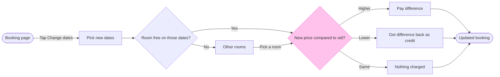

Here is the gate. The check passed after I reworded two labels.

Question the board answers: which screens does a Roamstay guest pass through to change their booking dates, and where do they choose?
Outcome: the Roamstay Product team can agree that the flow covers the room check and all three price outcomes.

Glance lines:
- First glance: "New price compared to old?", the outlined decision where the money moves
- Second glance, in the order the check prints: Booking page, Pick new dates, "Room free on those dates?", Other rooms, Pay difference, Get difference back as credit, Nothing charged and Updated booking, the goal
- Last glance: the key and the source line, since the goal comes last

Sketch, the checked model as the check read it:



```text
PASSED 1 diagram(s) in model.md
```

The four critique questions, answered:
- Where the eye goes first: "New price compared to old?". It is the node the board most needs read, because it carries the three outcomes
- What it reads second: the row from Booking page to Updated booking, which carries the reader from the start to the price outcomes and the end
- What a reader could miss: that "Pick a room" from Other rooms is my assumption from round two, and that a guest with no free room has no drawn way out. Missing either costs them a false picture of the flow. The source line names the second one
- What the remove test would cut next: Nothing charged. It stays because the three outcomes then read side by side

Two things to know about the model:
- The check flagged the line from Other rooms to the price decision as bending off the main row. A top-down version of this model passed the check with no such flag, but it stacks the board taller than wide. I recommend keeping left to right and accepting the bend
- Two outcome labels are shorter than your words ("Pay difference", "Get difference back as credit"). The fuller wordings left one word alone on a line

Target: existing file <draft-file-key>. I read it once and its page holds nothing, so no section shares the title and nothing already there is touched. You named the file, so no new file or plan lookup is needed. I took the Roamstay Product plan from your message without checking it.

What gets written: one section titled "Change booking dates" with 9 nodes, 11 connectors, the key and the source line. No extensions are planned.

Calls: one `use_figma` call to compose the board, then one `get_figjam` read-back. Figma limits a Starter plan and a View or Collab seat to six tool calls a month, and the session and the file read have already used some of that.

Left out: the case where no other room is free, because your message states none.

Rollback: delete the one section the write returns, only after your yes to a question that names it. Nothing else in the file changes.

Write this board into file <draft-file-key> as a new section called "Change booking dates"?