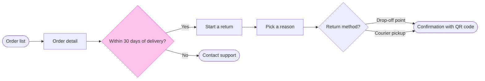

# FJ-022 turn 4 transcript

**User:** Yes, that reading is right.

**Tool call:** `Read` `{"file_path": "/private/tmp/claude-501/-Users-michelkerkmeester-MEGA-Development-AI-Systems/348b59cb-58a2-4b49-8147-c40143312bc1/scratchpad/r049run/tmp/FJ-022/devin-compare-bench/FJ-022/sk-create-figjam/references/quality-rubric.md"}`

**Tool result:** `Read`

```text
"1\t---\n2\ttitle: \"FigJam Diagram Quality Rubric\"\n3\tdescription: \"The taste gate a FigJam model passes before the write gate, translated from sk-design-diagram's success criteria: type fit, the remove test, signal, the check, the board, the design rubric that scores a composed board and the reply.\"\n4\tcontextType: implementation\n5\timportance_tier: important\n6\ttrigger_phrases:\n7\t  - \"figjam quality rubric\"\n8\t  - \"diagram taste gate\"\n9\t  - \"remove test\"\n10\t  - \"figjam review checklist\"\n11\t  - \"figjam design rubric\"\n12\tversion: 1.0.12.0\n13\t---\n14\t\n15\t# FigJam Diagram Quality Rubric\n16\t\n17\tThe script checks what a script can see. This rubric is the rest: whether the diagram should exist, whether every node earns its place and whether the reader can trust what lands on the board. Walk it after the check passes and before the write gate.\n18\t\n19\t**Loading Condition:** CONDITIONAL, on every Flow route before the write gate\n20\t**Purpose:** The judgement pass between the pre-write check and the gate\n21\t**Scope:** The model, the provenance table, the planned extensions and, after the write, the board and the reply\n22\t\n23\t---\n24\t\n25\t## 1. TYPE FIT\n26\t\n27\t- [ ] The type answers the reader's question, as `references/flow-mode.md` Section 3 maps it\n28\t- [ ] A table, a list or a paragraph would not do the same job. If it would, say so and offer that instead\n29\t- [ ] The type's reference in `references/types/` was loaded and 
```

**Tool call:** `Read` `{"file_path": "/private/tmp/claude-501/-Users-michelkerkmeester-MEGA-Development-AI-Systems/348b59cb-58a2-4b49-8147-c40143312bc1/scratchpad/r049run/tmp/FJ-022/devin-compare-bench/FJ-022/sk-create-figjam/references/style-guide.md"}`

**Tool result:** `Read`

```text
"1\t---\n2\ttitle: \"FigJam Diagram Style Guide\"\n3\tdescription: \"The colour every composed FigJam board draws by kind in the shipped design, the type scale and the 8 pixel grid, the palette pairs the check accepts with their measured contrast, and the spacing bands, translated from sk-design-diagram's style guide and derivation record.\"\n4\tcontextType: implementation\n5\timportance_tier: important\n6\ttrigger_phrases:\n7\t  - \"figjam style guide\"\n8\t  - \"figjam palette\"\n9\t  - \"figjam colour by kind\"\n10\t  - \"figjam type scale\"\n11\t  - \"palette derivation record\"\n12\t  - \"figjam contrast\"\n13\tversion: 1.0.6.0\n14\t---\n15\t\n16\t# FigJam Diagram Style Guide\n17\t\n18\tThe rules for colour, type and spacing on a FigJam board. The composer in `assets/compose-board.js` draws every board in the design `assets/figjam-design.md` holds, which ships as the tables below record, and every hex a model, a design or a note extension uses comes from the palette in Section 3. `scripts/flow_check.py` refuses any other.\n19\t\n20\t**Loading Condition:** CONDITIONAL, before the gate on every Flow route, and when a model or a note extension uses colour\n21\t**Purpose:** Names the colour each kind draws in, the type scale, the grid, the palette pairs the check accepts and the measured contrast record\n22\t**Scope:** The composed board, Mermaid `style`, `classDef` and `linkStyle` colours, sticky and pin colours for notes, and the contrast record the self-test re-measures\n
```

**Tool call:** `ToolSearch` `{"query": "select:mcp__figma-remote__create_session,mcp__figma-remote__get_figjam,mcp__figma-remote__use_figma,mcp__figma-remote__get_screenshot", "max_results": 4}`

**Tool result:** `ToolSearch`

```text
[{"type": "tool_reference", "tool_name": "mcp__figma-remote__create_session"}, {"type": "tool_reference", "tool_name": "mcp__figma-remote__get_figjam"}, {"type": "tool_reference", "tool_name": "mcp__figma-remote__use_figma"}, {"type": "tool_reference", "tool_name": "mcp__figma-remote__get_screenshot"}]
```

**Tool call:** `Bash` `{"command": "S=$(mktemp -d) && echo \"$S\" && cat > \"$S/model.md\" <<'EOF'\n```mermaid\nflowchart LR\n    %% title: Start a return\n    %% subtitle: How a customer starts a return in the app, from the order list to the QR code confirmation\n    %% source: Sources: a description of the app and the returns doc. Left out: free pickup for orders over 100 euros, a proposal under review\n    %% zone: Check the order: orderList, orderDetail, window, support\n    %% zone: Request the return: startReturn, reason, method, confirm\n    %% goal: confirm\n    orderList([Order list]) --> orderDetail[Order `

**Tool result:** `Bash`

```text
"/var/folders/3c/zfqcqsts0kn19cgblj82gqhm0000gn/T/tmp.1PZ8tsOVwm\n  diagram 1, user flow: ok, 8 nodes and 8 connectors, widest rank 2 steps, longest path 7 steps, 1.0 connectors per step, labels average 16 characters, 0 crossing pairs\nGlance: Within 30 days of delivery? (accent) > Order list > Order detail > Contact support > Start a return > Pick a reason > Return method? > Confirmation with QR code (goal)\nRow: the line from Within 30 days of delivery? to Start a return bends off its row round Contact support, so move Contact support into the zone Start a return sits in, where it shares that step's column\nPASSED 1 diagram(s) in model.md\nexit 0"
```

**Tool call:** `Bash` `{"command": "S=/var/folders/3c/zfqcqsts0kn19cgblj82gqhm0000gn/T/tmp.1PZ8tsOVwm && sed -e 's/%% zone: Check the order: orderList, orderDetail, window, support/%% zone: Check the order: orderList, orderDetail, window/' -e 's/%% zone: Request the return: startReturn, reason, method, confirm/%% zone: Request the return: startReturn, reason, method, confirm, support/' \"$S/model.md\" > \"$S/model2.md\" && python3 -I sk-create-figjam/scripts/flow_check.py \"$S/model2.md\"; echo \"exit $?\"", "description": "Check variant with Contact support in second zone"}`

**Tool result:** `Bash`

```text
"  diagram 1, user flow: ok, 8 nodes and 8 connectors, widest rank 2 steps, longest path 7 steps, 1.0 connectors per step, labels average 16 characters, 0 crossing pairs\nGlance: Within 30 days of delivery? (accent) > Order list > Order detail > Start a return > Contact support > Pick a reason > Return method? > Confirmation with QR code (goal)\nPASSED 1 diagram(s) in model2.md\nexit 0"
```

**Tool call:** `Bash` `{"command": "S=/var/folders/3c/zfqcqsts0kn19cgblj82gqhm0000gn/T/tmp.1PZ8tsOVwm && python3 -I sk-create-figjam/scripts/compose_board.py \"$S/model2.md\" --diagram 1 --out \"$S/code.js\"; echo \"exit $?\"; wc -c \"$S/code.js\"", "description": "Compose board code from checked model"}`

**Tool result:** `Bash`

```text
"COMPOSED diagram 1, 8 nodes and 8 connectors, widest rank 2 steps, longest path 7 steps, 1.0 connectors per step, labels average 16 characters, 0 crossing pairs: 8 nodes and 8 connectors to read back, 42346 characters in /var/folders/3c/zfqcqsts0kn19cgblj82gqhm0000gn/T/tmp.1PZ8tsOVwm/code.js, drawn in the design FigJam default\nexit 0\n   42346 /var/folders/3c/zfqcqsts0kn19cgblj82gqhm0000gn/T/tmp.1PZ8tsOVwm/code.js"
```

**Tool call:** `mcp__figma-remote__create_session` `{"fileKey": "<draft-file-key>", "description": "Read the FigJam file once, then add a Start a return user flow board as a new section beside existing content"}`

**Tool result:** `mcp__figma-remote__create_session`

```text
"{\"sessionId\":\"e1f3ae1c-510a-424f-860c-593bc4fba3c4\"}"
```

**Tool call:** `mcp__figma-remote__get_figjam` `{"fileKey": "<draft-file-key>", "nodeId": "0:1", "includeImagesOfNodes": false, "sessionId": "e1f3ae1c-510a-424f-860c-593bc4fba3c4"}`

**Tool result:** `mcp__figma-remote__get_figjam`

```text
[{"type": "text", "text": "<canvas id=\"0:1\" name=\"Page 1\" x=\"0\" y=\"0\" width=\"0\" height=\"0\" />"}]
```

**Assistant:**

The check passed and the file's page is empty, so the board has nothing to sit beside and no same-titled section to collide with. This is the gate, and nothing is written yet.

**Purpose**
* Question: how does a Fernhouse customer start a return in the app, from the order list to a confirmed return?
* Outcome: the reader can confirm each screen between those two points and see both ways out of the 30-day check

**The sketch, as the check read it**

`diagram 1, user flow: ok, 8 nodes and 8 connectors, widest rank 2 steps, longest path 7 steps, 1.0 connectors per step, labels average 16 characters, 0 crossing pairs`
`PASSED 1 diagram(s) in model2.md`

**One change from the playback**
Contact support now sits in the Request the return zone, not Check the order. With it in the first zone, the check reported that the Yes line to Start a return bends off the main row around it. With the move the row runs straight. If you prefer the playback's grouping, I keep it and the board carries that bend.

**Glance lines**
* First glance: the Within 30 days of delivery? decision, in the pink outline
* Second glance: Order list, Order detail, Start a return, Contact support, Pick a reason, Return method? and the green Confirmation with QR code, in the order the check printed them
* Last glance: the key and the source line, since the goal comes last

**Critique questions**
* Where the eye goes first: the pink 30-day decision, and it is the node this reader needs most, because its No exit ends the flow
* What it reads second: the row from the order list to the confirmation, which shows the screens the customer walks through to reach the QR code
* What a reader could miss: that both methods converge on one confirmation. Missing it could lead them to expect a different QR screen per method
* What the remove test would cut next: Start a return. It stays as the one exact button label you gave

**Left out**
* Free pickup for orders over 100 euros, a proposal under review
* The return reasons themselves, because the sources don't list them
* What follows the confirmation (drop-off, warehouse check, refund), because it is outside the flow you asked for

**The write**
* Target: existing FigJam file `<draft-file-key>`, in the Fernhouse Product plan as you stated it. I can't confirm the plan from the file key
* What lands: one new section titled Start a return, with its title, subtitle, two zones, 8 nodes, 8 connectors, a key and the source line. No extensions, and nothing else on the file changes
* Calls: one `use_figma` call to compose the board and one `get_figjam` read-back. No `whoami` and no `create_new_file`, since the file exists. `create_session` and one `get_figjam` read of the empty page are already spent. On a Starter plan or a View or Collab seat, which allow six tool calls a month, the whole write fits in that allowance
* Rollback: delete the one section the write returns, through `use_figma` and only after you say yes to a question that names it. Nothing else was created

Write this board into that file now?
