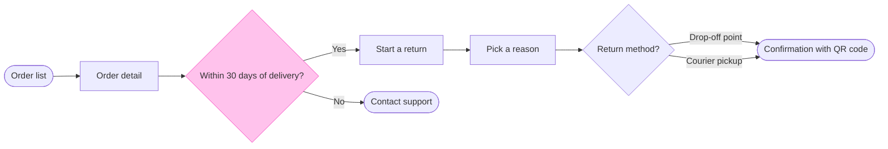

The check passed and the file's page is empty, so the board has nothing to sit beside and no same-titled section to collide with. This is the gate, and nothing is written yet.

**Purpose**
* Question: how does a Fernhouse customer start a return in the app, from the order list to a confirmed return?
* Outcome: the reader can confirm each screen between those two points and see both ways out of the 30-day check

**The sketch, as the check read it**

`diagram 1, user flow: ok, 8 nodes and 8 connectors, widest rank 2 steps, longest path 7 steps, 1.0 connectors per step, labels average 16 characters, 0 crossing pairs`
`PASSED 1 diagram(s) in model2.md`

**One change from the playback**
Contact support now sits in the Request the return zone, not Check the order. With it in the first zone, the check reported that the Yes line to Start a return bends off the main row around it. With the move the row runs straight. If you prefer the playback's grouping, I keep it and the board carries that bend.

**Glance lines**
* First glance: the Within 30 days of delivery? decision, in the pink outline
* Second glance: Order list, Order detail, Start a return, Contact support, Pick a reason, Return method? and the green Confirmation with QR code, in the order the check printed them
* Last glance: the key and the source line, since the goal comes last

**Critique questions**
* Where the eye goes first: the pink 30-day decision, and it is the node this reader needs most, because its No exit ends the flow
* What it reads second: the row from the order list to the confirmation, which shows the screens the customer walks through to reach the QR code
* What a reader could miss: that both methods converge on one confirmation. Missing it could lead them to expect a different QR screen per method
* What the remove test would cut next: Start a return. It stays as the one exact button label you gave

**Left out**
* Free pickup for orders over 100 euros, a proposal under review
* The return reasons themselves, because the sources don't list them
* What follows the confirmation (drop-off, warehouse check, refund), because it is outside the flow you asked for

**The write**
* Target: existing FigJam file `<draft-file-key>`, in the Fernhouse Product plan as you stated it. I can't confirm the plan from the file key
* What lands: one new section titled Start a return, with its title, subtitle, two zones, 8 nodes, 8 connectors, a key and the source line. No extensions, and nothing else on the file changes
* Calls: one `use_figma` call to compose the board and one `get_figjam` read-back. No `whoami` and no `create_new_file`, since the file exists. `create_session` and one `get_figjam` read of the empty page are already spent. On a Starter plan or a View or Collab seat, which allow six tool calls a month, the whole write fits in that allowance
* Rollback: delete the one section the write returns, through `use_figma` and only after you say yes to a question that names it. Nothing else was created

Write this board into that file now?