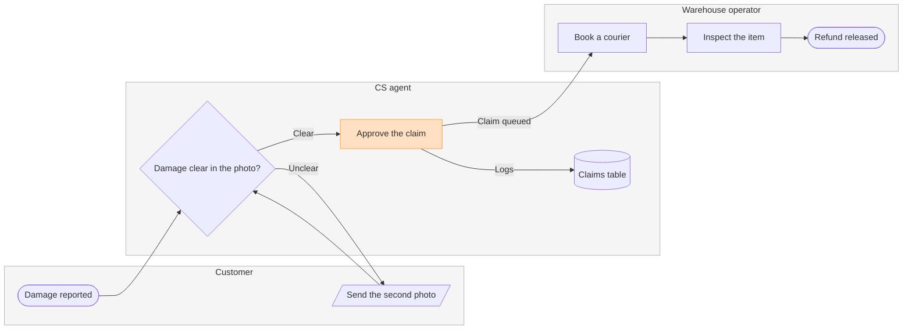

# FJ-023 turn 3 transcript

**User:** Yes, that reading is right.

**Tool call:** `Read` `{"file_path": "/private/tmp/claude-501/-Users-michelkerkmeester-MEGA-Development-AI-Systems/348b59cb-58a2-4b49-8147-c40143312bc1/scratchpad/r049run/tmp/FJ-023/devin-compare-bench/FJ-023/sk-create-figjam/references/quality-rubric.md"}`

**Tool result:** `Read`

```text
"1\t---\n2\ttitle: \"FigJam Diagram Quality Rubric\"\n3\tdescription: \"The taste gate a FigJam model passes before the write gate, translated from sk-design-diagram's success criteria: type fit, the remove test, signal, the check, the board, the design rubric that scores a composed board and the reply.\"\n4\tcontextType: implementation\n5\timportance_tier: important\n6\ttrigger_phrases:\n7\t  - \"figjam quality rubric\"\n8\t  - \"diagram taste gate\"\n9\t  - \"remove test\"\n10\t  - \"figjam review checklist\"\n11\t  - \"figjam design rubric\"\n12\tversion: 1.0.12.0\n13\t---\n14\t\n15\t# FigJam Diagram Quality Rubric\n16\t\n17\tThe script checks what a script can see. This rubric is the rest: whether the diagram should exist, whether every node earns its place and whether the reader can trust what lands on the board. Walk it after the check passes and before the write gate.\n18\t\n19\t**Loading Condition:** CONDITIONAL, on every Flow route before the write gate\n20\t**Purpose:** The judgement pass between the pre-write check and the gate\n21\t**Scope:** The model, the provenance table, the planned extensions and, after the write, the board and the reply\n22\t\n23\t---\n24\t\n25\t## 1. TYPE FIT\n26\t\n27\t- [ ] The type answers the reader's question, as `references/flow-mode.md` Section 3 maps it\n28\t- [ ] A table, a list or a paragraph would not do the same job. If it would, say so and offer that instead\n29\t- [ ] The type's reference in `references/types/` was loaded and 
```

**Tool call:** `Read` `{"file_path": "/private/tmp/claude-501/-Users-michelkerkmeester-MEGA-Development-AI-Systems/348b59cb-58a2-4b49-8147-c40143312bc1/scratchpad/r049run/tmp/FJ-023/devin-compare-bench/FJ-023/sk-create-figjam/references/style-guide.md"}`

**Tool result:** `Read`

```text
"1\t---\n2\ttitle: \"FigJam Diagram Style Guide\"\n3\tdescription: \"The colour every composed FigJam board draws by kind in the shipped design, the type scale and the 8 pixel grid, the palette pairs the check accepts with their measured contrast, and the spacing bands, translated from sk-design-diagram's style guide and derivation record.\"\n4\tcontextType: implementation\n5\timportance_tier: important\n6\ttrigger_phrases:\n7\t  - \"figjam style guide\"\n8\t  - \"figjam palette\"\n9\t  - \"figjam colour by kind\"\n10\t  - \"figjam type scale\"\n11\t  - \"palette derivation record\"\n12\t  - \"figjam contrast\"\n13\tversion: 1.0.6.0\n14\t---\n15\t\n16\t# FigJam Diagram Style Guide\n17\t\n18\tThe rules for colour, type and spacing on a FigJam board. The composer in `assets/compose-board.js` draws every board in the design `assets/figjam-design.md` holds, which ships as the tables below record, and every hex a model, a design or a note extension uses comes from the palette in Section 3. `scripts/flow_check.py` refuses any other.\n19\t\n20\t**Loading Condition:** CONDITIONAL, before the gate on every Flow route, and when a model or a note extension uses colour\n21\t**Purpose:** Names the colour each kind draws in, the type scale, the grid, the palette pairs the check accepts and the measured contrast record\n22\t**Scope:** The composed board, Mermaid `style`, `classDef` and `linkStyle` colours, sticky and pin colours for notes, and the contrast record the self-test re-measures\n
```

**Tool call:** `Bash` `{"command": "mktemp -d", "description": "Create scratch folder for the model"}`

**Tool result:** `Bash`

```text
"/var/folders/3c/zfqcqsts0kn19cgblj82gqhm0000gn/T/tmp.rk9jDVurzE"
```

**Tool call:** `mcp__figma-remote__create_session` `{"fileKey": "<draft-file-key>", "description": "Add a damaged-item refund process board as a new section in the existing FigJam file, after reading the file once"}`

**Tool result:** `mcp__figma-remote__create_session`

```text
"{\"sessionId\":\"fa541ee0-b0f6-44e0-b78f-2af4443a2c08\"}"
```

**Tool call:** `Write` `{"file_path": "/var/folders/3c/zfqcqsts0kn19cgblj82gqhm0000gn/T/tmp.rk9jDVurzE/model.md", "content": "```mermaid\n%% type: process\nflowchart LR\n    %% title: Damaged-item refund\n    %% subtitle: Who handles a damaged-item claim, from the customer's report to the released refund\n    %% source: Source: the support runbook. Left out: pickup skipped under €20, a pilot that is not yet live.\n    subgraph customer [\"Customer\"]\n        report([Damage reported])\n        photo[/Send the second photo/]\n    end\n    subgraph cs [\"CS agent\"]\n        check{Damage clear in the photo?}\n        a`

**Tool result:** `Write`

```text
"File created successfully at: /var/folders/3c/zfqcqsts0kn19cgblj82gqhm0000gn/T/tmp.rk9jDVurzE/model.md (file state is current in your context \u2014 no need to Read it back)"
```

**Tool call:** `mcp__figma-remote__get_figjam` `{"fileKey": "<draft-file-key>", "nodeId": "0:1", "sessionId": "fa541ee0-b0f6-44e0-b78f-2af4443a2c08", "includeImagesOfNodes": false}`

**Tool result:** `mcp__figma-remote__get_figjam`

```text
[{"type": "text", "text": "<canvas id=\"0:1\" name=\"Page 1\" x=\"0\" y=\"0\" width=\"0\" height=\"0\" />"}]
```

**Tool call:** `Bash` `{"command": "python3 sk-create-figjam/scripts/flow_check.py /var/folders/3c/zfqcqsts0kn19cgblj82gqhm0000gn/T/tmp.rk9jDVurzE/model.md", "description": "Run the pre-write check on the model"}`

**Tool result:** `Bash`

```text
"  diagram 1, process: ok, 8 nodes and 8 connectors, widest rank 2 steps, longest path 6 steps, 1.0 connectors per step, labels average 17 characters, 0 crossing pairs\nGlance: Approve the claim (accent) > Damage reported > Damage clear in the photo? > Send the second photo > Claims table > Book a courier > Inspect the item > Refund released (goal)\nPASSED 1 diagram(s) in model.md"
```

**Tool call:** `Bash` `{"command": "python3 sk-create-figjam/scripts/compose_board.py /var/folders/3c/zfqcqsts0kn19cgblj82gqhm0000gn/T/tmp.rk9jDVurzE/model.md --diagram 1 --out /var/folders/3c/zfqcqsts0kn19cgblj82gqhm0000gn/T/tmp.rk9jDVurzE/board1.js", "description": "Compose the board code from the checked model"}`

**Tool result:** `Bash`

```text
"COMPOSED diagram 1, 8 nodes and 8 connectors, widest rank 2 steps, longest path 6 steps, 1.0 connectors per step, labels average 17 characters, 0 crossing pairs: 8 nodes and 8 connectors to read back, 42177 characters in /var/folders/3c/zfqcqsts0kn19cgblj82gqhm0000gn/T/tmp.rk9jDVurzE/board1.js, drawn in the design FigJam default"
```

**Assistant:**

The model passed the check. Nothing is written yet.

```text
Question: who does what, and where does the claim change hands?
Outcome: CS and warehouse leads can see which team owns each step of a damaged-item refund and where the claim moves from CS to the warehouse.
First glance: Approve the claim, the CS step that hands the claim to the warehouse queue.
Second glance: Damage reported, where the claim starts, then Damage clear in the photo?, the decision the claim turns on, then Send the second photo, the loop back to the customer, then the Claims table, then Book a courier, Inspect the item and Refund released, the goal, in the order the check's Glance line prints.
Last glance: the key and the source line, since the goal comes last.
Sketch:
```



```text
Check:
  diagram 1, process: ok, 8 nodes and 8 connectors, widest rank 2 steps, longest path 6 steps, 1.0 connectors per step, labels average 17 characters, 0 crossing pairs
Glance: Approve the claim (accent) > Damage reported > Damage clear in the photo? > Send the second photo > Claims table > Book a courier > Inspect the item > Refund released (goal)
PASSED 1 diagram(s) in model.md

Eye first: Approve the claim, the handoff to the warehouse you asked to highlight, and it is the node the board most needs read.
Reads second: Damage reported, where the claim starts, then Damage clear in the photo?, then the claim on to Refund released, column by column across the three lanes, which shows who holds the claim at each step.
Could miss: Send the second photo, the loop back to the customer, which would hide why some claims stall before they reach the warehouse.
Remove next: the Claims table, kept because every decision on the claim is logged there.
Plan: Fernhouse Product. File: the existing FigJam file <draft-file-key>, with the board added as a new section. I read the file once: its page is empty, so no section shares the title "Damaged-item refund" and nothing already on it changes.
Writes: one composed board, 3 lanes, 8 nodes and 8 connectors, with a title, a key and a source line, at the Laptop reading distance.
Left out: pickup skipped under €20, a pilot that is not yet live.
Extensions: none.
Calls: one use_figma and one get_figjam read-back.
Rollback: delete the one board section the write returns, which I would do only on your separate yes to a question that names it.
Write it?
```
