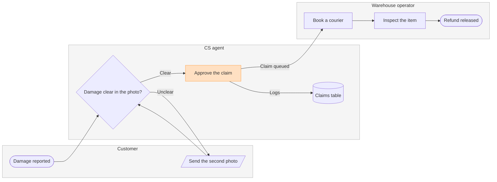

The model passed the check. Nothing is written yet.

```text
Question: who does what, and where does the claim change hands?
Outcome: CS and warehouse leads can see which team owns each step of a damaged-item refund and where the claim moves from CS to the warehouse.
First glance: Approve the claim, the CS step that hands the claim to the warehouse queue.
Second glance: Damage reported, where the claim starts, then Damage clear in the photo?, the decision the claim turns on, then Send the second photo, the loop back to the customer, then the Claims table, then Book a courier, Inspect the item and Refund released, the goal, in the order the check's Glance line prints.
Last glance: the key and the source line, since the goal comes last.
Sketch:
```



```text
Check:
  diagram 1, process: ok, 8 nodes and 8 connectors, widest rank 2 steps, longest path 6 steps, 1.0 connectors per step, labels average 17 characters, 0 crossing pairs
Glance: Approve the claim (accent) > Damage reported > Damage clear in the photo? > Send the second photo > Claims table > Book a courier > Inspect the item > Refund released (goal)
PASSED 1 diagram(s) in model.md

Eye first: Approve the claim, the handoff to the warehouse you asked to highlight, and it is the node the board most needs read.
Reads second: Damage reported, where the claim starts, then Damage clear in the photo?, then the claim on to Refund released, column by column across the three lanes, which shows who holds the claim at each step.
Could miss: Send the second photo, the loop back to the customer, which would hide why some claims stall before they reach the warehouse.
Remove next: the Claims table, kept because every decision on the claim is logged there.
Plan: Fernhouse Product. File: the existing FigJam file <draft-file-key>, with the board added as a new section. I read the file once: its page is empty, so no section shares the title "Damaged-item refund" and nothing already on it changes.
Writes: one composed board, 3 lanes, 8 nodes and 8 connectors, with a title, a key and a source line, at the Laptop reading distance.
Left out: pickup skipped under €20, a pilot that is not yet live.
Extensions: none.
Calls: one use_figma and one get_figjam read-back.
Rollback: delete the one board section the write returns, which I would do only on your separate yes to a question that names it.
Write it?
```