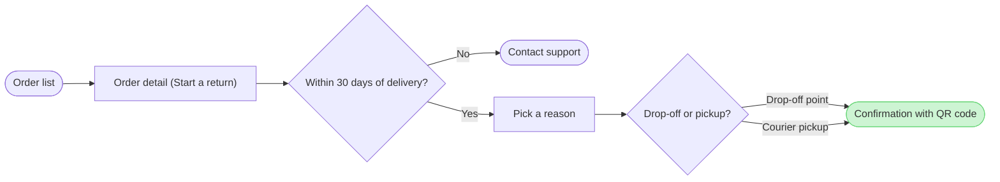

# FJ-022 turn 3 transcript

**User:** Yes, that reading is right.

**Tool call:** `Read` `{"file_path": "/private/var/folders/3c/zfqcqsts0kn19cgblj82gqhm0000gn/T/devin-compare-bench/FJ-022/sk-create-figjam/references/quality-rubric.md"}`

**Tool result:** `Read`

```text
"1\t---\n2\ttitle: \"FigJam Diagram Quality Rubric\"\n3\tdescription: \"The taste gate a FigJam model passes before the write gate, translated from sk-design-diagram's success criteria: type fit, the remove test, signal, the check, the board, the design rubric that scores a composed board and the reply.\"\n4\tcontextType: implementation\n5\timportance_tier: important\n6\ttrigger_phrases:\n7\t  - \"figjam quality rubric\"\n8\t  - \"diagram taste gate\"\n9\t  - \"remove test\"\n10\t  - \"figjam review checklist\"\n11\t  - \"figjam design rubric\"\n12\tversion: 1.0.3.0\n13\t---\n14\t\n15\t# FigJam Diagram Quality Rubric\n16\t\n17\tThe script checks what a script can see. This rubric is the rest: whether the diagram should exist, whether every node earns its place and whether the reader can trust what lands on the board. Walk it after the check passes and before the write gate.\n18\t\n19\t**Loading Condition:** CONDITIONAL, on every Flow route before the write gate\n20\t**Purpose:** The judgement pass between the pre-write check and the gate\n21\t**Scope:** The model, the provenance table, the planned extensions and, after the write, the board and the reply\n22\t\n23\t---\n24\t\n25\t## 1. TYPE FIT\n26\t\n27\t- [ ] The type answers the reader's question, as `references/flow-mode.md` Section 3 maps it\n28\t- [ ] A table, a list or a paragraph would not do the same job. If it would, say so and offer that instead\n29\t- [ ] The type's reference in `references/types/` was loaded and i
```

**Tool call:** `Read` `{"file_path": "/private/var/folders/3c/zfqcqsts0kn19cgblj82gqhm0000gn/T/devin-compare-bench/FJ-022/sk-create-figjam/references/style-guide.md"}`

**Tool result:** `Read`

```text
"1\t---\n2\ttitle: \"FigJam Diagram Style Guide\"\n3\tdescription: \"The colour every composed FigJam board draws by kind in the shipped design, the type scale and the 8 pixel grid, the palette pairs the check accepts with their measured contrast, and the spacing bands, translated from sk-design-diagram's style guide and derivation record.\"\n4\tcontextType: implementation\n5\timportance_tier: important\n6\ttrigger_phrases:\n7\t  - \"figjam style guide\"\n8\t  - \"figjam palette\"\n9\t  - \"figjam colour by kind\"\n10\t  - \"figjam type scale\"\n11\t  - \"palette derivation record\"\n12\t  - \"figjam contrast\"\n13\tversion: 1.0.3.0\n14\t---\n15\t\n16\t# FigJam Diagram Style Guide\n17\t\n18\tThe rules for colour, type and spacing on a FigJam board. The composer in `assets/compose-board.js` draws every board in the design `assets/figjam-design.md` holds, which ships as the tables below record, and every hex a model, a design or a note extension uses comes from the palette in Section 3. `scripts/flow_check.py` refuses any other.\n19\t\n20\t**Loading Condition:** CONDITIONAL, before the gate on every Flow route, and when a model or a note extension uses colour\n21\t**Purpose:** Names the colour each kind draws in, the type scale, the grid, the palette pairs the check accepts and the measured contrast record\n22\t**Scope:** The composed board, Mermaid `style`, `classDef` and `linkStyle` colours, sticky and pin colours for notes, and the contrast record the self-test re-measures\n
```

**Tool call:** `ToolSearch` `{"query": "select:mcp__figma-remote__get_figjam,mcp__figma-remote__create_session,mcp__figma-remote__use_figma,mcp__figma-remote__whoami", "max_results": 4}`

**Tool result:** `ToolSearch`

```text
[{"type": "tool_reference", "tool_name": "mcp__figma-remote__get_figjam"}, {"type": "tool_reference", "tool_name": "mcp__figma-remote__create_session"}, {"type": "tool_reference", "tool_name": "mcp__figma-remote__use_figma"}, {"type": "tool_reference", "tool_name": "mcp__figma-remote__whoami"}]
```

**Tool call:** `Bash` `{"command": "mktemp -d", "description": "Create scratch folder outside the repository"}`

**Tool result:** `Bash`

```text
"/var/folders/3c/zfqcqsts0kn19cgblj82gqhm0000gn/T/tmp.PPfVh67lx1"
```

**Tool call:** `Write` `{"file_path": "/var/folders/3c/zfqcqsts0kn19cgblj82gqhm0000gn/T/tmp.PPfVh67lx1/model.md", "content": "```mermaid\nflowchart LR\n    %% title: Start a return\n    %% subtitle: How a Fernhouse customer starts a return in the app, from the order list to a confirmed return\n    %% source: Sources: the app and the returns doc, as described in the request. Left out: free pickup for orders over €100, a proposal under review.\n    %% zone: Find the order: orders, detail\n    %% zone: Request the return: window, support, reason, method\n    %% zone: Done: confirmed\n    orders([Order list]) --> detail[`

**Tool result:** `Write`

```text
"File created successfully at: /var/folders/3c/zfqcqsts0kn19cgblj82gqhm0000gn/T/tmp.PPfVh67lx1/model.md (file state is current in your context \u2014 no need to Read it back)"
```

**Tool call:** `mcp__figma-remote__create_session` `{"fileKey": "<draft-file-key>", "description": "Read the existing FigJam file before adding a Start a return user flow board as a new section"}`

**Tool result:** `mcp__figma-remote__create_session`

```text
"{\"sessionId\":\"60e34a7a-6907-4d79-b7f6-a986c309554c\"}"
```

**Tool call:** `Bash` `{"command": "cd /private/var/folders/3c/zfqcqsts0kn19cgblj82gqhm0000gn/T/devin-compare-bench/FJ-022/sk-create-figjam && T=/var/folders/3c/zfqcqsts0kn19cgblj82gqhm0000gn/T/tmp.PPfVh67lx1 && python3 -I scripts/flow_check.py $T/model.md; echo \"exit $?\"; python3 -I scripts/compose_board.py $T/model.md --diagram 1 --out $T/code1.js; echo \"exit $?\"", "description": "Run pre-write check and compose the board code"}`

**Tool result:** `Bash`

```text
"  diagram 1, user flow: ok, 7 nodes and 7 connectors, widest rank 2 steps, longest path 6 steps, 1.0 connectors per step, labels average 20 characters, 0 crossing pairs\nPASSED 1 diagram(s) in model.md\nexit 0\nCOMPOSED diagram 1, 7 nodes and 7 connectors, widest rank 2 steps, longest path 6 steps, 1.0 connectors per step, labels average 20 characters, 0 crossing pairs: 7 nodes and 7 connectors to read back, 42178 characters in /var/folders/3c/zfqcqsts0kn19cgblj82gqhm0000gn/T/tmp.PPfVh67lx1/code1.js, drawn in the design FigJam default\nexit 0"
```

**Tool call:** `mcp__figma-remote__get_figjam` `{"fileKey": "<draft-file-key>", "nodeId": "0:1", "sessionId": "60e34a7a-6907-4d79-b7f6-a986c309554c"}`

**Tool result:** `mcp__figma-remote__get_figjam`

```text
[{"type": "text", "text": "<canvas id=\"0:1\" name=\"Page 1\" x=\"0\" y=\"0\" width=\"0\" height=\"0\">\n  <section id=\"1:3\" name=\"Loomlist block sync\" x=\"0\" y=\"0\" width=\"2832\" height=\"1432\">\n    <text id=\"1:4\" name=\"Loomlist block sync\" x=\"80\" y=\"80\" width=\"622\" height=\"77\" />\n    <text id=\"1:5\" name=\"The services that carry a block change from a Loomlist client to a woken iOS device, for engineers on sync\" x=\"80\" y=\"173\" width=\"1440\" height=\"34\" />\n    <section id=\"1:6\" name=\"Clients\" x=\"80\" y=\"272\" width=\"320\" height=\"592\">\n      <text id=\"1:7\" name=\"Clients\" x=\"32\" y=\"32\" width=\"82\" height=\"29\" />\n      <shape-with-text id=\"1:18\" x=\"48\" y=\"96\" width=\"224\" height=\"96\" name=\"ROUNDED_RECTANGLE\">Desktop client</shape-with-text>\n      <shape-with-text id=\"1:22\" x=\"48\" y=\"272\" width=\"224\" height=\"96\" name=\"ROUNDED_RECTANGLE\">Web client</shape-with-text>\n      <shape-with-text id=\"1:26\" x=\"48\" y=\"448\" width=\"224\" height=\"96\" name=\"ROUNDED_RECTANGLE\">iOS client</shape-with-text>\n    </section>\n    <section id=\"1:8\" name=\"Edge\" x=\"568\" y=\"448\" width=\"320\" height=\"240\">\n      <text id=\"1:9\" name=\"Edge\" x=\"32\" y=\"32\" width=\"59\" height=\"29\" />\n      <shape-with-text id=\"1:30\" x=\"48\" y=\"96\" width=\"224\" height=\"96\" name=\"ROUNDED_RECTANGLE\">API gateway</shape-with-text>\n    </section>\n    <connector id=\"1:69\" x=\"356.5\" y=\"572.5\" connector
```

**Assistant:**

The model passed the pre-write check and composed cleanly. Nothing is written yet.

```text
diagram 1, user flow: ok, 7 nodes and 7 connectors, widest rank 2 steps, longest path 6 steps, 1.0 connectors per step, labels average 20 characters, 0 crossing pairs
PASSED 1 diagram(s)
COMPOSED diagram 1, 7 nodes and 7 connectors to read back, drawn in the design FigJam default
```



**Answers to the four critique questions about the sketch**
- Where the eye goes first: the green confirmation with the pink outline. That's the node the board most needs read, because your question is whether a customer reaches a confirmed return.
- Reading order: the six-step main line runs straight from the order list to the confirmation, and Contact support sits beside it as an exit.
- Remove test: no node, edge or label can be cut without losing a step you described. The two edges into the confirmation carry the two choices, so neither repeats the other.
- Invented material: only the placement of the 30 day check on the order detail, which you accepted as assumed. No edge carries a trigger your sources don't state.

**The gate**

- **Question:** which screens does a customer pass through to start a return in the app, and where does the 30 day window end it?
- **Outcome:** a reader can follow a return from the order list to a confirmed return and see where the window stops it.
- **First glance:** the confirmation with QR code, the goal the flow reaches.
- **Second glance:** the drop-off or pickup choice that leads to it.
- **Last glance:** Contact support, the exit after 30 days.
- **File:** the existing FigJam file `<draft-file-key>`, with the board added as a new section. I read it once just now. It holds two sections, "Loomlist block sync" and "Fernhouse damaged-item refund", and neither shares the title "Start a return". Nothing already on it changes, and the new board lands 400 pixels to the right of what's there.
- **Plan:** the file's own. You said Fernhouse Product, and the file key doesn't tell me which plan owns it, so I can't confirm that. No new file is needed, so the Barter team plan in drafts with no project is not used.
- **Writes:** one composed board named "Start a return". It has 7 nodes and 7 connectors in three zones (Find the order, Request the return, Done), with a title, subtitle, key and source line, at the Laptop reading distance. The source line names the left-out free pickup.
- **Extensions:** none.
- **Calls:** one `use_figma` call for the board, then one `get_figjam` read-back. I've already spent `create_session` and one `get_figjam` read. If this account is on a Starter plan or a View or Collab seat, Figma allows six tool calls a month and reads count against that, so the read-back could be refused. Then the reply says `Read-back: not possible` and doesn't call the board done.
- **Rollback:** delete the one board section the write returns. That happens only if you ask for it or answer yes to a question that names the section.

Write it?
