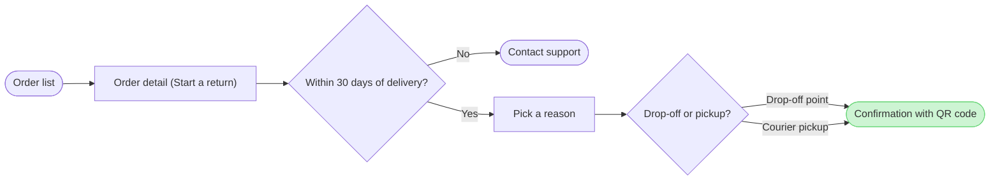

The model passed the pre-write check and composed cleanly. Nothing is written yet.

```text
diagram 1, user flow: ok, 7 nodes and 7 connectors, widest rank 2 steps, longest path 6 steps, 1.0 connectors per step, labels average 20 characters, 0 crossing pairs
PASSED 1 diagram(s)
COMPOSED diagram 1, 7 nodes and 7 connectors to read back, drawn in the design FigJam default
```



**Answers to the four critique questions about the sketch**
- Where the eye goes first: the green confirmation with the pink outline. That's the node the board most needs read, because your question is whether a customer reaches a confirmed return.
- Reading order: the six-step main line runs straight from the order list to the confirmation, and Contact support sits beside it as an exit.
- Remove test: no node, edge or label can be cut without losing a step you described. The two edges into the confirmation carry the two choices, so neither repeats the other.
- Invented material: only the placement of the 30 day check on the order detail, which you accepted as assumed. No edge carries a trigger your sources don't state.

**The gate**

- **Question:** which screens does a customer pass through to start a return in the app, and where does the 30 day window end it?
- **Outcome:** a reader can follow a return from the order list to a confirmed return and see where the window stops it.
- **First glance:** the confirmation with QR code, the goal the flow reaches.
- **Second glance:** the drop-off or pickup choice that leads to it.
- **Last glance:** Contact support, the exit after 30 days.
- **File:** the existing FigJam file `<draft-file-key>`, with the board added as a new section. I read it once just now. It holds two sections, "Loomlist block sync" and "Fernhouse damaged-item refund", and neither shares the title "Start a return". Nothing already on it changes, and the new board lands 400 pixels to the right of what's there.
- **Plan:** the file's own. You said Fernhouse Product, and the file key doesn't tell me which plan owns it, so I can't confirm that. No new file is needed, so the Barter team plan in drafts with no project is not used.
- **Writes:** one composed board named "Start a return". It has 7 nodes and 7 connectors in three zones (Find the order, Request the return, Done), with a title, subtitle, key and source line, at the Laptop reading distance. The source line names the left-out free pickup.
- **Extensions:** none.
- **Calls:** one `use_figma` call for the board, then one `get_figjam` read-back. I've already spent `create_session` and one `get_figjam` read. If this account is on a Starter plan or a View or Collab seat, Figma allows six tool calls a month and reads count against that, so the read-back could be refused. Then the reply says `Read-back: not possible` and doesn't call the board done.
- **Rollback:** delete the one board section the write returns. That happens only if you ask for it or answer yes to a question that names the section.

Write it?