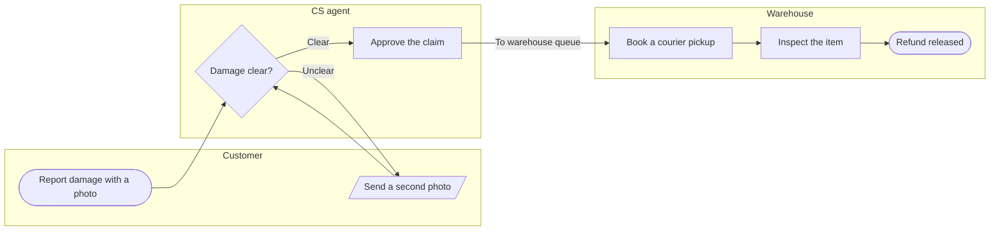

# FJ-023 turn 2 transcript

**User:** Yes, that reading is right.

**Tool call:** `ToolSearch` `{"query": "select:mcp__figma-remote__create_session,mcp__figma-remote__get_figjam,mcp__figma-remote__use_figma,mcp__figma-remote__whoami", "max_results": 4}`

**Tool result:** `ToolSearch`

```text
[{"type": "tool_reference", "tool_name": "mcp__figma-remote__create_session"}, {"type": "tool_reference", "tool_name": "mcp__figma-remote__get_figjam"}, {"type": "tool_reference", "tool_name": "mcp__figma-remote__use_figma"}, {"type": "tool_reference", "tool_name": "mcp__figma-remote__whoami"}]
```

**Tool call:** `Bash` `{"command": "mktemp -d /tmp/figjam-XXXXXX", "description": "Create scratch folder outside repo"}`

**Tool result:** `Bash`

```text
"/tmp/figjam-FVdyif"
```

**Tool call:** `Write` `{"file_path": "/tmp/figjam-FVdyif/model.md", "content": "```mermaid\n%% type: process\nflowchart LR\n    %% title: Damaged-item refund\n    %% subtitle: How a damaged-item claim moves between the customer, CS and the warehouse, from the report to the released refund\n    %% source: Source: the support runbook. Left out: pickup skipped under €20, a pilot that is not live. Logging every decision in the claims table.\n    %% focus: approve because Handoff to warehouse\n    subgraph customer [\"Customer\"]\n        report([Report damage with a photo])\n        photo[/Send a second photo/]\n    end`

**Tool result:** `Write`

```text
"File created successfully at: /tmp/figjam-FVdyif/model.md (file state is current in your context \u2014 no need to Read it back)"
```

**Tool call:** `Bash` `{"command": "cd /tmp && python3 -I \"/private/var/folders/3c/zfqcqsts0kn19cgblj82gqhm0000gn/T/devin-compare-bench/FJ-023/sk-create-figjam/scripts/flow_check.py\" /tmp/figjam-FVdyif/model.md; echo \"exit $?\"", "description": "Run pre-write check on the model"}`

**Tool result:** `Bash`

```text
"  diagram 1, process: ok, 7 nodes and 7 connectors, widest rank 2 steps, longest path 6 steps, 1.0 connectors per step, labels average 18 characters, 0 crossing pairs\nPASSED 1 diagram(s) in model.md\nexit 0\nShell cwd was reset to /private/var/folders/3c/zfqcqsts0kn19cgblj82gqhm0000gn/T/devin-compare-bench/FJ-023"
```

**Tool call:** `mcp__figma-remote__create_session` `{"fileKey": "<draft-file-key>", "description": "Read the FigJam file before adding a damaged-item refund process board as a new section"}`

**Tool result:** `mcp__figma-remote__create_session`

```text
"{\"sessionId\":\"8b04fa7f-f85b-4390-977d-27f9118d3d8e\"}"
```

**Tool call:** `Bash` `{"command": "cd /tmp && python3 -I \"/private/var/folders/3c/zfqcqsts0kn19cgblj82gqhm0000gn/T/devin-compare-bench/FJ-023/sk-create-figjam/scripts/compose_board.py\" /tmp/figjam-FVdyif/model.md --diagram 1 --out /tmp/figjam-FVdyif/board.js; echo \"exit $?\"", "description": "Compose the board code from the checked model"}`

**Tool result:** `Bash`

```text
"COMPOSED diagram 1, 7 nodes and 7 connectors, widest rank 2 steps, longest path 6 steps, 1.0 connectors per step, labels average 18 characters, 0 crossing pairs: 7 nodes and 7 connectors to read back, 42095 characters in /tmp/figjam-FVdyif/board.js, drawn in the design FigJam default\nexit 0\nShell cwd was reset to /private/var/folders/3c/zfqcqsts0kn19cgblj82gqhm0000gn/T/devin-compare-bench/FJ-023"
```

**Tool call:** `mcp__figma-remote__get_figjam` `{"fileKey": "<draft-file-key>", "nodeId": "0:1", "sessionId": "8b04fa7f-f85b-4390-977d-27f9118d3d8e"}`

**Tool result:** `mcp__figma-remote__get_figjam`

```text
[{"type": "text", "text": "<canvas id=\"0:1\" name=\"Page 1\" x=\"0\" y=\"0\" width=\"0\" height=\"0\">\n  <section id=\"1:3\" name=\"Checkout payment, authorised card\" x=\"0\" y=\"0\" width=\"1344\" height=\"1456\">\n    <text id=\"1:4\" name=\"Checkout payment, authorised card\" x=\"80\" y=\"80\" width=\"1121\" height=\"77\" />\n    <text id=\"1:5\" name=\"The calls a Roamstay checkout makes, in order, when the card is authorised\" x=\"80\" y=\"173\" width=\"1184\" height=\"34\" />\n    <shape-with-text id=\"1:6\" x=\"80\" y=\"272\" width=\"224\" height=\"96\" name=\"ROUNDED_RECTANGLE\">GuestApp</shape-with-text>\n    <shape-with-text id=\"1:10\" x=\"80\" y=\"960\" width=\"224\" height=\"48\" name=\"ROUNDED_RECTANGLE\">GuestApp</shape-with-text>\n    <connector id=\"1:14\" x=\"192\" y=\"372.5\" connectorStart=\"1:6\" connectorStartCap=\"NONE\" connectorEnd=\"1:10\" connectorEndCap=\"NONE\">life:GuestApp</connector>\n    <shape-with-text id=\"1:18\" x=\"400\" y=\"272\" width=\"224\" height=\"96\" name=\"ROUNDED_RECTANGLE\">BookingApi</shape-with-text>\n    <shape-with-text id=\"1:22\" x=\"400\" y=\"960\" width=\"224\" height=\"48\" name=\"ROUNDED_RECTANGLE\">BookingApi</shape-with-text>\n    <connector id=\"1:26\" x=\"512\" y=\"372.5\" connectorStart=\"1:18\" connectorStartCap=\"NONE\" connectorEnd=\"1:22\" connectorEndCap=\"NONE\">life:BookingApi</connector>\n    <shape-with-text id=\"1:30\" x=\"720\" y=\"272\" width=\"224\" height=\"96\" name=\"ROUNDED_RECTANGLE\">Payment
```

**Assistant:**

The check passed and the board code is composed. Here is the gate.



Check: PASSED, 7 nodes and 7 connectors, 0 crossing pairs, longest path 6 steps. Every node comes from a runbook line you gave. The one inferred connector is the second photo returning to "Damage clear?", which you accepted as assumed.

**Question:** who handles a damaged-item refund claim, and where does it move from CS to the warehouse?
**Outcome:** a reader sees which team owns each step and notices the handoff to the warehouse first.
**First glance:** "Approve the claim", the step that sends the claim to the warehouse. It carries the pink outline and the key entry "In focus: Handoff to warehouse".
**Second glance:** "To warehouse queue", the connector that carries the claim into the warehouse lane.
**Last glance:** the "Unclear" loop through the second photo, and the source line naming what is left out.

**Critique questions on the sketch:**
* The eye goes first to "Approve the claim", which is the node the board most needs read.
* The main route is one straight line from the report to the released refund, with the photo loop beside it.
* The green goal has a lighter outline than the accent, so it does not compete.
* The board reads in greyscale, because the decision, the photo input and the start and end shapes differ.

**File:** `<draft-file-key>`. It holds one section, "Checkout payment, authorised card", which reads as a Roamstay checkout sequence. No section shares our title. I can't confirm which plan owns this file, so please check it is the one in the Fernhouse Product plan. The yes covers this file only. If the write fails I will come back to you rather than create a new file in the Barter team plan.
**Writes:** one composed board as a new section 400 pixels to the right of the existing one, which stays untouched. It has 3 lanes, 7 nodes, 7 connectors, 2 labelled decision exits, a title, a subtitle, a key and a source line, at laptop reading distance.
**Extensions:** none.
**Calls:** one more `use_figma` and one `get_figjam` read-back. The session and the file read are already spent. If the plan is Starter, or the seat is View or Collab, that is part of a six-call monthly allowance.
**Rollback:** delete the one new section, only on your own yes to a question that names it.

Write it?
