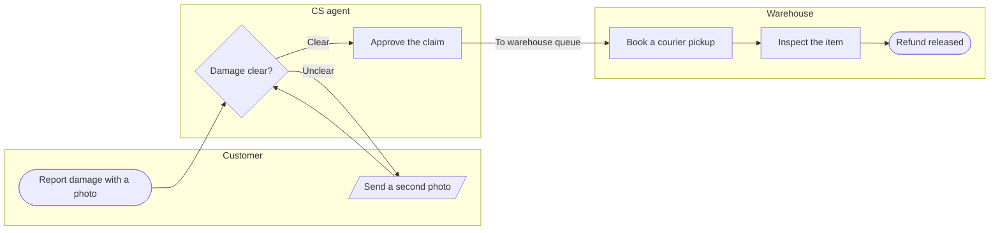

The check passed and the board code is composed. Here is the gate.

Check: PASSED, 7 nodes and 7 connectors, 0 crossing pairs, longest path 6 steps. Every node comes from a runbook line you gave. The one inferred connector is the second photo returning to "Damage clear?", which you accepted as assumed.

**Question:** who handles a damaged-item refund claim, and where does it move from CS to the warehouse?
**Outcome:** a reader sees which team owns each step and notices the handoff to the warehouse first.
**First glance:** "Approve the claim", the step that sends the claim to the warehouse. It carries the pink outline and the key entry "In focus: Handoff to warehouse".
**Second glance:** "To warehouse queue", the connector that carries the claim into the warehouse lane.
**Last glance:** the "Unclear" loop through the second photo, and the source line naming what is left out.

**Critique questions on the sketch:**
* The eye goes first to "Approve the claim", which is the node the board most needs read.
* The main route is one straight line from the report to the released refund, with the photo loop beside it.
* The green goal has a lighter outline than the accent, so it does not compete.
* The board reads in greyscale, because the decision, the photo input and the start and end shapes differ.

**File:** `<draft-file-key>`. It holds one section, "Checkout payment, authorised card", which reads as a Roamstay checkout sequence. No section shares our title. I can't confirm which plan owns this file, so please check it is the one in the Fernhouse Product plan. The yes covers this file only. If the write fails I will come back to you rather than create a new file in the Barter team plan.
**Writes:** one composed board as a new section 400 pixels to the right of the existing one, which stays untouched. It has 3 lanes, 7 nodes, 7 connectors, 2 labelled decision exits, a title, a subtitle, a key and a source line, at laptop reading distance.
**Extensions:** none.
**Calls:** one more `use_figma` and one `get_figjam` read-back. The session and the file read are already spent. If the plan is Starter, or the seat is View or Collab, that is part of a six-call monthly allowance.
**Rollback:** delete the one new section, only on your own yes to a question that names it.

Write it?