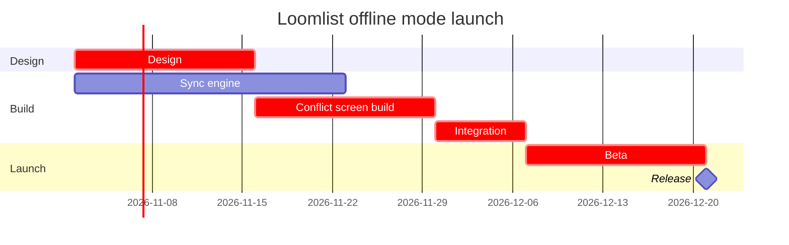

# FJ-009 turn 1 transcript

**User:** put the Loomlist offline mode launch plan on a FigJam gantt chart in a new board in our Loomlist Product plan. Design starts 2 November for two weeks, the sync engine takes three weeks from the same day, the conflict screen build follows design for two weeks, integration starts when both are done for one week, then a two-week beta and the release.

Write the board into the existing FigJam file with key <draft-file-key> rather than a new file. If you need a new file instead, create it in the Barter team plan and leave it in drafts, with no project.

**Assistant:**

I'll start by loading the hub skill files and the FigJam skill.

**Tool call:** `Read` `{"file_path": "/private/var/folders/3c/zfqcqsts0kn19cgblj82gqhm0000gn/T/devin-compare-bench/FJ-009/SKILL.md"}`

**Tool result:** `Read`

```text
"1\t---\n2\tname: product-owner\n3\tdescription: \"Product Owner hub: routes backlog, doc and FigJam diagram requests and two vendored tool packets via mode-registry.json.\"\n4\tallowed-tools: [Read, Write, Edit, Bash, Glob, Grep, WebFetch, WebSearch, mcp__code_mode__call_tool_chain]\n5\tversion: 1.0.6.0\n6\t---\n7\t\n8\t<!-- Keywords: product-owner, sk-product-owner, sk-create-figjam, mcp-click-up, mcp-figma, backlog, task, bug report, user story, epic, prd, product documentation, figjam, user flow, clickup -->\n9\t\n10\t# Product Owner Hub\n11\t\n12\tOne public skill identity over three workflow packets and one transport packet. This hub holds no packet-local logic. It routes by `workflowMode` through `mode-registry.json`, uses `hub-router.json` for router policy, signals and outcomes, and hands stage two to the root `ROUTER.md`, which maps the request's intent to the packet's leaves.\n13\t\n14\t**Version authority.** This file's `version` frontmatter is the hub's release version and matches the newest entry under `changelog/`. `description.json`, `mode-registry.json` and `hub-router.json` carry the same value. `ROUTER.md` keeps its own document version, and each packet keeps its own release line.\n15\t\n16\t---\n17\t\n18\t## 1. WHEN TO USE\n19\t\n20\tUse this skill for Barter backlog and documentation work, for diagrams drawn on FigJam boards, and for the ClickUp and Figma operations those artifacts travel through.\n21\t\n22\t| Mode | Kind | Use it for | Packet |\n23\t|---
```

**Tool call:** `Read` `{"file_path": "/private/var/folders/3c/zfqcqsts0kn19cgblj82gqhm0000gn/T/devin-compare-bench/FJ-009/ROUTER.md"}`

**Tool result:** `Read`

```text
"1\t---\n2\ttitle: \"Product Owner Surface Router: per-intent leaf sets\"\n3\tdescription: \"Stage two of the product-owner hub. hub-router.json selects the workflow mode, and this document maps a request's intent to the exact packet-local leaves that mode loads, as canonical (workflowMode, leafResourceId) pairs.\"\n4\ttrigger_phrases:\n5\t  - \"product owner surface router\"\n6\t  - \"product owner leaf routing\"\n7\t  - \"product owner resource map\"\n8\timportance_tier: important\n9\tcontextType: general\n10\tversion: 1.0.0.0\n11\trouter_state: active\n12\tskill_pointer: SKILL.md\n13\t---\n14\t\n15\t# Product Owner Surface Router: per-intent leaf sets\n16\t\n17\t## 1. OVERVIEW\n18\t\n19\tThis is the product-owner hub's second-layer router, at the hub root beside [`SKILL.md`](SKILL.md). The hub selects a mode in [`hub-router.json`](hub-router.json) (`sk-product-owner`, `sk-create-figjam`, `mcp-click-up` or `mcp-figma`), and this document maps the request's intent to the exact packet-local leaves that mode loads. Every path is packet-qualified (`<packet>/references|assets/...`, where `<packet>` is the mode's `mode-registry.json` `packet` field) and converts to the canonical `(workflowMode, leafResourceId)` pair at the one contract boundary, `.skilled/skills/sk-doc/sk-create-skill/scripts/lib/leaf-resource-contract.cjs` in the skills library. A packet's `INSTALL-GUIDE.md` sits at its packet root, outside that contract, so it is never a leaf here: `mcp-click-up/SKILL.md` loads
```

**Tool call:** `Read` `{"file_path": "/private/var/folders/3c/zfqcqsts0kn19cgblj82gqhm0000gn/T/devin-compare-bench/FJ-009/sk-create-figjam/SKILL.md"}`

**Tool result:** `Read`

```text
"1\t---\n2\tname: sk-create-figjam\n3\tdescription: \"Draws FigJam diagrams, from user flows to sequence, state, ER and gantt, as checked Mermaid models composed into framed boards.\"\n4\tallowed-tools: [Read, Write, Edit, Bash, Glob, Grep, mcp__code_mode__call_tool_chain]\n5\tversion: 1.0.6.0\n6\t---\n7\t\n8\t<!-- Keywords: sk-create-figjam, flow mode, figjam, user flow, process, architecture, sequence diagram, state diagram, er diagram, gantt, flowchart, mermaid, board, $flow, $figjam -->\n9\t\n10\t# FigJam Diagrams\n11\t\n12\tThe Product Owner packet that draws FigJam diagrams. It picks the diagram type the reader's question needs, turns screenshots, a Figma flow, a product doc, a schema or a plan into a Mermaid model of that type with a provenance table, checks the model and, after a yes, composes it into a framed FigJam board with a title, zones, colour by kind and a key. Seven types are drawn: user flow, process, architecture, sequence, state, ER and gantt. The hub [`../SKILL.md`](../SKILL.md) picks this packet, the hub [`../ROUTER.md`](../ROUTER.md) maps a Flow request to its leaves, and Section 2 routes inside it.\n13\t\n14\t---\n15\t\n16\t## 1. WHEN TO USE\n17\t\n18\t- `$flow` or `$figjam`, with no other artifact command\n19\t- FigJam output wording such as \"make a FigJam flow from these screenshots\" or \"a sequence diagram in FigJam\"\n20\t- A request to add notes to or update a FigJam board, including one that carries a `figma.com/board` link\n21\t- A Flow route 
```

**Assistant:**

Flow route, gantt type. I'll load the Flow Mode reference, the templates, the gantt type files, the HVR cards and the rubric/style guide.

**Tool call:** `Read` `{"file_path": "/private/var/folders/3c/zfqcqsts0kn19cgblj82gqhm0000gn/T/devin-compare-bench/FJ-009/sk-create-figjam/references/flow-mode.md"}`

**Tool result:** `Read`

```text
"1\t---\n2\ttitle: \"Product Owner - Templates - Flow Mode\"\n3\tdescription: \"Product Owner flow-mode workflow: screenshots, Figma flows, product docs, schemas and plans turned into a checked Mermaid model of the right FigJam diagram type, written to a board and delivered as the board URL with a read-back line and the HVR self-scan line.\"\n4\tcontextType: implementation\n5\timportance_tier: important\n6\ttrigger_phrases:\n7\t  - \"flow mode\"\n8\t  - \"$flow figjam board\"\n9\t  - \"figjam diagram type\"\n10\t  - \"figjam flow from screenshots\"\n11\t  - \"flow model pre-write check\"\n12\t  - \"board url read-back\"\n13\tversion: 1.0.5.0\n14\t---\n15\t\n16\t# Product Owner - Templates - Flow Mode\n17\t\n18\tFlow-mode guidance for FigJam diagrams. The workflow picks the diagram type the reader's question needs, turns screenshots, a Figma flow, a product doc, a schema or a plan into a Mermaid model of that type, checks it, writes it to a FigJam board and reads the board back before replying.\n19\t\n20\t**Loading Condition:** ALWAYS on a Flow route, as half of the routed pair with `assets/flow-templates.md`\n21\t**Purpose:** Provides the flow-mode workflow, the type choice, the intake, the rules every type shares, the write routes and the delivery reply when `$flow`, `$figjam` or FigJam output wording is detected\n22\t**Scope:** Type choice, intake per input type, the model, the pre-write check, the quality pass, the write gate, the composed, generated and `fj` write routes,
```

**Tool call:** `Read` `{"file_path": "/private/var/folders/3c/zfqcqsts0kn19cgblj82gqhm0000gn/T/devin-compare-bench/FJ-009/sk-create-figjam/assets/flow-templates.md"}`

**Tool result:** `Read`

```text
"1\t---\n2\ttitle: \"Product Owner Flow Templates\"\n3\tdescription: \"User-flow Mermaid patterns, the provenance table and the reply shape for Product Owner Flow Mode, each pattern passing the pre-write check.\"\n4\tcontextType: general\n5\timportance_tier: important\n6\ttrigger_phrases:\n7\t  - \"flow templates\"\n8\t  - \"mermaid flow patterns\"\n9\t  - \"flow provenance table\"\n10\t  - \"flow reply shape\"\n11\tversion: 1.0.2.0\n12\t---\n13\t\n14\t# Product Owner Flow Templates\n15\t\n16\tCopy/apply patterns for Product Owner Flow Mode models.\n17\t\n18\t**Loading Condition:** CONDITIONAL, with `references/flow-mode.md` whenever Flow intent is selected\n19\t**Purpose:** Provides the user-flow patterns, the provenance table every diagram type keeps and the reply shape every type delivers\n20\t**Scope:** Five user-flow patterns, the intake questions, the provenance table and the reply shape. The other types keep their patterns in `assets/templates/`\n21\t**Output Path:** None. The model is working data and the board is the deliverable\n22\t\n23\t---\n24\t\n25\t## 1. OVERVIEW\n26\t\n27\t### Purpose\n28\t\n29\tEvery pattern below passes `scripts/flow_check.py` as a user flow, and `scripts/compose_board.py` composes it into a board. Start from the pattern closest to the flow, rename the nodes after the real screens and triggers, add the board lines below and run the check before the write gate. A process, an architecture, a sequence, a state diagram, an ER diagram or a gantt 
```

**Tool call:** `Read` `{"file_path": "/private/var/folders/3c/zfqcqsts0kn19cgblj82gqhm0000gn/T/devin-compare-bench/FJ-009/sk-create-figjam/references/types/gantt.md"}`

**Tool result:** `Read`

```text
"1\t---\n2\ttitle: \"FigJam Type - Gantt\"\n3\tdescription: \"Tasks, phases and milestones on a time axis, drawn as a FigJam gantt chart in one of two date formats, with no styling, anchored dependencies, twelve tasks and five parallel bars per section.\"\n4\tcontextType: implementation\n5\timportance_tier: important\n6\ttrigger_phrases:\n7\t  - \"figjam gantt chart\"\n8\t  - \"roadmap timeline figjam\"\n9\t  - \"launch plan figjam\"\n10\t  - \"milestones on figjam\"\n11\tversion: 1.0.4.0\n12\t---\n13\t\n14\t# FigJam Type - Gantt\n15\t\n16\tA gantt chart puts tasks and phases on a time axis, with milestones as points. The composer draws each section as a tinted band, each task as a named row with its bar on a shared axis and each milestone as a diamond, and picks the tick spacing from the chart's length. Neither it nor the generated fallback honours colour, axis, weekend or marker settings, so the check refuses them.\n17\t\n18\t**Loading Condition:** CONDITIONAL, when the Flow route draws a gantt chart\n19\t**Purpose:** The grammar, rules, budget and read-back for a gantt chart\n20\t**Pairs With:** `assets/templates/gantt.md`\n21\t\n22\t---\n23\t\n24\t## 1. WHEN TO USE\n25\t\n26\t**The reader's question:** which tasks and phases are active when?\n27\t\n28\t- A release plan or a launch plan with dates\n29\t- A sprint or a phase plan with dependencies between tasks\n30\t- A one-day run of show, in hours\n31\t\n32\tUse a process when there are no dates and the order of steps is 
```

**Tool call:** `Read` `{"file_path": "/private/var/folders/3c/zfqcqsts0kn19cgblj82gqhm0000gn/T/devin-compare-bench/FJ-009/sk-create-figjam/assets/templates/gantt.md"}`

**Tool result:** `Read`

```text
"1\t---\n2\ttitle: \"FigJam Gantt Templates\"\n3\tdescription: \"Gantt patterns that pass the pre-write check: a phased plan with dependencies and a milestone, and a one-day run of show.\"\n4\tcontextType: general\n5\timportance_tier: important\n6\ttrigger_phrases:\n7\t  - \"gantt templates\"\n8\t  - \"figjam gantt pattern\"\n9\tversion: 1.0.1.0\n10\t---\n11\t\n12\t# FigJam Gantt Templates\n13\t\n14\tCopy/apply patterns for a gantt model. Each pattern passes `scripts/flow_check.py`, and `references/types/gantt.md` holds the rules.\n15\t\n16\t**Loading Condition:** CONDITIONAL, with `references/types/gantt.md`\n17\t**Purpose:** Starting points for a gantt chart\n18\t**Scope:** Two patterns. The provenance table and the reply shape are in `assets/flow-templates.md`\n19\t\n20\t---\n21\t\n22\t## 1. USAGE\n23\t\n24\t- Anchor the first task on a date and chain the rest with `after`\n25\t- Months are `M`. A lowercase `m` is minutes\n26\t- `crit` only on the real critical path and `active` only on what runs now\n27\t- No colour and no axis settings, which neither route draws. The tags colour the bars\n28\t\n29\t---\n30\t\n31\t## 2. PATTERNS\n32\t\n33\t### Phased plan with dependencies and a milestone\n34\t\n35\t```mermaid\n36\tgantt\n37\t    title Checkout redesign\n38\t    dateFormat YYYY-MM-DD\n39\t    section Discovery\n40\t    Interviews :done, research, 2026-11-02, 2w\n41\t    Synthesis :done, synth, after research, 1w\n42\t    section Build\n43\t    New payment step :active, pa
```

**Tool call:** `Read` `{"file_path": "/private/var/folders/3c/zfqcqsts0kn19cgblj82gqhm0000gn/T/devin-compare-bench/FJ-009/sk-product-owner/references/hvr-core.md"}`

**Tool result:** `Read`

```text
"1\t---\n2\ttitle: \"Rules - Human Voice Core\"\n3\tdescription: \"Human Voice hard blockers carried inline, loaded on every request so the banned terms are in view while writing.\"\n4\tcontextType: general\n5\timportance_tier: critical\n6\ttrigger_phrases:\n7\t  - \"human voice card\"\n8\t  - \"hard blockers\"\n9\t  - \"hvr self-scan\"\n10\tversion: 0.100.0.0\n11\t---\n12\t\n13\t# Rules - Human Voice Core\n14\t\n15\tHuman Voice hard blockers carried inline, loaded on every request so the banned terms are in view while writing.\n16\t\n17\t**Loading Condition:** ALWAYS\n18\t**Purpose:** Carries the Human Voice hard blockers inline so the banned terms are in view on every request, without loading the full standard\n19\t**Scope:** Punctuation, hard blocker words and phrases, banned metaphors and cliches, setup language, generalisation fixes, output warnings, structural bans, always-cut modifiers and the before-delivery self-scan report line\n20\t**Output Path:** None. The card governs the wording of an artifact another file writes, and produces none of its own\n21\t**Authority:** `Rules - Human Voice - EN` is the full standard, symlinked into every consuming system as its own human-voice reference. Carried here: punctuation, hard blocker words and phrases, banned metaphors, setup phrases, generalisation fixes, output warnings, structural bans, always-cut modifiers. Left there: soft deductions, context-dependent flags, voice directives, the precedence hierarchy and the point scor
```

**Tool call:** `Read` `{"file_path": "/private/var/folders/3c/zfqcqsts0kn19cgblj82gqhm0000gn/T/devin-compare-bench/FJ-009/sk-product-owner/references/conciseness.md"}`

**Tool result:** `Read`

```text
"1\t---\n2\ttitle: \"Rules - Conciseness\"\n3\tdescription: \"The conciseness layer above the Human Voice card: what to cut, what is never cut, and the test that decides which is which.\"\n4\tcontextType: general\n5\timportance_tier: critical\n6\ttrigger_phrases:\n7\t  - \"conciseness layer\"\n8\t  - \"reconstruction test\"\n9\t  - \"concise not robotic\"\n10\t  - \"over-compression\"\n11\tversion: 0.100.0.0\n12\t---\n13\t\n14\t# Rules - Conciseness\n15\t\n16\tThe conciseness layer above the Human Voice card: what to cut, what is never cut, and the test that decides which is which.\n17\t\n18\t**Loading Condition:** ALWAYS, and rules only. A file paid for on every turn stays small enough to be worth paying for\n19\t**Purpose:** Carries the cut rules, the keep rules and the reconstruction test that decides between them, so every delivery is sized as well as checked for banned wording\n20\t**Scope:** Quantity, structure and load-bearing-ness, so an artifact that clears every hard blocker is not still three times too long. Nothing routes to it, since being ALWAYS-loaded is what makes it unroutable\n21\t**Output Path:** None. The layer governs the length of an artifact another file writes, and produces none of its own\n22\t**Loads With:** the consuming system's skill entry and `Rules - Human Voice Core`. That card governs word choice and this file governs quantity, so both run on every delivery\n23\t**Authority:** `Rules - Conciseness - On Demand Rationale` carries the reason behi
```

**Assistant:**

Flow route, gantt type. Before I draft the playback I'll check which Figma tools are connected, since a gantt needs a hosted route.

**Tool call:** `ToolSearch` `{"query": "figma use_figma get_figjam create_new_file whoami generate_diagram create_session", "max_results": 10}`

**Tool result:** `ToolSearch`

```text
"No matching deferred tools found"
```

**Tool call:** `ToolSearch` `{"query": "select:mcp__code_mode__call_tool_chain", "max_results": 3}`

**Tool result:** `ToolSearch`

```text
"No matching deferred tools found"
```

**Tool call:** `Bash` `{"command": "cd /private/var/folders/3c/zfqcqsts0kn19cgblj82gqhm0000gn/T/devin-compare-bench/FJ-009/sk-create-figjam && python3 scripts/flow_check.py --help 2>&1 | head -40; ls ../.mcp.json ../opencode.json ../.devin 2>&1 | head", "description": "Show flow_check usage and look for MCP config"}`

**Tool result:** `Bash`

```text
"mermaid_extract: --help: not a Mermaid file\nUNREADABLE --help: the extractor refused it\nls: ../.mcp.json: No such file or directory\nls: ../opencode.json: No such file or directory\n../.devin:\nconfig.json"
```

**Tool call:** `Bash` `{"command": "S=$(mktemp -d) && echo \"$S\" && cat > \"$S/model.md\" <<'EOF'\n```mermaid\ngantt\n    title Loomlist offline mode launch\n    dateFormat YYYY-MM-DD\n    %% subtitle: Offline mode launch plan from design start on 2 November 2026 to release\n    %% source: Source: the launch plan in the request. Dates are calendar weeks from 2 November 2026.\n    %% focus: integrate\n    section Design\n    Design :crit, design, 2026-11-02, 2w\n    section Build\n    Sync engine :sync, 2026-11-02, 3w\n    Conflict screen build :crit, screen, after design, 2w\n    Integration :crit, integrate, after`

**Tool result:** `Bash`

```text
"/var/folders/3c/zfqcqsts0kn19cgblj82gqhm0000gn/T/tmp.tUS1QL7NCz\n  diagram 1, gantt: ok, 6 tasks in 3 sections\nPASSED 1 diagram(s) in model.md\nexit 0"
```

**Tool call:** `Bash` `{"command": "rm -rf /var/folders/3c/zfqcqsts0kn19cgblj82gqhm0000gn/T/tmp.tUS1QL7NCz && ls /var/folders/3c/zfqcqsts0kn19cgblj82gqhm0000gn/T/tmp.tUS1QL7NCz 2>&1 | head -1; cd /private/var/folders/3c/zfqcqsts0kn19cgblj82gqhm0000gn/T/devin-compare-bench/FJ-009 && git status --short | grep -i export", "description": "Delete scratch folder and confirm nothing in export"}`

**Tool result:** `Bash`

```text
"ls: /var/folders/3c/zfqcqsts0kn19cgblj82gqhm0000gn/T/tmp.tUS1QL7NCz: No such file or directory"
```

**Assistant:**

No board was written, because nothing in this session can draw a gantt chart on FigJam. I listed the connected tools this turn and found no `use_figma`, `generate_diagram`, `get_figjam` or `whoami`, and no Code Mode wrapper. The `fj` route can't draw a gantt chart either, so the file `<draft-file-key>` is untouched.

The plan passes `flow_check.py` as a gantt (6 tasks in 3 sections). This is the model to draw once a Figma connection exists:



| Task | Start | End |
|---|---|---|
| Design | 2 Nov | 16 Nov |
| Sync engine | 2 Nov | 23 Nov |
| Conflict screen build | 16 Nov | 30 Nov |
| Integration | 30 Nov | 7 Dec |
| Beta | 7 Dec | 21 Dec |
| Release | 21 Dec | milestone |

Finding: Figma connection missing. Writing needs the Figma MCP server (`https://mcp.figma.com/mcp`) connected through Figma's plugin or the claude.ai connector, exposing `use_figma` and `get_figjam`. Connect it and tell me, and I'll read the file once, name any section already titled "Loomlist offline mode launch" and send the write gate for your yes.
Finding: Assumed year 2026, from today's date and the "2 November" start. Say so if you meant another year.
Finding: Assumed calendar weeks, with no weekend or holiday gaps. The chart draws none, so a holiday inside the window would push the dates.
Finding: Integration waits on both Sync engine (ends 23 Nov) and Conflict screen build (ends 30 Nov), so it starts 30 Nov. Sync engine has a week of slack, so I left it untagged. The critical path is Design, Conflict screen build, Integration and Beta. `%% focus: integrate` makes Integration the first glance because it is where the two streams join. Say if you want another bar there.
Finding: The file key settles the target, so no new file or plan is needed. Your message names both "Loomlist Product plan" and "Barter team plan". That only matters if the key turns out unreachable, and then I'd ask which plan before creating a draft with no project.
HVR self-scan: 0 hard blockers. Fixed: none. Kept with reason: none.
