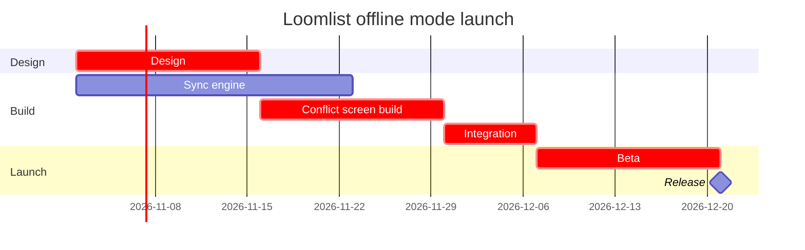

No board was written, because nothing in this session can draw a gantt chart on FigJam. I listed the connected tools this turn and found no `use_figma`, `generate_diagram`, `get_figjam` or `whoami`, and no Code Mode wrapper. The `fj` route can't draw a gantt chart either, so the file `<draft-file-key>` is untouched.

The plan passes `flow_check.py` as a gantt (6 tasks in 3 sections). This is the model to draw once a Figma connection exists:

| Task | Start | End |
|---|---|---|
| Design | 2 Nov | 16 Nov |
| Sync engine | 2 Nov | 23 Nov |
| Conflict screen build | 16 Nov | 30 Nov |
| Integration | 30 Nov | 7 Dec |
| Beta | 7 Dec | 21 Dec |
| Release | 21 Dec | milestone |

Finding: Figma connection missing. Writing needs the Figma MCP server (`https://mcp.figma.com/mcp`) connected through Figma's plugin or the claude.ai connector, exposing `use_figma` and `get_figjam`. Connect it and tell me, and I'll read the file once, name any section already titled "Loomlist offline mode launch" and send the write gate for your yes.
Finding: Assumed year 2026, from today's date and the "2 November" start. Say so if you meant another year.
Finding: Assumed calendar weeks, with no weekend or holiday gaps. The chart draws none, so a holiday inside the window would push the dates.
Finding: Integration waits on both Sync engine (ends 23 Nov) and Conflict screen build (ends 30 Nov), so it starts 30 Nov. Sync engine has a week of slack, so I left it untagged. The critical path is Design, Conflict screen build, Integration and Beta. `%% focus: integrate` makes Integration the first glance because it is where the two streams join. Say if you want another bar there.
Finding: The file key settles the target, so no new file or plan is needed. Your message names both "Loomlist Product plan" and "Barter team plan". That only matters if the key turns out unreachable, and then I'd ask which plan before creating a draft with no project.
HVR self-scan: 0 hard blockers. Fixed: none. Kept with reason: none.