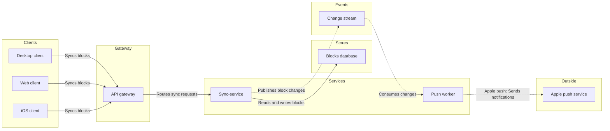

# FJ-012 turn 3 transcript

**User:** Yes, that reading is right.

**Tool call:** `Read` `{"file_path": "/private/var/folders/3c/zfqcqsts0kn19cgblj82gqhm0000gn/T/devin-compare-bench/FJ-012/sk-create-figjam/assets/templates/architecture.md"}`

**Tool result:** `Read`

```text
"1\t---\n2\ttitle: \"FigJam Architecture Templates\"\n3\tdescription: \"Architecture patterns that pass the pre-write check: a request path through every lane and an event-driven path with a backward edge.\"\n4\tcontextType: general\n5\timportance_tier: important\n6\ttrigger_phrases:\n7\t  - \"architecture templates\"\n8\t  - \"figjam architecture pattern\"\n9\tversion: 1.0.1.0\n10\t---\n11\t\n12\t# FigJam Architecture Templates\n13\t\n14\tCopy/apply patterns for an architecture model. Each pattern passes `scripts/flow_check.py`, and `references/types/architecture.md` holds the lanes and the allowed edges.\n15\t\n16\t**Loading Condition:** CONDITIONAL, with `references/types/architecture.md`\n17\t**Purpose:** Starting points for an architecture\n18\t**Scope:** Two patterns. The provenance table and the reply shape are in `assets/flow-templates.md`\n19\t\n20\t---\n21\t\n22\t## 1. USAGE\n23\t\n24\t- Keep the `%% type: architecture` line first, before any `%% title:` or other board line. On the generated fallback, pass `useArchitectureLayoutCode` as `\"FIGMA_DIAGRAM_2026\"` on the call\n25\t- Keep the six lane ids exactly and rename only the labels\n26\t- Drop a lane the system does not have. An empty lane is never filled with an invented part\n27\t- Label every edge from its source's side, and an external edge as `\"Service: Purpose\"`\n28\t\n29\t---\n30\t\n31\t## 2. PATTERNS\n32\t\n33\t### Request path\n34\t\n35\t```mermaid\n36\t%% type: architecture\n37\tflowchart LR\n38\t   
```

**Tool call:** `Read` `{"file_path": "/private/var/folders/3c/zfqcqsts0kn19cgblj82gqhm0000gn/T/devin-compare-bench/FJ-012/sk-create-figjam/references/quality-rubric.md"}`

**Tool result:** `Read`

```text
"1\t---\n2\ttitle: \"FigJam Diagram Quality Rubric\"\n3\tdescription: \"The taste gate a FigJam model passes before the write gate, translated from sk-design-diagram's success criteria: type fit, the remove test, signal, the check, the board, the design rubric that scores a composed board and the reply.\"\n4\tcontextType: implementation\n5\timportance_tier: important\n6\ttrigger_phrases:\n7\t  - \"figjam quality rubric\"\n8\t  - \"diagram taste gate\"\n9\t  - \"remove test\"\n10\t  - \"figjam review checklist\"\n11\t  - \"figjam design rubric\"\n12\tversion: 1.0.3.0\n13\t---\n14\t\n15\t# FigJam Diagram Quality Rubric\n16\t\n17\tThe script checks what a script can see. This rubric is the rest: whether the diagram should exist, whether every node earns its place and whether the reader can trust what lands on the board. Walk it after the check passes and before the write gate.\n18\t\n19\t**Loading Condition:** CONDITIONAL, on every Flow route before the write gate\n20\t**Purpose:** The judgement pass between the pre-write check and the gate\n21\t**Scope:** The model, the provenance table, the planned extensions and, after the write, the board and the reply\n22\t\n23\t---\n24\t\n25\t## 1. TYPE FIT\n26\t\n27\t- [ ] The type answers the reader's question, as `references/flow-mode.md` Section 3 maps it\n28\t- [ ] A table, a list or a paragraph would not do the same job. If it would, say so and offer that instead\n29\t- [ ] The type's reference in `references/types/` was loaded and i
```

**Tool call:** `Read` `{"file_path": "/private/var/folders/3c/zfqcqsts0kn19cgblj82gqhm0000gn/T/devin-compare-bench/FJ-012/sk-create-figjam/references/style-guide.md"}`

**Tool result:** `Read`

```text
"1\t---\n2\ttitle: \"FigJam Diagram Style Guide\"\n3\tdescription: \"The colour every composed FigJam board draws by kind in the shipped design, the type scale and the 8 pixel grid, the palette pairs the check accepts with their measured contrast, and the spacing bands, translated from sk-design-diagram's style guide and derivation record.\"\n4\tcontextType: implementation\n5\timportance_tier: important\n6\ttrigger_phrases:\n7\t  - \"figjam style guide\"\n8\t  - \"figjam palette\"\n9\t  - \"figjam colour by kind\"\n10\t  - \"figjam type scale\"\n11\t  - \"palette derivation record\"\n12\t  - \"figjam contrast\"\n13\tversion: 1.0.3.0\n14\t---\n15\t\n16\t# FigJam Diagram Style Guide\n17\t\n18\tThe rules for colour, type and spacing on a FigJam board. The composer in `assets/compose-board.js` draws every board in the design `assets/figjam-design.md` holds, which ships as the tables below record, and every hex a model, a design or a note extension uses comes from the palette in Section 3. `scripts/flow_check.py` refuses any other.\n19\t\n20\t**Loading Condition:** CONDITIONAL, before the gate on every Flow route, and when a model or a note extension uses colour\n21\t**Purpose:** Names the colour each kind draws in, the type scale, the grid, the palette pairs the check accepts and the measured contrast record\n22\t**Scope:** The composed board, Mermaid `style`, `classDef` and `linkStyle` colours, sticky and pin colours for notes, and the contrast record the self-test re-measures\n
```

**Tool call:** `ToolSearch` `{"query": "select:mcp__figma-remote__create_session,mcp__figma-remote__get_figjam,mcp__figma-remote__use_figma,mcp__figma-remote__whoami", "max_results": 5}`

**Tool result:** `ToolSearch`

```text
[{"type": "tool_reference", "tool_name": "mcp__figma-remote__create_session"}, {"type": "tool_reference", "tool_name": "mcp__figma-remote__get_figjam"}, {"type": "tool_reference", "tool_name": "mcp__figma-remote__use_figma"}, {"type": "tool_reference", "tool_name": "mcp__figma-remote__whoami"}]
```

**Tool call:** `Bash` `{"command": "mktemp -d /tmp/figjam-loomlist.XXXXXX; cd /private/var/folders/3c/zfqcqsts0kn19cgblj82gqhm0000gn/T/devin-compare-bench/FJ-012/sk-create-figjam && python3 scripts/flow_check.py --help 2>&1 | head -30", "description": "Create scratch folder and show check usage"}`

**Tool result:** `Bash`

```text
"/tmp/figjam-loomlist.s91s5Q\nmermaid_extract: --help: not a Mermaid file\nUNREADABLE --help: the extractor refused it"
```

**Tool call:** `Write` `{"file_path": "/tmp/figjam-loomlist.s91s5Q/model.md", "content": "```mermaid\n%% type: architecture\n%% title: Block sync services\n%% subtitle: How a block change reaches the sync-service, the blocks database and Apple push\n%% source: Sources: Loomlist request. Connections assumed, no service doc. Left out: file storage, Apple push to iOS\n%% focus: syncService\nflowchart LR\n    subgraph client [\"Clients\"]\n        desktop[Desktop client]\n        web[Web client]\n        ios[iOS client]\n    end\n    subgraph gateway [\"Gateway\"]\n        apiGateway[API gateway]\n    end\n    subgraph s`

**Tool result:** `Write`

```text
"File created successfully at: /tmp/figjam-loomlist.s91s5Q/model.md (file state is current in your context \u2014 no need to Read it back)"
```

**Tool call:** `Bash` `{"command": "python3 scripts/flow_check.py /tmp/figjam-loomlist.s91s5Q/model.md; echo \"exit=$?\"; python3 scripts/compose_board.py /tmp/figjam-loomlist.s91s5Q/model.md --diagram 1 --out /tmp/figjam-loomlist.s91s5Q/compose.js 2>&1 | head -20; echo \"exit=$?\"", "description": "Run pre-write check and compose the board code"}`

**Tool result:** `Bash`

```text
"  diagram 1, architecture: ok, 9 nodes and 8 connectors, widest rank 3 steps, longest path 6 steps, 0.9 connectors per step, labels average 13 characters, 0 crossing pairs\nPASSED 1 diagram(s) in model.md\nexit=0\nCOMPOSED diagram 1, 9 nodes and 8 connectors, widest rank 3 steps, longest path 6 steps, 0.9 connectors per step, labels average 13 characters, 0 crossing pairs: 9 nodes and 8 connectors to read back, 42575 characters in /tmp/figjam-loomlist.s91s5Q/compose.js, drawn in the design FigJam default\nexit=0"
```

**Tool call:** `mcp__figma-remote__create_session` `{"fileKey": "<test-file-key>", "description": "Add a block sync architecture board as a new section in the Loomlist FigJam file"}`

**Tool result:** `mcp__figma-remote__create_session`

```text
"{\"sessionId\":\"bd1132a3-874c-4179-988a-17e6767bd114\"}"
```

**Assistant:**

The model passes the check and composes cleanly. Next I'm reading the existing file once so the write has a before-state to compare with.

**Tool call:** `mcp__figma-remote__get_figjam` `{"fileKey": "<test-file-key>", "nodeId": "0:1", "sessionId": "bd1132a3-874c-4179-988a-17e6767bd114", "includeImagesOfNodes": false}`

**Tool result:** `mcp__figma-remote__get_figjam`

```text
"Error: result (682,379 characters across 5,783 lines) exceeds maximum allowed tokens. Output has been saved to /Users/michelkerkmeester/.claude/projects/-private-var-folders-3c-zfqcqsts0kn19cgblj82gqhm0000gn-T-devin-compare-bench-FJ-012/a7c810a4-08b7-4bf7-9600-87376537541e/tool-results/mcp-figma-remote-get_figjam-1793053787774.txt.\nFormat: Plain text\nUse offset and limit parameters to read specific portions of the file, search within it for specific content, and jq to make structured queries.\nREQUIREMENTS FOR SUMMARIZATION/ANALYSIS/REVIEW:\n- You MUST read the content from the file at /Users/michelkerkmeester/.claude/projects/-private-var-folders-3c-zfqcqsts0kn19cgblj82gqhm0000gn-T-devin-compare-bench-FJ-012/a7c810a4-08b7-4bf7-9600-87376537541e/tool-results/mcp-figma-remote-get_figjam-1793053787774.txt in sequential chunks until 100% of the content has been read.\n- If you receive truncation warnings when reading the file, reduce the chunk size until you have read 100% of the content without truncation.\n- Before producing ANY summary or analysis, you MUST explicitly describe what portion of the content you have read. ***If you did not read the entire content, you MUST explicitly state this.***\n- If after a few attempts you cannot read the file (file not found, lines too long for Read's offset/limit, no shell access), STOP retrying. Summarize what you were able to read, explicitly state which portion you could not read and why, and proceed.\n"
```

**Assistant:**

The file is large, so I'll search the saved read for top-level sections and any section titled like the new board instead of reading all of it.

**Tool call:** `Bash` `{"command": "F=\"/Users/michelkerkmeester/.claude/projects/-private-var-folders-3c-zfqcqsts0kn19cgblj82gqhm0000gn-T-devin-compare-bench-FJ-012/a7c810a4-08b7-4bf7-9600-87376537541e/tool-results/mcp-figma-remote-get_figjam-1793053787774.txt\"; head -c 1500 \"$F\"; echo; echo ----; grep -n -i \"block sync\" \"$F\" | head; echo ----; grep -c -i \"section\" \"$F\"; grep -n -i \"productowner\" \"$F\" | head", "description": "Inspect saved board read for structure and same-title sections"}`

**Tool result:** `Bash`

```text
"<canvas id=\"0:1\" name=\"Page 1\" x=\"0\" y=\"0\" width=\"0\" height=\"0\">\n  <shape-with-text id=\"1:3\" x=\"768\" y=\"-492\" width=\"224\" height=\"128\" name=\"ROUNDED_RECTANGLE\">Order list</shape-with-text>\n  <shape-with-text id=\"1:6\" x=\"768\" y=\"-236\" width=\"224\" height=\"128\" name=\"SQUARE\">Order detail</shape-with-text>\n  <shape-with-text id=\"1:9\" x=\"780\" y=\"20\" width=\"200\" height=\"200\" name=\"DIAMOND\">Within 30 days?</shape-with-text>\n  <shape-with-text id=\"1:12\" x=\"608\" y=\"476\" width=\"224\" height=\"128\" name=\"ROUNDED_RECTANGLE\">Contact support</shape-with-text>\n  <shape-with-text id=\"1:15\" x=\"928\" y=\"476\" width=\"224\" height=\"128\" name=\"SQUARE\">Pick a reason</shape-with-text>\n  <shape-with-text id=\"1:18\" x=\"940\" y=\"732\" width=\"200\" height=\"200\" name=\"DIAMOND\">Drop-off or pickup?</shape-with-text>\n  <shape-with-text id=\"1:21\" x=\"768\" y=\"1188\" width=\"224\" height=\"128\" name=\"SQUARE\">Choose a drop-off point</shape-with-text>\n  <shape-with-text id=\"1:24\" x=\"1088\" y=\"1188\" width=\"224\" height=\"128\" name=\"SQUARE\">Book a courier pickup</shape-with-text>\n  <shape-with-text id=\"1:27\" x=\"928\" y=\"1444\" width=\"224\" height=\"128\" name=\"ROUNDED_RECTANGLE\">Return confirmed with QR code</shape-with-text>\n  <connector id=\"1:30\" x=\"880\" y=\"-356\" connectorStart=\"1:3\" connectorStartCap=\"NONE\" connectorEnd=\"1:6\" connectorEndCap=\"ARROW_LINES\"></connector>\n  <connector id=\"1:
```

**Tool call:** `Bash` `{"command": "F=\"/Users/michelkerkmeester/.claude/projects/-private-var-folders-3c-zfqcqsts0kn19cgblj82gqhm0000gn-T-devin-compare-bench-FJ-012/a7c810a4-08b7-4bf7-9600-87376537541e/tool-results/mcp-figma-remote-get_figjam-1793053787774.txt\"; echo \"top-level (2-space indent) elements by tag:\"; grep -E '^  <[a-z-]+ ' \"$F\" | sed -E 's/^  <([a-z-]+) .*/\\1/' | sort | uniq -c; echo ---; grep -E '^  <section ' \"$F\" | sed -E 's/.*id=\"([^\"]+)\" name=\"([^\"]*)\" x=\"([^\"]+)\" y=\"([^\"]+)\" width=\"([^\"]+)\" height=\"([^\"]+)\".*/\\1 | \\2 | x=\\3 y=\\4 w=\\5 h=\\6/' | cut -c1-140; echo ---;`

**Tool result:** `Bash`

```text
"top-level (2-space indent) elements by tag:\n  20 connector\n  99 section\n  11 shape-with-text\n   5 text\n---\n19:1408 | Sprint retro | x=608 y=1972 w=1000 h=720\n62:66 | Booking status | x=2008 y=-608 w=2088 h=1560\n68:306 | Start a return | x=7576 y=-608 w=3048 h=1328\n71:361 | Damaged-item refund | x=10792 y=-608 w=2424 h=1720\n73:562 | 1. Checkout payment, authorised card | x=16672 y=-608 w=1416 h=1504\n73:785 | Booking status | x=18488 y=-608 w=2040 h=1560\n74:954 | 2. Checkout payment, declined card | x=23984 y=-608 w=1288 h=1472\n75:1067 | Offline mode launch | x=25672 y=-608 w=2064 h=1336\n75:1165 | Stays model | x=28136 y=-608 w=1568 h=1616\n76:1194 | 1. Sign up | x=30104 y=-608 w=1896 h=952\n77:1250 | 2. Workspace setup | x=32400 y=-608 w=3184 h=888\n78:1384 | Start a return | x=35984 y=-608 w=2648 h=1000\n80:1439 | Start a return | x=39032 y=-608 w=3120 h=1272\n81:1514 | Damaged-item refund | x=42552 y=-608 w=2336 h=1544\n82:1574 | Change booking dates | x=45288 y=-608 w=2760 h=1168\n83:1693 | Booking status | x=48448 y=-608 w=1912 h=1480\n85:1883 | Start a return | x=53976 y=-608 w=2816 h=1104\n88:2099 | Booking status | x=63072 y=-608 w=2016 h=1568\n88:2284 | Start a return | x=65488 y=-608 w=2576 h=1104\n90:2620 | Damaged-item refund | x=74680 y=-608 w=2376 h=1720\n91:2621 | 1. Checkout payment, happy path | x=77456 y=-608 w=1552 h=1544\n92:2769 | 2. Checkout payment, declined card | x=79408 y=-608 w=1288 h=1472\n93:2889 | Booking status | x=81096 y=-608 w=18
```

**Assistant:**

The model passes the check and the board composes. Nothing is written yet.

**What the read of the file showed**
- The file holds 99 top-level sections and 35 loose items, and nothing on it will change.
- No section is titled "Block sync services", so there's no same-title clash.
- Five existing sections are about block sync, and this conversation wrote none of them: "Block sync", "Loomlist block sync", "1. Loomlist block sync, protocol v3", "How block sync works" and "Block sync 2".
- I'd keep the title "Block sync services" so it can't be confused with those. Nothing gets deleted either way.

**The board**
- **Question:** which parts does a block change pass through between a client and a push notification?
- **Outcome:** the reader can say which service owns each hop.
- **Drawn as:** an architecture, Balanced detail, exact names for engineers, laptop reading distance.
- **Check:** passed, with 9 nodes, 8 connectors, 0 crossings, widest rank 3 and longest path 6.
- **Composer:** the code is 42,575 characters, under the 50,000 limit, in the default design with no design warnings.
- **Provenance:** the 9 parts come from your list. All 8 connections are assumed (no source states a call), and the board's source line says so.
- **Glance lines:**
  - **First glance:** sync-service, marked with the accent.
  - **Second glance:** the gateway on the way in and the change stream into the push worker, the two links a change takes to reach Apple push.
  - **Last glance:** the source line, which carries the assumed connections and what was left out.

**Sketch**


**Four critique questions, answered on the sketch**
- Where does the eye go first? To sync-service, which is the part the board most needs read.
- Does every node serve the question? Yes. The cut of file storage is the only removal.
- Does any connector restate the layout? No. "Syncs blocks" appears on three edges, one under the limit of four.
- Does it read in greyscale? Yes. Dashed lines mark the event and outside calls, and the lanes are named.

**The write**
- **Target:** the existing file `<test-file-key>`, as a new section. You named the Loomlist Engineering plan, and I haven't confirmed the file sits in it. No new file is needed, so the Barter fallback isn't used.
- **Placement:** about 400 pixels to the right of the last section, "Block sync 2".
- **Left out:** file storage (over the 9-node budget) and Apple's push reaching the iOS client (the board has no outside-to-client arrow).
- **Extensions:** none.
- **Calls:** one `use_figma` to compose the board and one `get_figjam` on the new section for the read-back. The session and the file read are already spent. If your seat is limited, those count against its monthly allowance.
- **Rollback:** delete the one new section the write returns, and only on your yes to a question that names it.

Do you want me to write this board into that file?
