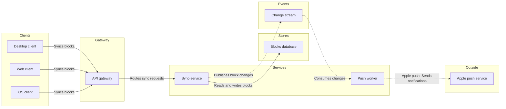

The model passes the check and the board composes. Nothing is written yet.

**What the read of the file showed**
- The file holds 99 top-level sections and 35 loose items, and nothing on it will change.
- No section is titled "Block sync services", so there's no same-title clash.
- Five existing sections are about block sync, and this conversation wrote none of them: "Block sync", "Loomlist block sync", "1. Loomlist block sync, protocol v3", "How block sync works" and "Block sync 2".
- I'd keep the title "Block sync services" so it can't be confused with those. Nothing gets deleted either way.

**The board**
- **Question:** which parts does a block change pass through between a client and a push notification?
- **Outcome:** the reader can say which service owns each hop.
- **Drawn as:** an architecture, Balanced detail, exact names for engineers, laptop reading distance.
- **Check:** passed, with 9 nodes, 8 connectors, 0 crossings, widest rank 3 and longest path 6.
- **Composer:** the code is 42,575 characters, under the 50,000 limit, in the default design with no design warnings.
- **Provenance:** the 9 parts come from your list. All 8 connections are assumed (no source states a call), and the board's source line says so.
- **Glance lines:**
  - **First glance:** sync-service, marked with the accent.
  - **Second glance:** the gateway on the way in and the change stream into the push worker, the two links a change takes to reach Apple push.
  - **Last glance:** the source line, which carries the assumed connections and what was left out.

**Sketch**

**Four critique questions, answered on the sketch**
- Where does the eye go first? To sync-service, which is the part the board most needs read.
- Does every node serve the question? Yes. The cut of file storage is the only removal.
- Does any connector restate the layout? No. "Syncs blocks" appears on three edges, one under the limit of four.
- Does it read in greyscale? Yes. Dashed lines mark the event and outside calls, and the lanes are named.

**The write**
- **Target:** the existing file `<test-file-key>`, as a new section. You named the Loomlist Engineering plan, and I haven't confirmed the file sits in it. No new file is needed, so the Barter fallback isn't used.
- **Placement:** about 400 pixels to the right of the last section, "Block sync 2".
- **Left out:** file storage (over the 9-node budget) and Apple's push reaching the iOS client (the board has no outside-to-client arrow).
- **Extensions:** none.
- **Calls:** one `use_figma` to compose the board and one `get_figjam` on the new section for the read-back. The session and the file read are already spent. If your seat is limited, those count against its monthly allowance.
- **Rollback:** delete the one new section the write returns, and only on your yes to a question that names it.

Do you want me to write this board into that file?