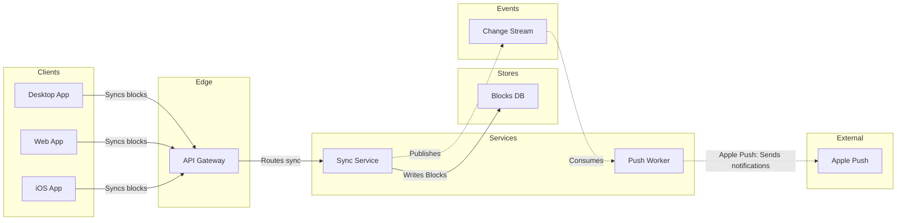

# FJ-019 turn 3 transcript

**User:** Yes, that reading is right.

**Tool call:** `Read` `{"file_path": "/private/var/folders/3c/zfqcqsts0kn19cgblj82gqhm0000gn/T/devin-compare-bench/FJ-019/sk-create-figjam/references/quality-rubric.md"}`

**Tool result:** `Read`

```text
"1\t---\n2\ttitle: \"FigJam Diagram Quality Rubric\"\n3\tdescription: \"The taste gate a FigJam model passes before the write gate, translated from sk-design-diagram's success criteria: type fit, the remove test, signal, the check, the board, the design rubric that scores a composed board and the reply.\"\n4\tcontextType: implementation\n5\timportance_tier: important\n6\ttrigger_phrases:\n7\t  - \"figjam quality rubric\"\n8\t  - \"diagram taste gate\"\n9\t  - \"remove test\"\n10\t  - \"figjam review checklist\"\n11\t  - \"figjam design rubric\"\n12\tversion: 1.0.3.0\n13\t---\n14\t\n15\t# FigJam Diagram Quality Rubric\n16\t\n17\tThe script checks what a script can see. This rubric is the rest: whether the diagram should exist, whether every node earns its place and whether the reader can trust what lands on the board. Walk it after the check passes and before the write gate.\n18\t\n19\t**Loading Condition:** CONDITIONAL, on every Flow route before the write gate\n20\t**Purpose:** The judgement pass between the pre-write check and the gate\n21\t**Scope:** The model, the provenance table, the planned extensions and, after the write, the board and the reply\n22\t\n23\t---\n24\t\n25\t## 1. TYPE FIT\n26\t\n27\t- [ ] The type answers the reader's question, as `references/flow-mode.md` Section 3 maps it\n28\t- [ ] A table, a list or a paragraph would not do the same job. If it would, say so and offer that instead\n29\t- [ ] The type's reference in `references/types/` was loaded and i
```

**Tool call:** `Read` `{"file_path": "/private/var/folders/3c/zfqcqsts0kn19cgblj82gqhm0000gn/T/devin-compare-bench/FJ-019/sk-create-figjam/references/style-guide.md"}`

**Tool call:** `Bash` `{"command": "mktemp -d", "description": "Create scratch folder outside the repo"}`

**Tool result:** `Read`

```text
"1\t---\n2\ttitle: \"FigJam Diagram Style Guide\"\n3\tdescription: \"The colour every composed FigJam board draws by kind in the shipped design, the type scale and the 8 pixel grid, the palette pairs the check accepts with their measured contrast, and the spacing bands, translated from sk-design-diagram's style guide and derivation record.\"\n4\tcontextType: implementation\n5\timportance_tier: important\n6\ttrigger_phrases:\n7\t  - \"figjam style guide\"\n8\t  - \"figjam palette\"\n9\t  - \"figjam colour by kind\"\n10\t  - \"figjam type scale\"\n11\t  - \"palette derivation record\"\n12\t  - \"figjam contrast\"\n13\tversion: 1.0.3.0\n14\t---\n15\t\n16\t# FigJam Diagram Style Guide\n17\t\n18\tThe rules for colour, type and spacing on a FigJam board. The composer in `assets/compose-board.js` draws every board in the design `assets/figjam-design.md` holds, which ships as the tables below record, and every hex a model, a design or a note extension uses comes from the palette in Section 3. `scripts/flow_check.py` refuses any other.\n19\t\n20\t**Loading Condition:** CONDITIONAL, before the gate on every Flow route, and when a model or a note extension uses colour\n21\t**Purpose:** Names the colour each kind draws in, the type scale, the grid, the palette pairs the check accepts and the measured contrast record\n22\t**Scope:** The composed board, Mermaid `style`, `classDef` and `linkStyle` colours, sticky and pin colours for notes, and the contrast record the self-test re-measures\n
```

**Tool result:** `Bash`

```text
"/var/folders/3c/zfqcqsts0kn19cgblj82gqhm0000gn/T/tmp.M2aVIikGCU"
```

**Tool call:** `Write` `{"file_path": "/var/folders/3c/zfqcqsts0kn19cgblj82gqhm0000gn/T/tmp.M2aVIikGCU/model.md", "content": "```mermaid\n%% type: architecture\nflowchart LR\n    %% title: Block sync\n    %% subtitle: The parts a block change passes through in Loomlist sync, for engineers and the product owner\n    %% source: Source: the request, connections assumed, not yet confirmed. Left out: file storage, off the sync path\n    %% focus: sync\n    subgraph client [\"Clients\"]\n        desktop[Desktop App]\n        webClient[Web App]\n        ios[iOS App]\n    end\n    subgraph gateway [\"Edge\"]\n        api[API`

**Tool result:** `Write`

```text
"File created successfully at: /var/folders/3c/zfqcqsts0kn19cgblj82gqhm0000gn/T/tmp.M2aVIikGCU/model.md (file state is current in your context \u2014 no need to Read it back)"
```

**Tool call:** `Bash` `{"command": "python3 sk-create-figjam/scripts/flow_check.py /var/folders/3c/zfqcqsts0kn19cgblj82gqhm0000gn/T/tmp.M2aVIikGCU/model.md", "description": "Run the pre-write check on the model"}`

**Tool result:** `Bash`

```text
"  diagram 1, architecture: ok, 9 nodes and 8 connectors, widest rank 3 steps, longest path 6 steps, 0.9 connectors per step, labels average 10 characters, 0 crossing pairs\nPASSED 1 diagram(s) in model.md"
```

**Tool call:** `Bash` `{"command": "python3 sk-create-figjam/scripts/compose_board.py /var/folders/3c/zfqcqsts0kn19cgblj82gqhm0000gn/T/tmp.M2aVIikGCU/model.md --diagram 1 --out /var/folders/3c/zfqcqsts0kn19cgblj82gqhm0000gn/T/tmp.M2aVIikGCU/board1.js; echo \"exit $?\"; wc -c /var/folders/3c/zfqcqsts0kn19cgblj82gqhm0000gn/T/tmp.M2aVIikGCU/board1.js", "description": "Compose the board code from the checked model"}`

**Tool result:** `Bash`

```text
"COMPOSED diagram 1, 9 nodes and 8 connectors, widest rank 3 steps, longest path 6 steps, 0.9 connectors per step, labels average 10 characters, 0 crossing pairs: 9 nodes and 8 connectors to read back, 42413 characters in /var/folders/3c/zfqcqsts0kn19cgblj82gqhm0000gn/T/tmp.M2aVIikGCU/board1.js, drawn in the design FigJam default\nexit 0\n   42413 /var/folders/3c/zfqcqsts0kn19cgblj82gqhm0000gn/T/tmp.M2aVIikGCU/board1.js"
```

**Assistant:**

The model passed the check and composed cleanly. This is the gate, and it asks about the write alone.



Check: `PASSED`, 9 nodes and 8 connectors, longest path 6 steps, 0 crossing pairs, 0 design warnings.

* Question: which parts make up Loomlist block sync, and how do they connect?
* Outcome: engineers and the product owner can name every part a block change passes through and see what sits outside the system.
* First glance: Sync Service, where a block change is written and published. It carries the pink outline.
* Second glance: the Change Stream that carries each change on to the Push Worker.
* Last glance: Apple Push, the external hop at the end of the path.
* Plan: <figma-plan-1>, read from your fallback. The connected account has no Loomlist Engineering plan, so the board cannot go there. <figma-plan-1> is the only Barter plan on the account, so that reading is my inference.
* File: a new FigJam file named "Block sync", left in drafts with no project.
* Writes: one composed board of 9 nodes and 8 connectors in 6 lanes, with a title, a subtitle, a key and a source line, at the Laptop reading distance.
* Assumed: all eight connections. The uncertainty sits on the board's source line, not on each edge label.
* Left out: file storage, off the sync path.
* Extensions: none.
* Calls: `create_new_file`, `create_session`, one `use_figma` and one `get_figjam` read-back. `whoami` is already spent.
* Rollback: delete the new file.

Write it to <figma-plan-1> as a draft with no project?
