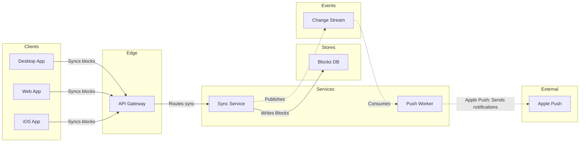

The model passed the check and composed cleanly. This is the gate, and it asks about the write alone.

Check: `PASSED`, 9 nodes and 8 connectors, longest path 6 steps, 0 crossing pairs, 0 design warnings.

* Question: which parts make up Loomlist block sync, and how do they connect?
* Outcome: engineers and the product owner can name every part a block change passes through and see what sits outside the system.
* First glance: Sync Service, where a block change is written and published. It carries the pink outline.
* Second glance: the Change Stream that carries each change on to the Push Worker.
* Last glance: Apple Push, the external hop at the end of the path.
* Plan: <figma-plan-1>, read from your fallback. The connected account has no Loomlist Engineering plan, so the board cannot go there. <figma-plan-1> is the only Barter plan on the account, so that reading is my inference.
* File: a new FigJam file named "Block sync", left in drafts with no project.
* Writes: one composed board of 9 nodes and 8 connectors in 6 lanes, with a title, a subtitle, a key and a source line, at the Laptop reading distance.
* Assumed: all eight connections. The uncertainty sits on the board's source line, not on each edge label.
* Left out: file storage, off the sync path.
* Extensions: none.
* Calls: `create_new_file`, `create_session`, one `use_figma` and one `get_figjam` read-back. `whoami` is already spent.
* Rollback: delete the new file.

Write it to <figma-plan-1> as a draft with no project?