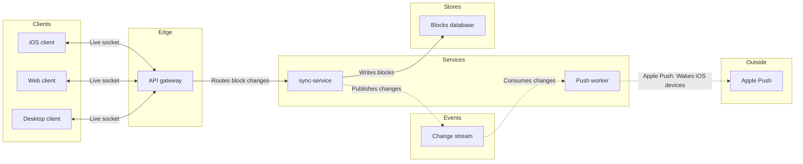

# FJ-024 turn 3 transcript

**User:** Yes, that reading is right.

**Tool call:** `Bash` `{"command": "cd /private/var/folders/3c/zfqcqsts0kn19cgblj82gqhm0000gn/T/devin-compare-bench/FJ-024/sk-create-figjam && python3 scripts/flow_check.py --help 2>&1 | head -30; python3 scripts/compose_board.py --help 2>&1 | head -30; mktemp -d", "description": "Show script usage and create scratch folder"}`

**Tool result:** `Bash`

```text
"mermaid_extract: --help: not a Mermaid file\nUNREADABLE --help: the extractor refused it\n\n  compose_board.py <model.md> [--diagram N] [--out path]  -> 0 the filled code is written, 1 the model fails\n                                                             the check, 2 unreadable or no such diagram\n  compose_board.py <model.md> --model                      -> print the MODEL as JSON instead of the code\n  compose_board.py --template                              -> print the compact code with its MODEL and THEME\n                                                             placeholders, the text the Project's composer\n                                                             Knowledge file carries\n  compose_board.py --design-check                          -> print the design a board is drawn in, what it\n                                                             changes, its measures and the THEME it sends: 0 the\n                                                             design reads with no warning, 1 one or more warnings\n  compose_board.py --self-test                             -> prove every shipped model composes, its counts\n                                                             match the check, the code fits one use_figma call and\n                                                             the board it draws keeps its geometry and its design\n/var/folders/3c/zfqcqsts0kn19cgblj82gqhm0000gn/T/tmp.iLmiHz7koN"
```

**Tool call:** `ToolSearch` `{"query": "select:mcp__figma-remote__create_session,mcp__figma-remote__get_figjam,mcp__figma-remote__use_figma,mcp__figma-remote__get_screenshot", "max_results": 4}`

**Tool result:** `ToolSearch`

```text
[{"type": "tool_reference", "tool_name": "mcp__figma-remote__create_session"}, {"type": "tool_reference", "tool_name": "mcp__figma-remote__get_figjam"}, {"type": "tool_reference", "tool_name": "mcp__figma-remote__use_figma"}, {"type": "tool_reference", "tool_name": "mcp__figma-remote__get_screenshot"}]
```

**Tool call:** `Write` `{"file_path": "/var/folders/3c/zfqcqsts0kn19cgblj82gqhm0000gn/T/tmp.iLmiHz7koN/model.md", "content": "```mermaid\n%% type: architecture\nflowchart LR\n    %% title: Loomlist block sync\n    %% subtitle: The services that carry a block change from a Loomlist client to a woken iOS device, for engineers on sync\n    %% source: Source: the request for this board. Left out: file storage, no stated connection and over the node budget.\n    %% focus: syncService because Writes every block change\n    subgraph client [\"Clients\"]\n        desktopClient[Desktop client]\n        webClient[Web client]\n`

**Tool result:** `Write`

```text
"File created successfully at: /var/folders/3c/zfqcqsts0kn19cgblj82gqhm0000gn/T/tmp.iLmiHz7koN/model.md (file state is current in your context \u2014 no need to Read it back)"
```

**Tool call:** `mcp__figma-remote__create_session` `{"fileKey": "<draft-file-key>", "description": "Read the FigJam file, then add a Loomlist block sync architecture board as a new section after the user's yes"}`

**Tool result:** `mcp__figma-remote__create_session`

```text
"{\"sessionId\":\"5fd0f22d-1a61-48e9-8c4d-c269363f09b7\"}"
```

**Tool call:** `Bash` `{"command": "python3 scripts/flow_check.py /var/folders/3c/zfqcqsts0kn19cgblj82gqhm0000gn/T/tmp.iLmiHz7koN/model.md; echo \"exit $?\"; python3 scripts/compose_board.py /var/folders/3c/zfqcqsts0kn19cgblj82gqhm0000gn/T/tmp.iLmiHz7koN/model.md --diagram 1 --out /var/folders/3c/zfqcqsts0kn19cgblj82gqhm0000gn/T/tmp.iLmiHz7koN/board.js; echo \"exit $?\"; wc -c /var/folders/3c/zfqcqsts0kn19cgblj82gqhm0000gn/T/tmp.iLmiHz7koN/board.js", "description": "Run pre-write check and compose the board code"}`

**Tool result:** `Bash`

```text
"  diagram 1, architecture: ok, 9 nodes and 8 connectors, widest rank 3 steps, longest path 6 steps, 0.9 connectors per step, labels average 12 characters, 0 crossing pairs\nPASSED 1 diagram(s) in model.md\nexit 0\nCOMPOSED diagram 1, 9 nodes and 8 connectors, widest rank 3 steps, longest path 6 steps, 0.9 connectors per step, labels average 12 characters, 0 crossing pairs: 9 nodes and 8 connectors to read back, 42692 characters in /var/folders/3c/zfqcqsts0kn19cgblj82gqhm0000gn/T/tmp.iLmiHz7koN/board.js, drawn in the design FigJam default\nexit 0\n   42692 /var/folders/3c/zfqcqsts0kn19cgblj82gqhm0000gn/T/tmp.iLmiHz7koN/board.js"
```

**Tool call:** `mcp__figma-remote__get_figjam` `{"fileKey": "<draft-file-key>", "nodeId": "0:1", "includeImagesOfNodes": false, "sessionId": "5fd0f22d-1a61-48e9-8c4d-c269363f09b7"}`

**Tool result:** `mcp__figma-remote__get_figjam`

```text
[{"type": "text", "text": "<canvas id=\"0:1\" name=\"Page 1\" x=\"0\" y=\"0\" width=\"0\" height=\"0\" />"}]
```

**Assistant:**

Here is the gate. The model passed the pre-write check, and the target page is empty, so no section shares the title and nothing on the file will change.

```text
diagram 1, architecture: ok, 9 nodes and 8 connectors, widest rank 3 steps, longest path 6 steps, 0.9 connectors per step, 0 crossing pairs
PASSED 1 diagram(s)
```

**Sketch (the checked model)**



**Critique of the sketch**
1. Where the eye goes first: sync-service, the one node with the pink outline
2. Can a change be followed from a client to Apple Push: yes, with no crossing connectors on a six-step longest path
3. Repeated labels: "Live socket" appears three times, under the limit of four
4. Anything beyond your sources: only the gateway to sync-service edge, which you confirmed. The Apple Push to iOS hop sits in the last edge's label

**Question:** which services carry a block change from a client to a woken iOS device?
**Outcome:** a Loomlist engineer can see where a change is written, published and pushed.

**Glances**
- First: sync-service, where every block change is written and published
- Second: the Change stream, which carries each change on to the Push worker
- Last: Apple Push, the outside hop that wakes sleeping iOS devices

**The write**
- File: `<draft-file-key>`, as a new section on its empty page. No plan applies, because no new file is created
- Draws: one framed board with 9 nodes and 8 connectors in 6 lanes, a title, a subtitle, a key and a source line, at laptop reading distance
- Left out: file storage, the Apple Push to iOS connector, and retry and failure paths
- Extensions: none
- Calls: one `use_figma` to compose the board and one `get_figjam` to read it back. I have already spent one `get_figjam` reading the empty page. If you are on a Starter plan or a View or Collab seat, Figma counts reads against six tool calls a month
- Rollback: delete the one board section the write returns, which I'd do only on your separate yes naming it

If the file refuses the write, I stop and ask before creating anything.

Write it?
