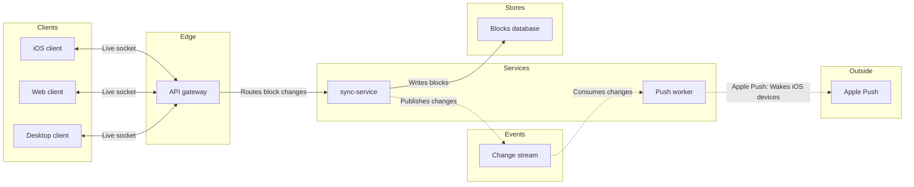

Here is the gate. The model passed the pre-write check, and the target page is empty, so no section shares the title and nothing on the file will change.

```text
diagram 1, architecture: ok, 9 nodes and 8 connectors, widest rank 3 steps, longest path 6 steps, 0.9 connectors per step, 0 crossing pairs
PASSED 1 diagram(s)
```

**Sketch (the checked model)**



**Critique of the sketch**
1. Where the eye goes first: sync-service, the one node with the pink outline
2. Can a change be followed from a client to Apple Push: yes, with no crossing connectors on a six-step longest path
3. Repeated labels: "Live socket" appears three times, under the limit of four
4. Anything beyond your sources: only the gateway to sync-service edge, which you confirmed. The Apple Push to iOS hop sits in the last edge's label

**Question:** which services carry a block change from a client to a woken iOS device?
**Outcome:** a Loomlist engineer can see where a change is written, published and pushed.

**Glances**
- First: sync-service, where every block change is written and published
- Second: the Change stream, which carries each change on to the Push worker
- Last: Apple Push, the outside hop that wakes sleeping iOS devices

**The write**
- File: `<draft-file-key>`, as a new section on its empty page. No plan applies, because no new file is created
- Draws: one framed board with 9 nodes and 8 connectors in 6 lanes, a title, a subtitle, a key and a source line, at laptop reading distance
- Left out: file storage, the Apple Push to iOS connector, and retry and failure paths
- Extensions: none
- Calls: one `use_figma` to compose the board and one `get_figjam` to read it back. I have already spent one `get_figjam` reading the empty page. If you are on a Starter plan or a View or Collab seat, Figma counts reads against six tool calls a month
- Rollback: delete the one board section the write returns, which I'd do only on your separate yes naming it

If the file refuses the write, I stop and ask before creating anything.

Write it?