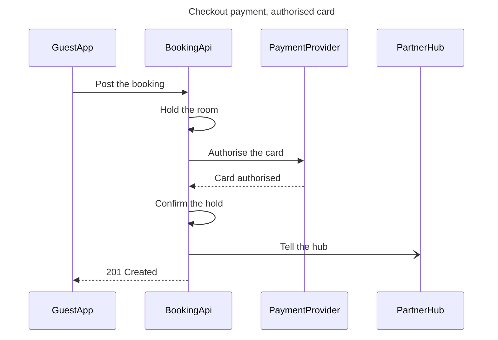

# FJ-025 turn 2 transcript

**User:** Yes, that reading is right.

**Tool call:** `ToolSearch` `{"query": "select:mcp__figma-remote__create_session,mcp__figma-remote__get_figjam,mcp__figma-remote__use_figma,mcp__figma-remote__whoami", "max_results": 4}`

**Tool result:** `ToolSearch`

```text
[{"type": "tool_reference", "tool_name": "mcp__figma-remote__create_session"}, {"type": "tool_reference", "tool_name": "mcp__figma-remote__get_figjam"}, {"type": "tool_reference", "tool_name": "mcp__figma-remote__use_figma"}, {"type": "tool_reference", "tool_name": "mcp__figma-remote__whoami"}]
```

**Tool call:** `Read` `{"file_path": "/private/var/folders/3c/zfqcqsts0kn19cgblj82gqhm0000gn/T/devin-compare-bench/FJ-025/sk-create-figjam/references/quality-rubric.md"}`

**Tool result:** `Read`

```text
"1\t---\n2\ttitle: \"FigJam Diagram Quality Rubric\"\n3\tdescription: \"The taste gate a FigJam model passes before the write gate, translated from sk-design-diagram's success criteria: type fit, the remove test, signal, the check, the board, the design rubric that scores a composed board and the reply.\"\n4\tcontextType: implementation\n5\timportance_tier: important\n6\ttrigger_phrases:\n7\t  - \"figjam quality rubric\"\n8\t  - \"diagram taste gate\"\n9\t  - \"remove test\"\n10\t  - \"figjam review checklist\"\n11\t  - \"figjam design rubric\"\n12\tversion: 1.0.3.0\n13\t---\n14\t\n15\t# FigJam Diagram Quality Rubric\n16\t\n17\tThe script checks what a script can see. This rubric is the rest: whether the diagram should exist, whether every node earns its place and whether the reader can trust what lands on the board. Walk it after the check passes and before the write gate.\n18\t\n19\t**Loading Condition:** CONDITIONAL, on every Flow route before the write gate\n20\t**Purpose:** The judgement pass between the pre-write check and the gate\n21\t**Scope:** The model, the provenance table, the planned extensions and, after the write, the board and the reply\n22\t\n23\t---\n24\t\n25\t## 1. TYPE FIT\n26\t\n27\t- [ ] The type answers the reader's question, as `references/flow-mode.md` Section 3 maps it\n28\t- [ ] A table, a list or a paragraph would not do the same job. If it would, say so and offer that instead\n29\t- [ ] The type's reference in `references/types/` was loaded and i
```

**Tool call:** `Read` `{"file_path": "/private/var/folders/3c/zfqcqsts0kn19cgblj82gqhm0000gn/T/devin-compare-bench/FJ-025/sk-create-figjam/references/style-guide.md"}`

**Tool result:** `Read`

```text
"1\t---\n2\ttitle: \"FigJam Diagram Style Guide\"\n3\tdescription: \"The colour every composed FigJam board draws by kind in the shipped design, the type scale and the 8 pixel grid, the palette pairs the check accepts with their measured contrast, and the spacing bands, translated from sk-design-diagram's style guide and derivation record.\"\n4\tcontextType: implementation\n5\timportance_tier: important\n6\ttrigger_phrases:\n7\t  - \"figjam style guide\"\n8\t  - \"figjam palette\"\n9\t  - \"figjam colour by kind\"\n10\t  - \"figjam type scale\"\n11\t  - \"palette derivation record\"\n12\t  - \"figjam contrast\"\n13\tversion: 1.0.3.0\n14\t---\n15\t\n16\t# FigJam Diagram Style Guide\n17\t\n18\tThe rules for colour, type and spacing on a FigJam board. The composer in `assets/compose-board.js` draws every board in the design `assets/figjam-design.md` holds, which ships as the tables below record, and every hex a model, a design or a note extension uses comes from the palette in Section 3. `scripts/flow_check.py` refuses any other.\n19\t\n20\t**Loading Condition:** CONDITIONAL, before the gate on every Flow route, and when a model or a note extension uses colour\n21\t**Purpose:** Names the colour each kind draws in, the type scale, the grid, the palette pairs the check accepts and the measured contrast record\n22\t**Scope:** The composed board, Mermaid `style`, `classDef` and `linkStyle` colours, sticky and pin colours for notes, and the contrast record the self-test re-measures\n
```

**Tool call:** `mcp__figma-remote__create_session` `{"fileKey": "<draft-file-key>", "description": "Add a checkout payment sequence diagram as a new section in the Roamstay FigJam file"}`

**Tool call:** `Bash` `{"command": "mktemp -d /tmp/figjam-seq.XXXXXX", "description": "Create scratch folder for the model"}`

**Tool result:** `mcp__figma-remote__create_session`

```text
"{\"sessionId\":\"c2dbccd5-c12f-4cac-9323-69e17bda3bc6\"}"
```

**Tool result:** `Bash`

```text
"/tmp/figjam-seq.PJZNPB"
```

**Tool call:** `mcp__figma-remote__get_figjam` `{"fileKey": "<draft-file-key>", "nodeId": "0:1", "sessionId": "c2dbccd5-c12f-4cac-9323-69e17bda3bc6", "includeImagesOfNodes": false}`

**Tool result:** `mcp__figma-remote__get_figjam`

```text
[{"type": "text", "text": "<canvas id=\"0:1\" name=\"Page 1\" x=\"0\" y=\"0\" width=\"0\" height=\"0\" />"}]
```

**Tool call:** `Write` `{"file_path": "/tmp/figjam-seq.PJZNPB/model.md", "content": "```mermaid\nsequenceDiagram\n    title Checkout payment, authorised card\n    %% subtitle: The calls a Roamstay checkout makes, in order, when the card is authorised\n    %% source: Source: the payments brief. Left out: the declined-card path, release the hold and 402, kept for a second board.\n    %% focus: 3\n    participant GuestApp\n    participant BookingApi\n    participant PaymentProvider\n    participant PartnerHub\n    GuestApp->>BookingApi: Post the booking\n    BookingApi->>BookingApi: Hold the room\n    BookingApi->>Payme`

**Tool result:** `Write`

```text
"File created successfully at: /tmp/figjam-seq.PJZNPB/model.md (file state is current in your context \u2014 no need to Read it back)"
```

**Tool call:** `Bash` `{"command": "cd /private/var/folders/3c/zfqcqsts0kn19cgblj82gqhm0000gn/T/devin-compare-bench/FJ-025/sk-create-figjam && python3 scripts/flow_check.py /tmp/figjam-seq.PJZNPB/model.md; echo \"exit $?\"; python3 scripts/compose_board.py /tmp/figjam-seq.PJZNPB/model.md --diagram 1 --out /tmp/figjam-seq.PJZNPB/code.js; echo \"exit $?\"; wc -c /tmp/figjam-seq.PJZNPB/code.js", "description": "Run pre-write check and compose the board code"}`

**Tool result:** `Bash`

```text
"  diagram 1, sequence: ok, 4 participants and 7 messages\nPASSED 1 diagram(s) in model.md\nexit 0\nCOMPOSED diagram 1, 4 participants and 7 messages: 4 nodes and 7 connectors to read back, 17759 characters in /tmp/figjam-seq.PJZNPB/code.js, drawn in the design FigJam default\nexit 0\n   17759 /tmp/figjam-seq.PJZNPB/code.js"
```

**Assistant:**

The model passed the pre-write check, and the board code composed without errors. Nothing is written yet.

**Sketch (checked)**


**Gate**
* **Question:** in what order do the guest app, the booking API, the payment provider and the partner hub exchange messages when a guest pays at checkout?
* **Outcome:** the reader can follow the checkout calls in order, from the booking post to the 201.
* **First glance:** message 3, Authorise the card, the call to the payment provider that decides the checkout. I marked it with the pink accent.
* **Second glance:** message 4, Card authorised, the answer that lets the booking API confirm the hold and reply to the app.
* **Last glance:** message 6, Tell the hub, which sits beside the main path and doesn't hold up the 201.
* **File:** the existing FigJam file `<draft-file-key>`. I read it and its page is empty, so no section shares this title and nothing on it can change. I can't confirm which plan owns it, and I'm taking it as Roamstay Product, as you said.
* **Writes:** one new section, "Checkout payment, authorised card". It has 4 participants and 7 numbered messages, with a title, a subtitle, a key and a source line, at the laptop reading distance. The source line names the declined-card path as left out.
* **Extensions:** none.
* **Calls:** one `use_figma` write and one `get_figjam` read-back. The read of the file is already spent. If your seat is on a Starter plan or is View or Collab, the monthly limit is six tool calls, and this work has used about three.
* **Rollback:** delete that one section. I would do it only on a reply from you that names it.

Write the board into that file?
