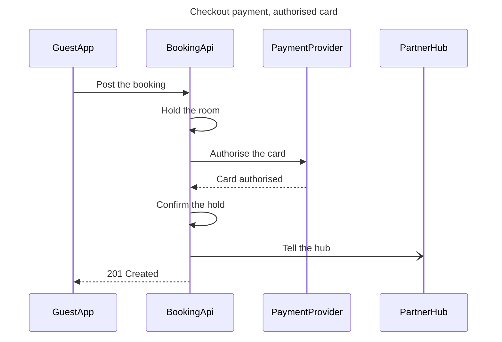

The model passed the pre-write check, and the board code composed without errors. Nothing is written yet.

**Sketch (checked)**

**Gate**
* **Question:** in what order do the guest app, the booking API, the payment provider and the partner hub exchange messages when a guest pays at checkout?
* **Outcome:** the reader can follow the checkout calls in order, from the booking post to the 201.
* **First glance:** message 3, Authorise the card, the call to the payment provider that decides the checkout. I marked it with the pink accent.
* **Second glance:** message 4, Card authorised, the answer that lets the booking API confirm the hold and reply to the app.
* **Last glance:** message 6, Tell the hub, which sits beside the main path and doesn't hold up the 201.
* **File:** the existing FigJam file `<draft-file-key>`. I read it and its page is empty, so no section shares this title and nothing on it can change. I can't confirm which plan owns it, and I'm taking it as Roamstay Product, as you said.
* **Writes:** one new section, "Checkout payment, authorised card". It has 4 participants and 7 numbered messages, with a title, a subtitle, a key and a source line, at the laptop reading distance. The source line names the declined-card path as left out.
* **Extensions:** none.
* **Calls:** one `use_figma` write and one `get_figjam` read-back. The read of the file is already spent. If your seat is on a Starter plan or is View or Collab, the monthly limit is six tool calls, and this work has used about three.
* **Rollback:** delete that one section. I would do it only on a reply from you that names it.

Write the board into that file?