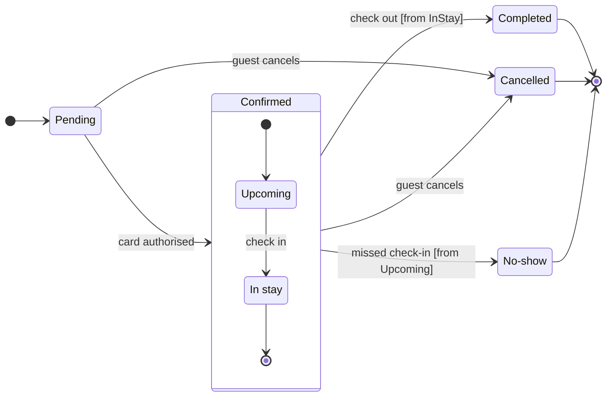

# FJ-026 turn 2 transcript

**User:** Yes, that reading is right.

**Tool call:** `Bash` `{"command": "mktemp -d", "description": "Create scratch folder for model"}`

**Tool result:** `Bash`

```text
"/var/folders/3c/zfqcqsts0kn19cgblj82gqhm0000gn/T/tmp.8Jh7nkprR8"
```

**Tool call:** `ToolSearch` `{"query": "select:mcp__figma-remote__create_session,mcp__figma-remote__get_figjam,mcp__figma-remote__use_figma,mcp__figma-remote__get_screenshot", "max_results": 4}`

**Tool result:** `ToolSearch`

```text
[{"type": "tool_reference", "tool_name": "mcp__figma-remote__create_session"}, {"type": "tool_reference", "tool_name": "mcp__figma-remote__get_figjam"}, {"type": "tool_reference", "tool_name": "mcp__figma-remote__use_figma"}, {"type": "tool_reference", "tool_name": "mcp__figma-remote__get_screenshot"}]
```

**Tool call:** `Write` `{"file_path": "/var/folders/3c/zfqcqsts0kn19cgblj82gqhm0000gn/T/tmp.8Jh7nkprR8/model.md", "content": "```mermaid\nstateDiagram-v2\n    %% title: Booking status\n    %% subtitle: Every status a Roamstay booking passes through, and what moves it on\n    %% source: Source: the Roamstay booking status brief. Left out: the timing of the No-show mark, which the brief does not give.\n    direction LR\n    [*] --> Pending\n    Pending --> Confirmed: card authorised\n    state Confirmed {\n        [*] --> Upcoming\n        Upcoming --> InStay: check in\n        InStay --> [*]\n    }\n    state \"In sta`

**Tool result:** `Write`

```text
"File created successfully at: /var/folders/3c/zfqcqsts0kn19cgblj82gqhm0000gn/T/tmp.8Jh7nkprR8/model.md (file state is current in your context \u2014 no need to Read it back)"
```

**Tool call:** `mcp__figma-remote__create_session` `{"fileKey": "<draft-file-key>", "description": "Read the existing FigJam file, then add a Booking status state diagram board for Roamstay"}`

**Tool result:** `mcp__figma-remote__create_session`

```text
"{\"sessionId\":\"772eacd0-9206-4c31-8097-561ffdd893d4\"}"
```

**Tool call:** `Bash` `{"command": "cd /private/var/folders/3c/zfqcqsts0kn19cgblj82gqhm0000gn/T/devin-compare-bench/FJ-026/sk-create-figjam && python3 scripts/flow_check.py /var/folders/3c/zfqcqsts0kn19cgblj82gqhm0000gn/T/tmp.8Jh7nkprR8/model.md; echo \"exit $?\"", "description": "Run pre-write check on the state model"}`

**Tool result:** `Bash`

```text
"  diagram 1, state: ok, 7 states and 12 transitions\nPASSED 1 diagram(s) in model.md\nexit 0"
```

**Tool call:** `mcp__figma-remote__get_figjam` `{"fileKey": "<draft-file-key>", "nodeId": "0:1", "sessionId": "772eacd0-9206-4c31-8097-561ffdd893d4", "includeImagesOfNodes": false}`

**Tool result:** `mcp__figma-remote__get_figjam`

```text
[{"type": "text", "text": "<canvas id=\"0:1\" name=\"Page 1\" x=\"0\" y=\"0\" width=\"0\" height=\"0\" />"}]
```

**Tool call:** `Bash` `{"command": "python3 scripts/compose_board.py /var/folders/3c/zfqcqsts0kn19cgblj82gqhm0000gn/T/tmp.8Jh7nkprR8/model.md --diagram 1 --out /var/folders/3c/zfqcqsts0kn19cgblj82gqhm0000gn/T/tmp.8Jh7nkprR8/board.js; echo \"exit $?\"; wc -c /var/folders/3c/zfqcqsts0kn19cgblj82gqhm0000gn/T/tmp.8Jh7nkprR8/board.js", "description": "Compose board code from checked model"}`

**Tool result:** `Bash`

```text
"COMPOSED diagram 1, 7 states and 12 transitions: 12 nodes and 12 connectors to read back, 42394 characters in /var/folders/3c/zfqcqsts0kn19cgblj82gqhm0000gn/T/tmp.8Jh7nkprR8/board.js, drawn in the design FigJam default\nexit 0\n   42394 /var/folders/3c/zfqcqsts0kn19cgblj82gqhm0000gn/T/tmp.8Jh7nkprR8/board.js"
```

**Assistant:**

The model passed the check and the board code composes (7 states, 12 transitions). The file has no sections yet, so no board there shares the title.

**Sketch** (the checked model, not yet on any board):



**Question:** which statuses exist and what moves a booking between them?
**Outcome:** support can read every booking status and spot the three statuses a booking ends in.
**First glance:** the Confirmed section. It is the largest tinted shape, and a state diagram takes one accent at most, so I'm not forcing it onto an end state.
**Second glance:** the three light gray end states, Completed, Cancelled and No-show, and the events leading into them.
**Last glance:** Pending, where every booking starts.
**Plan and file:** the existing FigJam file `<draft-file-key>`. I'm creating no new file and no draft, so the Roamstay Product plan is not touched.
**Writes:** one new board section called "Booking status" beside the file's current content, which is empty. It has 7 states and 12 transitions, a title, a key and a source line, at the Laptop reading distance. The end states are drawn in light gray and keyed "Final state".
**Extensions:** none.
**Calls:** one `use_figma` and one `get_figjam` read-back. I've already spent one `get_figjam` read on the file. If the account is on a Starter plan or a View or Collab seat, those reads count toward its six calls a month.
**Rollback:** delete the one board section the write returns. I'd do that only on your yes to a question that names it.

Write it?
