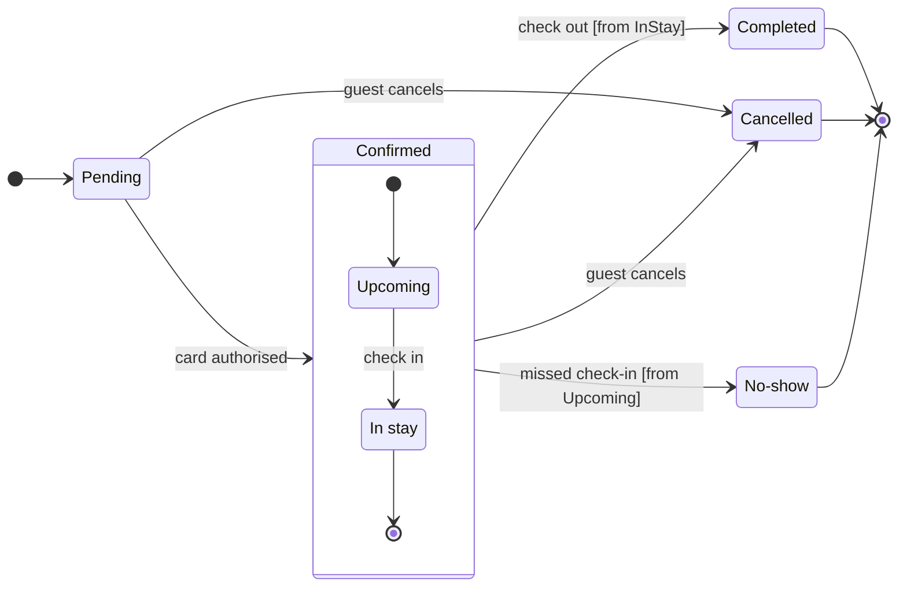

The model passed the check and the board code composes (7 states, 12 transitions). The file has no sections yet, so no board there shares the title.

**Sketch** (the checked model, not yet on any board):

**Question:** which statuses exist and what moves a booking between them?
**Outcome:** support can read every booking status and spot the three statuses a booking ends in.
**First glance:** the Confirmed section. It is the largest tinted shape, and a state diagram takes one accent at most, so I'm not forcing it onto an end state.
**Second glance:** the three light gray end states, Completed, Cancelled and No-show, and the events leading into them.
**Last glance:** Pending, where every booking starts.
**Plan and file:** the existing FigJam file `<draft-file-key>`. I'm creating no new file and no draft, so the Roamstay Product plan is not touched.
**Writes:** one new board section called "Booking status" beside the file's current content, which is empty. It has 7 states and 12 transitions, a title, a key and a source line, at the Laptop reading distance. The end states are drawn in light gray and keyed "Final state".
**Extensions:** none.
**Calls:** one `use_figma` and one `get_figjam` read-back. I've already spent one `get_figjam` read on the file. If the account is on a Starter plan or a View or Collab seat, those reads count toward its six calls a month.
**Rollback:** delete the one board section the write returns. I'd do that only on your yes to a question that names it.

Write it?