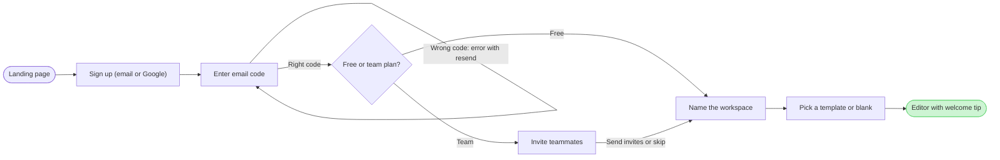

# FJ-029 turn 3 transcript

**User:** Yes, that reading is right.

**Tool call:** `Read` `{"file_path": "/private/var/folders/3c/zfqcqsts0kn19cgblj82gqhm0000gn/T/devin-compare-bench/FJ-029/sk-create-figjam/references/quality-rubric.md"}`

**Tool result:** `Read`

```text
"1\t---\n2\ttitle: \"FigJam Diagram Quality Rubric\"\n3\tdescription: \"The taste gate a FigJam model passes before the write gate, translated from sk-design-diagram's success criteria: type fit, the remove test, signal, the check, the board, the design rubric that scores a composed board and the reply.\"\n4\tcontextType: implementation\n5\timportance_tier: important\n6\ttrigger_phrases:\n7\t  - \"figjam quality rubric\"\n8\t  - \"diagram taste gate\"\n9\t  - \"remove test\"\n10\t  - \"figjam review checklist\"\n11\t  - \"figjam design rubric\"\n12\tversion: 1.0.3.0\n13\t---\n14\t\n15\t# FigJam Diagram Quality Rubric\n16\t\n17\tThe script checks what a script can see. This rubric is the rest: whether the diagram should exist, whether every node earns its place and whether the reader can trust what lands on the board. Walk it after the check passes and before the write gate.\n18\t\n19\t**Loading Condition:** CONDITIONAL, on every Flow route before the write gate\n20\t**Purpose:** The judgement pass between the pre-write check and the gate\n21\t**Scope:** The model, the provenance table, the planned extensions and, after the write, the board and the reply\n22\t\n23\t---\n24\t\n25\t## 1. TYPE FIT\n26\t\n27\t- [ ] The type answers the reader's question, as `references/flow-mode.md` Section 3 maps it\n28\t- [ ] A table, a list or a paragraph would not do the same job. If it would, say so and offer that instead\n29\t- [ ] The type's reference in `references/types/` was loaded and i
```

**Tool call:** `Read` `{"file_path": "/private/var/folders/3c/zfqcqsts0kn19cgblj82gqhm0000gn/T/devin-compare-bench/FJ-029/sk-create-figjam/references/style-guide.md"}`

**Tool result:** `Read`

```text
"1\t---\n2\ttitle: \"FigJam Diagram Style Guide\"\n3\tdescription: \"The colour every composed FigJam board draws by kind in the shipped design, the type scale and the 8 pixel grid, the palette pairs the check accepts with their measured contrast, and the spacing bands, translated from sk-design-diagram's style guide and derivation record.\"\n4\tcontextType: implementation\n5\timportance_tier: important\n6\ttrigger_phrases:\n7\t  - \"figjam style guide\"\n8\t  - \"figjam palette\"\n9\t  - \"figjam colour by kind\"\n10\t  - \"figjam type scale\"\n11\t  - \"palette derivation record\"\n12\t  - \"figjam contrast\"\n13\tversion: 1.0.3.0\n14\t---\n15\t\n16\t# FigJam Diagram Style Guide\n17\t\n18\tThe rules for colour, type and spacing on a FigJam board. The composer in `assets/compose-board.js` draws every board in the design `assets/figjam-design.md` holds, which ships as the tables below record, and every hex a model, a design or a note extension uses comes from the palette in Section 3. `scripts/flow_check.py` refuses any other.\n19\t\n20\t**Loading Condition:** CONDITIONAL, before the gate on every Flow route, and when a model or a note extension uses colour\n21\t**Purpose:** Names the colour each kind draws in, the type scale, the grid, the palette pairs the check accepts and the measured contrast record\n22\t**Scope:** The composed board, Mermaid `style`, `classDef` and `linkStyle` colours, sticky and pin colours for notes, and the contrast record the self-test re-measures\n
```

**Tool call:** `ToolSearch` `{"query": "select:mcp__figma-remote__create_session,mcp__figma-remote__get_figjam,mcp__figma-remote__use_figma,mcp__figma-remote__whoami", "max_results": 4}`

**Tool result:** `ToolSearch`

```text
[{"type": "tool_reference", "tool_name": "mcp__figma-remote__create_session"}, {"type": "tool_reference", "tool_name": "mcp__figma-remote__get_figjam"}, {"type": "tool_reference", "tool_name": "mcp__figma-remote__use_figma"}, {"type": "tool_reference", "tool_name": "mcp__figma-remote__whoami"}]
```

**Tool call:** `Bash` `{"command": "cd /private/var/folders/3c/zfqcqsts0kn19cgblj82gqhm0000gn/T/devin-compare-bench/FJ-029/sk-create-figjam && sed -n 1,200p assets/examples/user-flow-fernhouse-return.md | head -150; python3 scripts/flow_check.py --help 2>&1 | head -30", "description": "View user-flow example and check usage"}`

**Tool result:** `Bash`

```text
"---\ntitle: \"Example - User Flow - Fernhouse Return\"\ndescription: \"A worked user flow on the fictional Fernhouse store: app screenshots and a returns doc turned into a checked model with its board lines and zones, a playback, a gate message and the reply.\"\ncontextType: general\nimportance_tier: normal\ntrigger_phrases:\n  - \"user flow example\"\n  - \"fernhouse return flow\"\nversion: 1.0.1.0\n---\n\n# Example - User Flow - Fernhouse Return\n\nFernhouse is a fictional store used across the Product Owner fixtures. Every name, screen and rule here is invented for the example.\n\n---\n\n## 1. REQUEST\n\n```text\n$flow how a customer starts a return in the app, from these screenshots and the returns doc\n```\n\nSources: five app screenshots and a returns doc.\n\n| Source | Says |\n|---|---|\n| `Orders - Tap_ Order row.png` | The order list, a row under the finger |\n| `Order detail - Tap_ Start a return.png` | The order page with a Start a return button |\n| `Return reason - Select_ Reason.png` | A list of reasons |\n| `Return method - Select_ Drop-off or pickup.png` | Two choices: a drop-off point or a courier pickup |\n| `Return confirmed.png` | A confirmation with a QR code |\n| Returns doc, Section 2 | Returns are open for 30 days after delivery. After that the app shows Contact support. Current behavior |\n| Returns doc, Section 4 | A free pickup for orders over \u20ac100. Proposal, under review |\n\n---\n\n## 2. TYPE AND DIALS\n\n- **Reader question:** which screens
```

**Tool call:** `Bash` `{"command": "SCR=$(mktemp -d) && echo \"$SCR\" && cat > \"$SCR/model.md\" <<'EOF'\n```mermaid\nflowchart LR\n    %% title: Loomlist signup and workspace setup\n    %% subtitle: How a new person goes from the landing page to the first editor session, with the code, plan, skip and blank choices\n    %% source: Sources: the Loomlist onboarding doc, as summarised in the request. Folded: the wrong-code error, into a connector label. Left out: a separate Google path and anything after the welcome tip.\n    %% zone: Create the account: landing, signup, verify, codeOk\n    %% zone: Set up the workspac`

**Tool result (error):** `Bash`

```text
"Exit code 1\n/var/folders/3c/zfqcqsts0kn19cgblj82gqhm0000gn/T/tmp.8i7OkxpqYb\n  diagram 1, user flow: the longest path runs 9 steps, at most 8: split the flow\nFAILED 1 of 1 diagram(s) in model.md"
```

**Tool call:** `Bash` `{"command": "SCR=/var/folders/3c/zfqcqsts0kn19cgblj82gqhm0000gn/T/tmp.8i7OkxpqYb && ls \"$SCR\" && cat > \"$SCR/model2.md\" <<'EOF'\n```mermaid\nflowchart LR\n    %% title: Loomlist signup and workspace setup\n    %% subtitle: How a new person goes from the landing page to the first editor session, with the code, plan, skip and blank choices\n    %% source: Sources: the Loomlist onboarding doc, as summarised in the request. Folded: the wrong-code error, into a connector label. Left out: a separate Google path and anything after the welcome tip.\n    %% zone: Create the account: landing, signup`

**Tool result:** `Bash`

```text
"model.md\n  diagram 1, user flow: ok, 8 nodes and 9 connectors, widest rank 1 steps, longest path 8 steps, 1.1 connectors per step, labels average 19 characters, 0 crossing pairs\nPASSED 1 diagram(s) in model2.md"
```

**Tool call:** `Bash` `{"command": "SCR=/var/folders/3c/zfqcqsts0kn19cgblj82gqhm0000gn/T/tmp.8i7OkxpqYb && python3 scripts/compose_board.py \"$SCR/model2.md\" --diagram 1 --out \"$SCR/board1.js\"; echo exit=$?; wc -c \"$SCR/board1.js\"", "description": "Compose the checked model into board code"}`

**Tool result:** `Bash`

```text
"COMPOSED diagram 1, 8 nodes and 9 connectors, widest rank 1 steps, longest path 8 steps, 1.1 connectors per step, labels average 19 characters, 0 crossing pairs: 8 nodes and 9 connectors to read back, 42474 characters in /var/folders/3c/zfqcqsts0kn19cgblj82gqhm0000gn/T/tmp.8i7OkxpqYb/board1.js, drawn in the design FigJam default\nexit=0\n   42474 /var/folders/3c/zfqcqsts0kn19cgblj82gqhm0000gn/T/tmp.8i7OkxpqYb/board1.js"
```

**Assistant:**

The model passes the check and composes. Next I'm reading the target file once, so the gate can name any section that shares the board's title.

**Tool call:** `mcp__figma-remote__create_session` `{"fileKey": "<draft-file-key>", "description": "Add a Loomlist signup and workspace setup user flow as a new section on the existing FigJam board, after reading it once for same-titled sections"}`

**Tool result:** `mcp__figma-remote__create_session`

```text
"{\"sessionId\":\"5b498928-903a-4902-bcd1-b126a4cec686\"}"
```

**Tool call:** `mcp__figma-remote__get_figjam` `{"fileKey": "<draft-file-key>", "nodeId": "0:1", "includeImagesOfNodes": false, "sessionId": "5b498928-903a-4902-bcd1-b126a4cec686"}`

**Tool result:** `mcp__figma-remote__get_figjam`

```text
[{"type": "text", "text": "<canvas id=\"0:1\" name=\"Page 1\" x=\"0\" y=\"0\" width=\"0\" height=\"0\" />"}]
```

**Assistant:**

The check printed `PASSED` and the composer printed `COMPOSED`. The file is empty (page 1 holds no content), so no section shares the board's title.

One change from the outline you approved. With the "Code right?" diamond the longest path ran 9 steps and the limit is 8. The code screen and its check always travel together, so I merged them. "Enter email code" now carries both exits: wrong code loops back to itself with the label "Wrong code: error with resend", and right code goes on to the plan choice. The alternative is two boards, "1. Sign up" and "2. Workspace setup", which keeps the diamond.



Provenance: every node and edge comes from the onboarding doc as summarised in your request, in its stated order, and is treated as current behavior (assumed).

The gate:
- Question: which screens does a new person pass through, and where do they choose, from the landing page to the first editor session?
- Outcome: the product team can check each branch (wrong code, plan, skip, blank) against what is built.
- First glance: the editor with welcome tip, the green goal with the pink outline.
- Second glance: the free or team plan diamond and the teammates detour.
- Last glance: the wrong-code loop and the source line.
- File: `<draft-file-key>`, with the board added as a new section. Nothing already on it changes, and the file needs no plan and no new file.
- Writes: one board titled "Loomlist signup and workspace setup" with 8 nodes and 9 connectors, two zones ("Create the account" and "Set up the workspace"), a key, a subtitle and a source line, at laptop reading distance.
- Extensions: none.
- Calls: one `use_figma` and one `get_figjam` read-back, after loading Figma's `figma-use` and `figma-use-figjam` guidance. Starter plans and View or Collab seats are limited to six tool calls a month, and the session and file read already count toward that.
- Rollback: delete the one section the write returns. That deletion asks for its own yes.

Write it?
