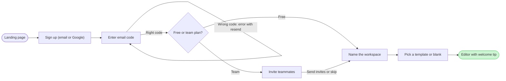

The check printed `PASSED` and the composer printed `COMPOSED`. The file is empty (page 1 holds no content), so no section shares the board's title.

One change from the outline you approved. With the "Code right?" diamond the longest path ran 9 steps and the limit is 8. The code screen and its check always travel together, so I merged them. "Enter email code" now carries both exits: wrong code loops back to itself with the label "Wrong code: error with resend", and right code goes on to the plan choice. The alternative is two boards, "1. Sign up" and "2. Workspace setup", which keeps the diamond.

Provenance: every node and edge comes from the onboarding doc as summarised in your request, in its stated order, and is treated as current behavior (assumed).

The gate:
- Question: which screens does a new person pass through, and where do they choose, from the landing page to the first editor session?
- Outcome: the product team can check each branch (wrong code, plan, skip, blank) against what is built.
- First glance: the editor with welcome tip, the green goal with the pink outline.
- Second glance: the free or team plan diamond and the teammates detour.
- Last glance: the wrong-code loop and the source line.
- File: `<draft-file-key>`, with the board added as a new section. Nothing already on it changes, and the file needs no plan and no new file.
- Writes: one board titled "Loomlist signup and workspace setup" with 8 nodes and 9 connectors, two zones ("Create the account" and "Set up the workspace"), a key, a subtitle and a source line, at laptop reading distance.
- Extensions: none.
- Calls: one `use_figma` and one `get_figjam` read-back, after loading Figma's `figma-use` and `figma-use-figjam` guidance. Starter plans and View or Collab seats are limited to six tool calls a month, and the session and file read already count toward that.
- Rollback: delete the one section the write returns. That deletion asks for its own yes.

Write it?