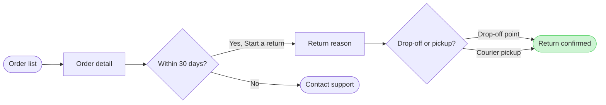

# FJ-031 turn 3 transcript

**User:** Yes, that reading is right.

**Tool call:** `Bash` `{"command": "S=$(mktemp -d) && echo \"$S\" && cat > \"$S/model.md\" <<'EOF'\n```mermaid\nflowchart LR\n    %% title: Start a return\n    %% subtitle: How a Fernhouse customer starts a return in the app, from the order list to a confirmed return\n    %% source: Sources: the Fernhouse app and the returns doc. Left out: free pickup over €100, a proposal under review.\n    %% zone: Find the order: orders, detail\n    %% zone: Request the return: window, support, reason, method\n    %% zone: Done: confirmed\n    orders([Order list]) --> detail[Order detail]\n    detail --> window{Within 30 days?}\n`

**Tool result:** `Bash`

```text
"/var/folders/3c/zfqcqsts0kn19cgblj82gqhm0000gn/T/tmp.WzFYhyBfpR\n  diagram 1, user flow: ok, 7 nodes and 7 connectors, widest rank 2 steps, longest path 6 steps, 1.0 connectors per step, labels average 14 characters, 0 crossing pairs\nPASSED 1 diagram(s) in model.md"
```

**Tool call:** `ToolSearch` `{"query": "select:mcp__figma-remote__create_session,mcp__figma-remote__get_figjam,mcp__figma-remote__use_figma,mcp__figma-remote__whoami,mcp__figma-remote__create_new_file,mcp__figma-remote__get_screenshot", "max_results": 6}`

**Tool result:** `ToolSearch`

```text
[{"type": "tool_reference", "tool_name": "mcp__figma-remote__create_session"}, {"type": "tool_reference", "tool_name": "mcp__figma-remote__get_figjam"}, {"type": "tool_reference", "tool_name": "mcp__figma-remote__use_figma"}, {"type": "tool_reference", "tool_name": "mcp__figma-remote__whoami"}, {"type": "tool_reference", "tool_name": "mcp__figma-remote__create_new_file"}, {"type": "tool_reference", "tool_name": "mcp__figma-remote__get_screenshot"}]
```

**Tool call:** `Bash` `{"command": "S=/var/folders/3c/zfqcqsts0kn19cgblj82gqhm0000gn/T/tmp.WzFYhyBfpR && python3 sk-create-figjam/scripts/compose_board.py \"$S/model.md\" --diagram 1 --out \"$S/code.js\"; echo \"exit $?\"; wc -c \"$S/code.js\"", "description": "Compose the board code from the checked model"}`

**Tool result:** `Bash`

```text
"COMPOSED diagram 1, 7 nodes and 7 connectors, widest rank 2 steps, longest path 6 steps, 1.0 connectors per step, labels average 14 characters, 0 crossing pairs: 7 nodes and 7 connectors to read back, 42126 characters in /var/folders/3c/zfqcqsts0kn19cgblj82gqhm0000gn/T/tmp.WzFYhyBfpR/code.js, drawn in the design FigJam default\nexit 0\n   42128 /var/folders/3c/zfqcqsts0kn19cgblj82gqhm0000gn/T/tmp.WzFYhyBfpR/code.js"
```

**Tool call:** `mcp__figma-remote__create_session` `{"fileKey": "<test-file-key>", "description": "Add a Start a return user flow section to the existing FigJam file, after a read of what it holds"}`

**Tool result:** `mcp__figma-remote__create_session`

```text
"{\"sessionId\":\"ce4d822c-9193-417c-a2c6-4fdf7a55f60a\"}"
```

**Assistant:**

Now the one pre-gate read of the named file.

**Tool call:** `mcp__figma-remote__get_figjam` `{"fileKey": "<test-file-key>", "nodeId": "0:1", "includeImagesOfNodes": false, "sessionId": "ce4d822c-9193-417c-a2c6-4fdf7a55f60a"}`

**Tool result:** `mcp__figma-remote__get_figjam`

```text
"Error: result (658,692 characters across 5,589 lines) exceeds maximum allowed tokens. Output has been saved to /Users/michelkerkmeester/.claude/projects/-private-var-folders-3c-zfqcqsts0kn19cgblj82gqhm0000gn-T-devin-compare-bench-FJ-031/cc81ed05-af15-4ecc-bbe9-26ec8270f0cd/tool-results/mcp-figma-remote-get_figjam-1793052332137.txt.\nFormat: Plain text\nUse offset and limit parameters to read specific portions of the file, search within it for specific content, and jq to make structured queries.\nREQUIREMENTS FOR SUMMARIZATION/ANALYSIS/REVIEW:\n- You MUST read the content from the file at /Users/michelkerkmeester/.claude/projects/-private-var-folders-3c-zfqcqsts0kn19cgblj82gqhm0000gn-T-devin-compare-bench-FJ-031/cc81ed05-af15-4ecc-bbe9-26ec8270f0cd/tool-results/mcp-figma-remote-get_figjam-1793052332137.txt in sequential chunks until 100% of the content has been read.\n- If you receive truncation warnings when reading the file, reduce the chunk size until you have read 100% of the content without truncation.\n- Before producing ANY summary or analysis, you MUST explicitly describe what portion of the content you have read. ***If you did not read the entire content, you MUST explicitly state this.***\n- If after a few attempts you cannot read the file (file not found, lines too long for Read's offset/limit, no shell access), STOP retrying. Summarize what you were able to read, explicitly state which portion you could not read and why, and proceed.\n"
```

**Tool call:** `Bash` `{"command": "F=\"/Users/michelkerkmeester/.claude/projects/-private-var-folders-3c-zfqcqsts0kn19cgblj82gqhm0000gn-T-devin-compare-bench-FJ-031/cc81ed05-af15-4ecc-bbe9-26ec8270f0cd/tool-results/mcp-figma-remote-get_figjam-1793052332137.txt\"; head -c 1500 \"$F\"; echo; echo ----; grep -n -i -E \"section\" \"$F\" | head -40; echo; grep -c \"\" \"$F\"", "description": "Inspect the saved FigJam read for top-level sections"}`

**Tool result:** `Bash`

```text
"<canvas id=\"0:1\" name=\"Page 1\" x=\"0\" y=\"0\" width=\"0\" height=\"0\">\n  <shape-with-text id=\"1:3\" x=\"768\" y=\"-492\" width=\"224\" height=\"128\" name=\"ROUNDED_RECTANGLE\">Order list</shape-with-text>\n  <shape-with-text id=\"1:6\" x=\"768\" y=\"-236\" width=\"224\" height=\"128\" name=\"SQUARE\">Order detail</shape-with-text>\n  <shape-with-text id=\"1:9\" x=\"780\" y=\"20\" width=\"200\" height=\"200\" name=\"DIAMOND\">Within 30 days?</shape-with-text>\n  <shape-with-text id=\"1:12\" x=\"608\" y=\"476\" width=\"224\" height=\"128\" name=\"ROUNDED_RECTANGLE\">Contact support</shape-with-text>\n  <shape-with-text id=\"1:15\" x=\"928\" y=\"476\" width=\"224\" height=\"128\" name=\"SQUARE\">Pick a reason</shape-with-text>\n  <shape-with-text id=\"1:18\" x=\"940\" y=\"732\" width=\"200\" height=\"200\" name=\"DIAMOND\">Drop-off or pickup?</shape-with-text>\n  <shape-with-text id=\"1:21\" x=\"768\" y=\"1188\" width=\"224\" height=\"128\" name=\"SQUARE\">Choose a drop-off point</shape-with-text>\n  <shape-with-text id=\"1:24\" x=\"1088\" y=\"1188\" width=\"224\" height=\"128\" name=\"SQUARE\">Book a courier pickup</shape-with-text>\n  <shape-with-text id=\"1:27\" x=\"928\" y=\"1444\" width=\"224\" height=\"128\" name=\"ROUNDED_RECTANGLE\">Return confirmed with QR code</shape-with-text>\n  <connector id=\"1:30\" x=\"880\" y=\"-356\" connectorStart=\"1:3\" connectorStartCap=\"NONE\" connectorEnd=\"1:6\" connectorEndCap=\"ARROW_LINES\"></connector>\n  <connector id=\"1:
```

**Tool call:** `Bash` `{"command": "F=\"/Users/michelkerkmeester/.claude/projects/-private-var-folders-3c-zfqcqsts0kn19cgblj82gqhm0000gn-T-devin-compare-bench-FJ-031/cc81ed05-af15-4ecc-bbe9-26ec8270f0cd/tool-results/mcp-figma-remote-get_figjam-1793052332137.txt\"; echo \"== top-level (2-space indent) ==\"; grep -n -E '^  <(section|shape-with-text|sticky|text|connector|stamp|widget|code-block|table|image|link|embed)' \"$F\" | grep -v connector | cut -c1-170; echo; echo \"== Start a return section ==\"; sed -n '97,146p' \"$F\" | cut -c1-200", "description": "List top-level nodes and the existing Start a return section`

**Tool result:** `Bash`

```text
"== top-level (2-space indent) ==\n2:  <shape-with-text id=\"1:3\" x=\"768\" y=\"-492\" width=\"224\" height=\"128\" name=\"ROUNDED_RECTANGLE\">Order list</shape-with-text>\n3:  <shape-with-text id=\"1:6\" x=\"768\" y=\"-236\" width=\"224\" height=\"128\" name=\"SQUARE\">Order detail</shape-with-text>\n4:  <shape-with-text id=\"1:9\" x=\"780\" y=\"20\" width=\"200\" height=\"200\" name=\"DIAMOND\">Within 30 days?</shape-with-text>\n5:  <shape-with-text id=\"1:12\" x=\"608\" y=\"476\" width=\"224\" height=\"128\" name=\"ROUNDED_RECTANGLE\">Contact support</shape-with-text>\n6:  <shape-with-text id=\"1:15\" x=\"928\" y=\"476\" width=\"224\" height=\"128\" name=\"SQUARE\">Pick a reason</shape-with-text>\n7:  <shape-with-text id=\"1:18\" x=\"940\" y=\"732\" width=\"200\" height=\"200\" name=\"DIAMOND\">Drop-off or pickup?</shape-with-text>\n8:  <shape-with-text id=\"1:21\" x=\"768\" y=\"1188\" width=\"224\" height=\"128\" name=\"SQUARE\">Choose a drop-off point</shape-with-text>\n9:  <shape-with-text id=\"1:24\" x=\"1088\" y=\"1188\" width=\"224\" height=\"128\" name=\"SQUARE\">Book a courier pickup</shape-with-text>\n10:  <shape-with-text id=\"1:27\" x=\"928\" y=\"1444\" width=\"224\" height=\"128\" name=\"ROUNDED_RECTANGLE\">Return confirmed with QR code</shape-with-text>\n20:  <text id=\"2:47\" name=\"Start a return\" x=\"768\" y=\"-608\" width=\"230\" height=\"44\" />\n21:  <section id=\"19:1408\" name=\"Sprint retro\" x=\"608\" y=\"1972\" width=\"1000\" height=\"720\">\n29: 
```

**Tool call:** `Bash` `{"command": "F=\"/Users/michelkerkmeester/.claude/projects/-private-var-folders-3c-zfqcqsts0kn19cgblj82gqhm0000gn-T-devin-compare-bench-FJ-031/cc81ed05-af15-4ecc-bbe9-26ec8270f0cd/tool-results/mcp-figma-remote-get_figjam-1793052332137.txt\"; echo -n \"exact-title sections: \"; grep -c -E '^  <section id=\"[0-9:]+\" name=\"Start a return\"' \"$F\"; echo -n \"top-level sections: \"; grep -c -E '^  <section ' \"$F\"; echo -n \"top-level non-section nodes: \"; grep -c -E '^  <(shape-with-text|text|connector|sticky)' \"$F\"; grep -E '^  <section ' \"$F\" | sed -E 's/.* x=\"([-0-9.]+)\" y=\"[-0-9.]+`

**Tool result:** `Bash`

```text
"exact-title sections: 14\ntop-level sections: 96\ntop-level non-section nodes: 36\nrightmost edge: 277744"
```

**Tool call:** `Bash` `{"command": "S=/var/folders/3c/zfqcqsts0kn19cgblj82gqhm0000gn/T/tmp.WzFYhyBfpR && sed -i '' 's/%% title: Start a return$/%% title: Start a return 15/' \"$S/model.md\" && grep -n \"title:\" \"$S/model.md\" && python3 sk-create-figjam/scripts/flow_check.py \"$S/model.md\" && python3 sk-create-figjam/scripts/compose_board.py \"$S/model.md\" --diagram 1 --out \"$S/code.js\"", "description": "Retitle the model, recheck it and recompose the board code"}`

**Tool result:** `Bash`

```text
"3:    %% title: Start a return 15\n4:    %% subtitle: How a Fernhouse customer starts a return in the app, from the order list to a confirmed return\n  diagram 1, user flow: ok, 7 nodes and 7 connectors, widest rank 2 steps, longest path 6 steps, 1.0 connectors per step, labels average 14 characters, 0 crossing pairs\nPASSED 1 diagram(s) in model.md\nCOMPOSED diagram 1, 7 nodes and 7 connectors, widest rank 2 steps, longest path 6 steps, 1.0 connectors per step, labels average 14 characters, 0 crossing pairs: 7 nodes and 7 connectors to read back, 42129 characters in /var/folders/3c/zfqcqsts0kn19cgblj82gqhm0000gn/T/tmp.WzFYhyBfpR/code.js, drawn in the design FigJam default"
```

**Assistant:**

Check passed: 7 nodes, 7 connectors, 0 crossing pairs, and the board composed without error. This is the gate for the write.

**The sketch** (the checked model, not yet on any board)



**Question:** which screens does a Fernhouse customer pass through to start a return in the app, and where do they choose?
**Outcome:** the Post-purchase team and design can follow a return from the order list to the confirmed return and see where the 30-day window ends it.
**First glance:** the confirmed return, the goal in green with the accent outline
**Second glance:** the drop-off or pickup choice that leads to it
**Last glance:** Contact support, the exit after 30 days

**File:** the existing FigJam file `<test-file-key>`, with the board added as a new section beside what it holds. No plan is used and no new file is created. I can't confirm which plan owns the file, so Fernhouse Product is your word and not something I verified.

**What the file already holds:** I read it once. It has 96 sections and 36 loose nodes, and nothing will be moved, edited or deleted. Fourteen sections are already titled exactly "Start a return", and one is titled "Start a return in the app". A loose, unsectioned set of the same screens also sits at the top left. I recommend the title "Start a return 15" so the new board can't be mistaken for one of them, and the model above is already composed under it.

**Writes:** one section titled "Start a return 15" with 7 nodes, 7 connectors and 3 zones (Find the order, Request the return and Done). It also has a title, a subtitle, a key and the source line "Sources: the Fernhouse app and the returns doc. Left out: free pickup over €100, a proposal under review." The Laptop reading distance applies. The composer lands it about 400 pixels right of everything already on the page.
**Extensions:** none
**Calls:** one `use_figma` call to compose the board and one `get_figjam` read of the new section only. I already spent a session call and one read of the file. On a Starter plan or a View or Collab seat, Figma allows six tool calls a month, and these count against that
**Rollback:** delete the one new section the write returns. That deletion runs only on its own yes to a question that names it

Do you want me to write the "Start a return 15" board into that file now?
