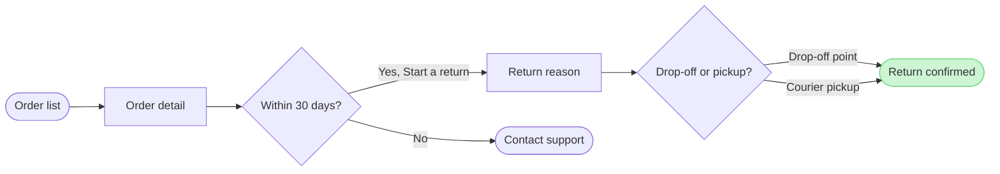

Check passed: 7 nodes, 7 connectors, 0 crossing pairs, and the board composed without error. This is the gate for the write.

**The sketch** (the checked model, not yet on any board)

**Question:** which screens does a Fernhouse customer pass through to start a return in the app, and where do they choose?
**Outcome:** the Post-purchase team and design can follow a return from the order list to the confirmed return and see where the 30-day window ends it.
**First glance:** the confirmed return, the goal in green with the accent outline
**Second glance:** the drop-off or pickup choice that leads to it
**Last glance:** Contact support, the exit after 30 days

**File:** the existing FigJam file `<test-file-key>`, with the board added as a new section beside what it holds. No plan is used and no new file is created. I can't confirm which plan owns the file, so Fernhouse Product is your word and not something I verified.

**What the file already holds:** I read it once. It has 96 sections and 36 loose nodes, and nothing will be moved, edited or deleted. Fourteen sections are already titled exactly "Start a return", and one is titled "Start a return in the app". A loose, unsectioned set of the same screens also sits at the top left. I recommend the title "Start a return 15" so the new board can't be mistaken for one of them, and the model above is already composed under it.

**Writes:** one section titled "Start a return 15" with 7 nodes, 7 connectors and 3 zones (Find the order, Request the return and Done). It also has a title, a subtitle, a key and the source line "Sources: the Fernhouse app and the returns doc. Left out: free pickup over €100, a proposal under review." The Laptop reading distance applies. The composer lands it about 400 pixels right of everything already on the page.
**Extensions:** none
**Calls:** one `use_figma` call to compose the board and one `get_figjam` read of the new section only. I already spent a session call and one read of the file. On a Starter plan or a View or Collab seat, Figma allows six tool calls a month, and these count against that
**Rollback:** delete the one new section the write returns. That deletion runs only on its own yes to a question that names it

Do you want me to write the "Start a return 15" board into that file now?