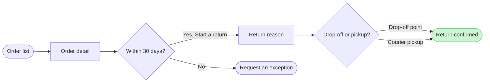

Check passed and the new board composed. This is the gate for the write.

**The sketch** (the checked model, not yet on any board)

**Question:** which screens does a Fernhouse customer pass through to start a return in the app, and where do they choose?
**Outcome:** the Post-purchase team and design can follow a return from the order list to the confirmed return and see where the 30-day window ends it.
**First glance:** the confirmed return, the goal in green with the accent outline
**Second glance:** the drop-off or pickup choice that leads to it
**Last glance:** Request an exception, the exit after 30 days

**File:** the existing FigJam file `<test-file-key>`, with the new board added as a section beside what it holds. No plan is used and no new file is created.

**What the file holds:** this write adds one section and edits, moves or deletes nothing. The earlier "Start a return 15" board stays in place until you answer the delete question below. I did not re-read the whole file before this gate, because the earlier read ran to 96 sections. The title "Start a return 16" is free as of that read. If someone added a section with that title since, it is named after the write and not replaced.

**Writes:** one section titled "Start a return 16" with 7 nodes, 7 connectors and 3 zones, a title, a subtitle, a key and the source line "Sources: the Fernhouse app, the returns doc and a later team update. Left out: free pickup over €100, a proposal under review." The Laptop reading distance applies. It lands about 400 pixels right of everything already on the page.
**Extensions:** none
**Calls:** one `use_figma` call to compose the board and one `get_figjam` read of the new section only
**Rollback:** delete the one new section the write returns. That deletion runs only on its own yes to a question that names it

**After the read-back:** I will ask whether to delete "Start a return 15", which this conversation wrote, and nothing is deleted without that second yes. A yes to this gate does not cover it.

Do you want me to write the "Start a return 16" board into that file now?