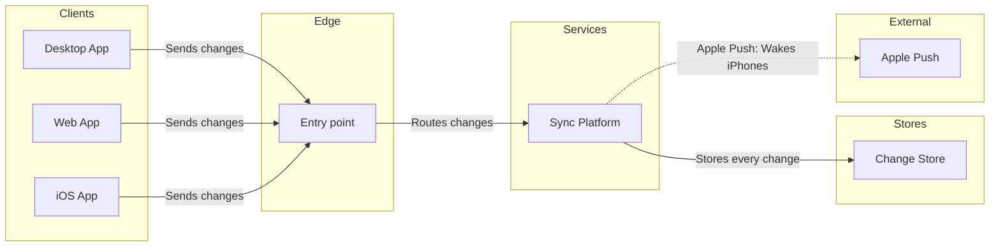

# FJ-033 turn 3 transcript

**User:** Yes, that reading is right.

**Tool call:** `Read` `{"file_path": "/private/var/folders/3c/zfqcqsts0kn19cgblj82gqhm0000gn/T/devin-compare-bench/FJ-033/sk-create-figjam/references/quality-rubric.md"}`

**Tool result:** `Read`

```text
"1\t---\n2\ttitle: \"FigJam Diagram Quality Rubric\"\n3\tdescription: \"The taste gate a FigJam model passes before the write gate, translated from sk-design-diagram's success criteria: type fit, the remove test, signal, the check, the board, the design rubric that scores a composed board and the reply.\"\n4\tcontextType: implementation\n5\timportance_tier: important\n6\ttrigger_phrases:\n7\t  - \"figjam quality rubric\"\n8\t  - \"diagram taste gate\"\n9\t  - \"remove test\"\n10\t  - \"figjam review checklist\"\n11\t  - \"figjam design rubric\"\n12\tversion: 1.0.3.0\n13\t---\n14\t\n15\t# FigJam Diagram Quality Rubric\n16\t\n17\tThe script checks what a script can see. This rubric is the rest: whether the diagram should exist, whether every node earns its place and whether the reader can trust what lands on the board. Walk it after the check passes and before the write gate.\n18\t\n19\t**Loading Condition:** CONDITIONAL, on every Flow route before the write gate\n20\t**Purpose:** The judgement pass between the pre-write check and the gate\n21\t**Scope:** The model, the provenance table, the planned extensions and, after the write, the board and the reply\n22\t\n23\t---\n24\t\n25\t## 1. TYPE FIT\n26\t\n27\t- [ ] The type answers the reader's question, as `references/flow-mode.md` Section 3 maps it\n28\t- [ ] A table, a list or a paragraph would not do the same job. If it would, say so and offer that instead\n29\t- [ ] The type's reference in `references/types/` was loaded and i
```

**Tool call:** `Read` `{"file_path": "/private/var/folders/3c/zfqcqsts0kn19cgblj82gqhm0000gn/T/devin-compare-bench/FJ-033/sk-create-figjam/references/style-guide.md"}`

**Tool result:** `Read`

```text
"1\t---\n2\ttitle: \"FigJam Diagram Style Guide\"\n3\tdescription: \"The colour every composed FigJam board draws by kind in the shipped design, the type scale and the 8 pixel grid, the palette pairs the check accepts with their measured contrast, and the spacing bands, translated from sk-design-diagram's style guide and derivation record.\"\n4\tcontextType: implementation\n5\timportance_tier: important\n6\ttrigger_phrases:\n7\t  - \"figjam style guide\"\n8\t  - \"figjam palette\"\n9\t  - \"figjam colour by kind\"\n10\t  - \"figjam type scale\"\n11\t  - \"palette derivation record\"\n12\t  - \"figjam contrast\"\n13\tversion: 1.0.3.0\n14\t---\n15\t\n16\t# FigJam Diagram Style Guide\n17\t\n18\tThe rules for colour, type and spacing on a FigJam board. The composer in `assets/compose-board.js` draws every board in the design `assets/figjam-design.md` holds, which ships as the tables below record, and every hex a model, a design or a note extension uses comes from the palette in Section 3. `scripts/flow_check.py` refuses any other.\n19\t\n20\t**Loading Condition:** CONDITIONAL, before the gate on every Flow route, and when a model or a note extension uses colour\n21\t**Purpose:** Names the colour each kind draws in, the type scale, the grid, the palette pairs the check accepts and the measured contrast record\n22\t**Scope:** The composed board, Mermaid `style`, `classDef` and `linkStyle` colours, sticky and pin colours for notes, and the contrast record the self-test re-measures\n
```

**Tool call:** `ToolSearch` `{"query": "select:mcp__figma-remote__create_session,mcp__figma-remote__get_figjam,mcp__figma-remote__use_figma,mcp__figma-remote__whoami,mcp__figma-remote__create_new_file", "max_results": 5}`

**Tool result:** `ToolSearch`

```text
[{"type": "tool_reference", "tool_name": "mcp__figma-remote__create_session"}, {"type": "tool_reference", "tool_name": "mcp__figma-remote__get_figjam"}, {"type": "tool_reference", "tool_name": "mcp__figma-remote__use_figma"}, {"type": "tool_reference", "tool_name": "mcp__figma-remote__whoami"}, {"type": "tool_reference", "tool_name": "mcp__figma-remote__create_new_file"}]
```

**Tool call:** `Bash` `{"command": "mktemp -d", "description": "Create scratch folder for the model"}`

**Tool result:** `Bash`

```text
"/var/folders/3c/zfqcqsts0kn19cgblj82gqhm0000gn/T/tmp.zE77dPRoIp"
```

**Tool call:** `Write` `{"file_path": "/var/folders/3c/zfqcqsts0kn19cgblj82gqhm0000gn/T/tmp.zE77dPRoIp/model.md", "content": "```mermaid\n%% type: architecture\nflowchart LR\n    %% title: Block sync\n    %% subtitle: How a block change reaches every Loomlist app, including a sleeping iPhone\n    %% source: Source: the product owner's description of block sync. Entry point and Change Store are named by what they do, assumed. Left out: how awake apps receive changes back.\n    %% focus: sync because it stores every change\n    subgraph client [\"Clients\"]\n        desktop[Desktop App]\n        webApp[Web App]\n      `

**Tool result:** `Write`

```text
"File created successfully at: /var/folders/3c/zfqcqsts0kn19cgblj82gqhm0000gn/T/tmp.zE77dPRoIp/model.md (file state is current in your context \u2014 no need to Read it back)"
```

**Tool call:** `mcp__figma-remote__create_session` `{"fileKey": "<test-file-key>", "description": "Read the existing FigJam file, then add a Block sync architecture board for a leadership update after the user's yes"}`

**Tool result:** `mcp__figma-remote__create_session`

```text
"{\"sessionId\":\"83096821-2649-4860-8581-68b6ea99d7e5\"}"
```

**Tool call:** `Bash` `{"command": "python3 sk-create-figjam/scripts/flow_check.py /var/folders/3c/zfqcqsts0kn19cgblj82gqhm0000gn/T/tmp.zE77dPRoIp/model.md && python3 sk-create-figjam/scripts/compose_board.py /var/folders/3c/zfqcqsts0kn19cgblj82gqhm0000gn/T/tmp.zE77dPRoIp/model.md --diagram 1 --out /var/folders/3c/zfqcqsts0kn19cgblj82gqhm0000gn/T/tmp.zE77dPRoIp/board.js", "description": "Run the pre-write check and compose the board code"}`

**Tool result:** `Bash`

```text
"  diagram 1, architecture: ok, 7 nodes and 6 connectors, widest rank 3 steps, longest path 4 steps, 0.9 connectors per step, labels average 10 characters, 0 crossing pairs\nPASSED 1 diagram(s) in model.md\nCOMPOSED diagram 1, 7 nodes and 6 connectors, widest rank 3 steps, longest path 4 steps, 0.9 connectors per step, labels average 10 characters, 0 crossing pairs: 7 nodes and 6 connectors to read back, 42197 characters in /var/folders/3c/zfqcqsts0kn19cgblj82gqhm0000gn/T/tmp.zE77dPRoIp/board.js, drawn in the design FigJam default"
```

**Tool call:** `mcp__figma-remote__get_figjam` `{"fileKey": "<test-file-key>", "nodeId": "0:1", "sessionId": "83096821-2649-4860-8581-68b6ea99d7e5", "includeImagesOfNodes": false}`

**Tool result:** `mcp__figma-remote__get_figjam`

```text
"Error: result (675,559 characters across 5,721 lines) exceeds maximum allowed tokens. Output has been saved to /Users/michelkerkmeester/.claude/projects/-private-var-folders-3c-zfqcqsts0kn19cgblj82gqhm0000gn-T-devin-compare-bench-FJ-033/d601fe8c-089c-4de1-8636-18003e454cfb/tool-results/mcp-figma-remote-get_figjam-1793053401091.txt.\nFormat: Plain text\nUse offset and limit parameters to read specific portions of the file, search within it for specific content, and jq to make structured queries.\nREQUIREMENTS FOR SUMMARIZATION/ANALYSIS/REVIEW:\n- You MUST read the content from the file at /Users/michelkerkmeester/.claude/projects/-private-var-folders-3c-zfqcqsts0kn19cgblj82gqhm0000gn-T-devin-compare-bench-FJ-033/d601fe8c-089c-4de1-8636-18003e454cfb/tool-results/mcp-figma-remote-get_figjam-1793053401091.txt in sequential chunks until 100% of the content has been read.\n- If you receive truncation warnings when reading the file, reduce the chunk size until you have read 100% of the content without truncation.\n- Before producing ANY summary or analysis, you MUST explicitly describe what portion of the content you have read. ***If you did not read the entire content, you MUST explicitly state this.***\n- If after a few attempts you cannot read the file (file not found, lines too long for Read's offset/limit, no shell access), STOP retrying. Summarize what you were able to read, explicitly state which portion you could not read and why, and proceed.\n"
```

**Tool call:** `Bash` `{"command": "cd /Users/michelkerkmeester/.claude/projects/-private-var-folders-3c-zfqcqsts0kn19cgblj82gqhm0000gn-T-devin-compare-bench-FJ-033/d601fe8c-089c-4de1-8636-18003e454cfb/tool-results/ && f=mcp-figma-remote-get_figjam-1793053401091.txt && head -c 1500 $f; echo; echo ----; grep -c \"\" $f; grep -n -i \"block sync\" $f | head -20; grep -n -i -E '<section|type=\"SECTION\"|\"SECTION\"' $f | head -40", "description": "Inspect the saved FigJam read for sections and title matches"}`

**Tool result:** `Bash`

```text
"<canvas id=\"0:1\" name=\"Page 1\" x=\"0\" y=\"0\" width=\"0\" height=\"0\">\n  <shape-with-text id=\"1:3\" x=\"768\" y=\"-492\" width=\"224\" height=\"128\" name=\"ROUNDED_RECTANGLE\">Order list</shape-with-text>\n  <shape-with-text id=\"1:6\" x=\"768\" y=\"-236\" width=\"224\" height=\"128\" name=\"SQUARE\">Order detail</shape-with-text>\n  <shape-with-text id=\"1:9\" x=\"780\" y=\"20\" width=\"200\" height=\"200\" name=\"DIAMOND\">Within 30 days?</shape-with-text>\n  <shape-with-text id=\"1:12\" x=\"608\" y=\"476\" width=\"224\" height=\"128\" name=\"ROUNDED_RECTANGLE\">Contact support</shape-with-text>\n  <shape-with-text id=\"1:15\" x=\"928\" y=\"476\" width=\"224\" height=\"128\" name=\"SQUARE\">Pick a reason</shape-with-text>\n  <shape-with-text id=\"1:18\" x=\"940\" y=\"732\" width=\"200\" height=\"200\" name=\"DIAMOND\">Drop-off or pickup?</shape-with-text>\n  <shape-with-text id=\"1:21\" x=\"768\" y=\"1188\" width=\"224\" height=\"128\" name=\"SQUARE\">Choose a drop-off point</shape-with-text>\n  <shape-with-text id=\"1:24\" x=\"1088\" y=\"1188\" width=\"224\" height=\"128\" name=\"SQUARE\">Book a courier pickup</shape-with-text>\n  <shape-with-text id=\"1:27\" x=\"928\" y=\"1444\" width=\"224\" height=\"128\" name=\"ROUNDED_RECTANGLE\">Return confirmed with QR code</shape-with-text>\n  <connector id=\"1:30\" x=\"880\" y=\"-356\" connectorStart=\"1:3\" connectorStartCap=\"NONE\" connectorEnd=\"1:6\" connectorEndCap=\"ARROW_LINES\"></connector>\n  <connector id=\"1:
```

**Tool call:** `Bash` `{"command": "cd /Users/michelkerkmeester/.claude/projects/-private-var-folders-3c-zfqcqsts0kn19cgblj82gqhm0000gn-T-devin-compare-bench-FJ-033/d601fe8c-089c-4de1-8636-18003e454cfb/tool-results/ && f=mcp-figma-remote-get_figjam-1793053401091.txt && echo \"top-level sections:\" && grep -c -E '^  <section ' $f && grep -E '^  <section ' $f | sed -E 's/.*name=\"([^\"]*)\" x=\"(-?[0-9]+)\" y=\"(-?[0-9]+)\" width=\"([0-9]+)\".*/\\2 \\4 \\1/' | awk '{x=$1; w=$2; $1=\"\";$2=\"\"; print x, x+w, $0}' | tail -40; echo; echo \"other top-level kinds:\"; grep -E '^  <[a-z-]+ ' $f | sed -E 's/^  <([a-z-]+) .*/`

**Tool result:** `Bash`

```text
"top-level sections:\n98\n186096 188184   Offline mode launch\n188584 190656   Offline mode launch\n191056 193128   Offline mode launch\n193528 195552   Offline mode launch\n195952 198000   Stays model\n198400 200472   Offline mode launch\n200872 202936   Stays model\n203336 205392   Booking status lifecycle\n205792 208992   Change booking dates\n<section 0   name=\"Customer\" x=\"126582\" y=\"-334.58331298828125\" width=\"296\" height=\"560\">\n<section 0   name=\"CS\" x=\"127166\" y=\"-291.16668701171875\" width=\"1576\" height=\"512.5\">\n129230 130398   Warehouse\n210000 211140   Roamstay checkout payment \u2014 authorised card\n211300 212160   Roamstay checkout payment \u2014 declined card\n212560 215784   Start a return in the app\n216184 219336   Fernhouse damage claim process\n219736 222264   Loomlist block sync\n222664 224704   Loomlist iOS push wake\n225104 226448   Roamstay checkout success\n226848 227968   Roamstay checkout decline\n228368 230624   Roamstay booking lifecycle for support\n231024 232752   Roamstay Stays Model for Guest Support\n233152 235432   Loomlist offline mode launch schedule\n235832 237944   Loomlist offline mode launch plan\n238344 241568   Refund process: Support, Warehouse, Finance\n241968 243664   Roamstay Pay now payment\n244064 245792   Booking status lifecycle\n246192 247776   1. Loomlist block sync, protocol v3\n248176 249680   2. Loomlist edit made without a connection\n250080 252904   Start a return\n253304 255648   Roamstay booking 
```

**Assistant:**

I'm reading the existing file's sections now to find where the new board lands and whether any title clashes.

**Tool call:** `Bash` `{"command": "cd /Users/michelkerkmeester/.claude/projects/-private-var-folders-3c-zfqcqsts0kn19cgblj82gqhm0000gn-T-devin-compare-bench-FJ-033/d601fe8c-089c-4de1-8636-18003e454cfb/tool-results/ && f=mcp-figma-remote-get_figjam-1793053401091.txt && echo \"max right edge of top-level sections:\" && grep -E '^  <section ' $f | sed -nE 's/.* x=\"(-?[0-9.]+)\" y=\"(-?[0-9.]+)\" width=\"([0-9.]+)\".*/\\1 \\3/p' | awk '{r=$1+$2; if(r>m)m=r} END{print m}'; echo \"top-level section ids/titles containing sync:\"; grep -E '^  <section ' $f | grep -i sync | sed -E 's/^  <section id=\"([^\"]*)\" name=\"([^\`

**Tool result:** `Bash`

```text
"max right edge of top-level sections:\n286328\ntop-level section ids/titles containing sync:\n119:5058 | Block sync | x=160032\n169:6116 | Loomlist block sync | x=219736\n179:7084 | 1. Loomlist block sync, protocol v3 | x=246192\n190:7877 | How block sync works | x=275232\nexact title 'Block sync' or numbered variants:\n119:5058 | Block sync | x=160032\ntop-level non-section nodes:\n  <shape-with-text id=\"1:3\" x=\"768\" y=\"-492\" width=\"224\" height=\"128\" name=\"ROUNDED_RECTANGLE\">Order list</shape-with-text>\n  <shape-with-text id=\"1:6\" x=\"768\" y=\"-236\" width=\"224\" height=\"128\" name=\"SQUARE\">Order detail</shape-with-text>\n  <shape-with-text id=\"1:9\" x=\"780\" y=\"20\" width=\"200\" height=\"200\" name=\"DIAMOND\">Within 30 days?</shape-with-text>\n  <shape-with-text id=\"1:12\" x=\"608\" y=\"476\" width=\"224\" height=\"128\" name=\"ROUNDED_RECTANGLE\">Contact support</shape-with-text>\n  <shape-with-text id=\"1:15\" x=\"928\" y=\"476\" width=\"224\" height=\"128\" name=\"SQUARE\">Pick a reason</shape-with-text>\n  <shape-with-text id=\"1:18\" x=\"940\" y=\"732\" width=\"200\" height=\"200\" name=\"DIAMOND\">Drop-off or pickup?</shape-with-text>\n  <shape-with-text id=\"1:21\" x=\"768\" y=\"1188\" width=\"224\" height=\"128\" name=\"SQUARE\">Choose a drop-off point</shape-with-text>\n  <shape-with-text id=\"1:24\" x=\"1088\" y=\"1188\" width=\"224\" height=\"128\" name=\"SQUARE\">Book a courier pickup</shape-with-text>\n  <shape-with-text id=\"1:27\" x
```

**Tool call:** `Bash` `{"command": "d=/var/folders/3c/zfqcqsts0kn19cgblj82gqhm0000gn/T/tmp.zE77dPRoIp && sed -i '' 's/%% title: Block sync$/%% title: Block sync 2/' $d/model.md && grep -n \"title:\" $d/model.md && python3 sk-create-figjam/scripts/flow_check.py $d/model.md && python3 sk-create-figjam/scripts/compose_board.py $d/model.md --diagram 1 --out $d/board.js && wc -c $d/board.js", "description": "Retitle model, rerun check and recompose board code"}`

**Tool result:** `Bash`

```text
"4:    %% title: Block sync 2\n5:    %% subtitle: How a block change reaches every Loomlist app, including a sleeping iPhone\n  diagram 1, architecture: ok, 7 nodes and 6 connectors, widest rank 3 steps, longest path 4 steps, 0.9 connectors per step, labels average 10 characters, 0 crossing pairs\nPASSED 1 diagram(s) in model.md\nCOMPOSED diagram 1, 7 nodes and 6 connectors, widest rank 3 steps, longest path 4 steps, 0.9 connectors per step, labels average 10 characters, 0 crossing pairs: 7 nodes and 6 connectors to read back, 42199 characters in /var/folders/3c/zfqcqsts0kn19cgblj82gqhm0000gn/T/tmp.zE77dPRoIp/board.js, drawn in the design FigJam default\n   42199 /var/folders/3c/zfqcqsts0kn19cgblj82gqhm0000gn/T/tmp.zE77dPRoIp/board.js\n[This command modified 1 file you've previously read: ../../../../../../../../var/folders/3c/zfqcqsts0kn19cgblj82gqhm0000gn/T/tmp.zE77dPRoIp/model.md. Call Read before editing.]"
```

**Assistant:**

This is the write gate. Nothing has been written to the board yet.

**What I changed since the playback**
- The title is now "Block sync 2". The file already has a section called "Block sync" (`119:5058`), which this conversation didn't write. A second one with the same title would be hard to tell apart, and it is also the key I tag the new board with.
- The file also holds three boards with similar names: "Loomlist block sync", "1. Loomlist block sync, protocol v3" and "How block sync works". I'm leaving them untouched. Leadership may see four sync boards side by side.
- The Apple Push connector reads "Apple Push: Wakes iPhones", because the full wording passes the 32-character meeting-screen limit. "Sleeping" stays in the subtitle.

**The model**


The check passed and the composer built the code: 7 nodes, 6 connectors, 5 lanes and 0 crossings. The longest path is 4 steps. The remove test cut nothing, because every node serves the question.

**First glance:** Sync Platform, where every change is stored and the wake-up starts. The key will read "In focus: stores every change".
**Second glance:** Apple Push, the dashed hop that wakes the iPhone.
**Last glance:** the three apps, which can wait.

**Question:** how a block change reaches every Loomlist app, including a sleeping iPhone.
**Outcome:** leadership sees that one sync platform serves all three apps, stores every change and wakes sleeping iPhones through Apple's push service.

**File:** the existing FigJam file `<test-file-key>`, which you named. It needs no plan or new file, so the Barter drafts fallback stays unused.
**Writes:** one framed board section called "Block sync 2", with a title, subtitle, key and source line, at meeting-screen distance. It lands 400 pixels to the right of the last of the 98 sections already there. The source line names your description, the two assumed part names and what was left out.
**Extensions:** none.
**Calls:** one `use_figma` call to compose it, then one `get_figjam` read of the new section to read it back. I already spent one `get_figjam` read on the file. If your Figma plan caps tool calls, that read counts against it.
**Rollback:** delete the new section on its own yes, asked by title. Nothing already in the file is moved, changed or deleted.

Write "Block sync 2" into this file?
