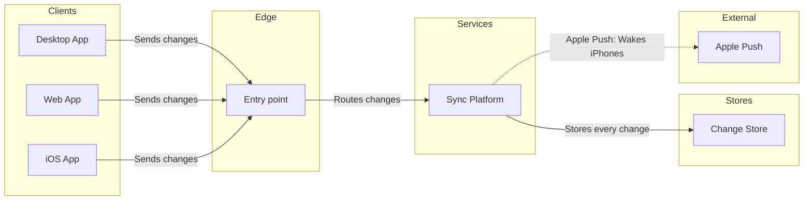

This is the write gate. Nothing has been written to the board yet.

**What I changed since the playback**
- The title is now "Block sync 2". The file already has a section called "Block sync" (`119:5058`), which this conversation didn't write. A second one with the same title would be hard to tell apart, and it is also the key I tag the new board with.
- The file also holds three boards with similar names: "Loomlist block sync", "1. Loomlist block sync, protocol v3" and "How block sync works". I'm leaving them untouched. Leadership may see four sync boards side by side.
- The Apple Push connector reads "Apple Push: Wakes iPhones", because the full wording passes the 32-character meeting-screen limit. "Sleeping" stays in the subtitle.

**The model**

The check passed and the composer built the code: 7 nodes, 6 connectors, 5 lanes and 0 crossings. The longest path is 4 steps. The remove test cut nothing, because every node serves the question.

**First glance:** Sync Platform, where every change is stored and the wake-up starts. The key will read "In focus: stores every change".
**Second glance:** Apple Push, the dashed hop that wakes the iPhone.
**Last glance:** the three apps, which can wait.

**Question:** how a block change reaches every Loomlist app, including a sleeping iPhone.
**Outcome:** leadership sees that one sync platform serves all three apps, stores every change and wakes sleeping iPhones through Apple's push service.

**File:** the existing FigJam file `<test-file-key>`, which you named. It needs no plan or new file, so the Barter drafts fallback stays unused.
**Writes:** one framed board section called "Block sync 2", with a title, subtitle, key and source line, at meeting-screen distance. It lands 400 pixels to the right of the last of the 98 sections already there. The source line names your description, the two assumed part names and what was left out.
**Extensions:** none.
**Calls:** one `use_figma` call to compose it, then one `get_figjam` read of the new section to read it back. I already spent one `get_figjam` read on the file. If your Figma plan caps tool calls, that read counts against it.
**Rollback:** delete the new section on its own yes, asked by title. Nothing already in the file is moved, changed or deleted.

Write "Block sync 2" into this file?