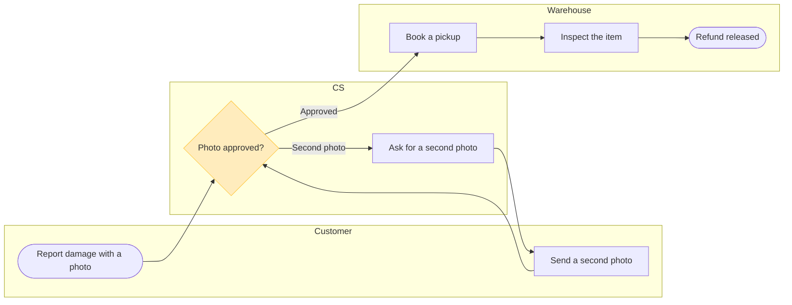

# FJ-034 turn 3 transcript

**User:** Yes, that reading is right.

**Tool call:** `Read` `{"file_path": "/private/var/folders/3c/zfqcqsts0kn19cgblj82gqhm0000gn/T/devin-compare-bench/FJ-034/sk-create-figjam/references/quality-rubric.md"}`

**Tool result:** `Read`

```text
"1\t---\n2\ttitle: \"FigJam Diagram Quality Rubric\"\n3\tdescription: \"The taste gate a FigJam model passes before the write gate, translated from sk-design-diagram's success criteria: type fit, the remove test, signal, the check, the board, the design rubric that scores a composed board and the reply.\"\n4\tcontextType: implementation\n5\timportance_tier: important\n6\ttrigger_phrases:\n7\t  - \"figjam quality rubric\"\n8\t  - \"diagram taste gate\"\n9\t  - \"remove test\"\n10\t  - \"figjam review checklist\"\n11\t  - \"figjam design rubric\"\n12\tversion: 1.0.3.0\n13\t---\n14\t\n15\t# FigJam Diagram Quality Rubric\n16\t\n17\tThe script checks what a script can see. This rubric is the rest: whether the diagram should exist, whether every node earns its place and whether the reader can trust what lands on the board. Walk it after the check passes and before the write gate.\n18\t\n19\t**Loading Condition:** CONDITIONAL, on every Flow route before the write gate\n20\t**Purpose:** The judgement pass between the pre-write check and the gate\n21\t**Scope:** The model, the provenance table, the planned extensions and, after the write, the board and the reply\n22\t\n23\t---\n24\t\n25\t## 1. TYPE FIT\n26\t\n27\t- [ ] The type answers the reader's question, as `references/flow-mode.md` Section 3 maps it\n28\t- [ ] A table, a list or a paragraph would not do the same job. If it would, say so and offer that instead\n29\t- [ ] The type's reference in `references/types/` was loaded and i
```

**Tool call:** `ToolSearch` `{"query": "select:mcp__figma-remote__create_session,mcp__figma-remote__get_figjam,mcp__figma-remote__use_figma,mcp__figma-remote__whoami", "max_results": 4}`

**Tool result:** `ToolSearch`

```text
[{"type": "tool_reference", "tool_name": "mcp__figma-remote__create_session"}, {"type": "tool_reference", "tool_name": "mcp__figma-remote__get_figjam"}, {"type": "tool_reference", "tool_name": "mcp__figma-remote__use_figma"}, {"type": "tool_reference", "tool_name": "mcp__figma-remote__whoami"}]
```

**Tool call:** `Bash` `{"command": "mktemp -d", "description": "Create scratch folder for the model"}`

**Tool result:** `Bash`

```text
"/var/folders/3c/zfqcqsts0kn19cgblj82gqhm0000gn/T/tmp.zvxRhmjerF"
```

**Tool call:** `Write` `{"file_path": "/var/folders/3c/zfqcqsts0kn19cgblj82gqhm0000gn/T/tmp.zvxRhmjerF/model.md", "content": "```mermaid\n%% title: Fernhouse damaged-item refund\n%% subtitle: Who does what from a damage report to a released refund, for new CS and warehouse staff\n%% source: Source: the request description. Left out: claim rejection, failed inspection and a limit on second photos, none of them stated\n%% type: process\nflowchart LR\n    subgraph customer [\"Customer\"]\n        report([Report damage with a photo])\n        resend[Send a second photo]\n    end\n    subgraph cs [\"CS\"]\n        approve`

**Tool result:** `Write`

```text
"File created successfully at: /var/folders/3c/zfqcqsts0kn19cgblj82gqhm0000gn/T/tmp.zvxRhmjerF/model.md (file state is current in your context \u2014 no need to Read it back)"
```

**Tool call:** `Bash` `{"command": "python3 sk-create-figjam/scripts/flow_check.py /var/folders/3c/zfqcqsts0kn19cgblj82gqhm0000gn/T/tmp.zvxRhmjerF/model.md 2>&1 | head -50", "description": "Run the pre-write check on the model"}`

**Tool result:** `Bash`

```text
"  diagram 1, process: ok, 7 nodes and 7 connectors, widest rank 2 steps, longest path 5 steps, 1.0 connectors per step, labels average 18 characters, 0 crossing pairs\nPASSED 1 diagram(s) in model.md"
```

**Assistant:**

Check passed. Now compose to confirm the counts and size, and open the session to read the target file.

**Tool call:** `Bash` `{"command": "python3 sk-create-figjam/scripts/compose_board.py /var/folders/3c/zfqcqsts0kn19cgblj82gqhm0000gn/T/tmp.zvxRhmjerF/model.md --diagram 1 --out /var/folders/3c/zfqcqsts0kn19cgblj82gqhm0000gn/T/tmp.zvxRhmjerF/board1.js 2>&1 | head -20; wc -c /var/folders/3c/zfqcqsts0kn19cgblj82gqhm0000gn/T/tmp.zvxRhmjerF/board1.js", "description": "Compose the board code and count its size"}`

**Tool result:** `Bash`

```text
"COMPOSED diagram 1, 7 nodes and 7 connectors, widest rank 2 steps, longest path 5 steps, 1.0 connectors per step, labels average 18 characters, 0 crossing pairs: 7 nodes and 7 connectors to read back, 42034 characters in /var/folders/3c/zfqcqsts0kn19cgblj82gqhm0000gn/T/tmp.zvxRhmjerF/board1.js, drawn in the design FigJam default\n   42034 /var/folders/3c/zfqcqsts0kn19cgblj82gqhm0000gn/T/tmp.zvxRhmjerF/board1.js"
```

**Tool call:** `mcp__figma-remote__create_session` `{"fileKey": "<draft-file-key>", "description": "Add a process board for the Fernhouse damaged-item refund to the existing FigJam file, after reading it once"}`

**Tool result:** `mcp__figma-remote__create_session`

```text
"{\"sessionId\":\"e5ab492b-94da-470f-bd11-21e55062b1d2\"}"
```

**Tool call:** `mcp__figma-remote__get_figjam` `{"fileKey": "<draft-file-key>", "nodeId": "0:1", "includeImagesOfNodes": false, "sessionId": "e5ab492b-94da-470f-bd11-21e55062b1d2"}`

**Tool result:** `mcp__figma-remote__get_figjam`

```text
[{"type": "text", "text": "<canvas id=\"0:1\" name=\"Page 1\" x=\"0\" y=\"0\" width=\"0\" height=\"0\">\n  <section id=\"1:3\" name=\"Loomlist block sync\" x=\"0\" y=\"0\" width=\"2832\" height=\"1432\">\n    <text id=\"1:4\" name=\"Loomlist block sync\" x=\"80\" y=\"80\" width=\"622\" height=\"77\" />\n    <text id=\"1:5\" name=\"The services that carry a block change from a Loomlist client to a woken iOS device, for engineers on sync\" x=\"80\" y=\"173\" width=\"1440\" height=\"34\" />\n    <section id=\"1:6\" name=\"Clients\" x=\"80\" y=\"272\" width=\"320\" height=\"592\">\n      <text id=\"1:7\" name=\"Clients\" x=\"32\" y=\"32\" width=\"82\" height=\"29\" />\n      <shape-with-text id=\"1:18\" x=\"48\" y=\"96\" width=\"224\" height=\"96\" name=\"ROUNDED_RECTANGLE\">Desktop client</shape-with-text>\n      <shape-with-text id=\"1:22\" x=\"48\" y=\"272\" width=\"224\" height=\"96\" name=\"ROUNDED_RECTANGLE\">Web client</shape-with-text>\n      <shape-with-text id=\"1:26\" x=\"48\" y=\"448\" width=\"224\" height=\"96\" name=\"ROUNDED_RECTANGLE\">iOS client</shape-with-text>\n    </section>\n    <section id=\"1:8\" name=\"Edge\" x=\"568\" y=\"448\" width=\"320\" height=\"240\">\n      <text id=\"1:9\" name=\"Edge\" x=\"32\" y=\"32\" width=\"59\" height=\"29\" />\n      <shape-with-text id=\"1:30\" x=\"48\" y=\"96\" width=\"224\" height=\"96\" name=\"ROUNDED_RECTANGLE\">API gateway</shape-with-text>\n    </section>\n    <connector id=\"1:69\" x=\"356.5\" y=\"572.5\" connector
```

**Assistant:**

The model passed the pre-write check and composes. This message asks about the write only.

## Sketch

The checked model for the board is below. Nothing has been written to a board.



The check read it as a process with 7 nodes, 7 connectors, 2 decision exits, 3 lanes, a widest rank of 2, a longest path of 5 and 0 crossing pairs.

## Glance lines

- First glance: the Photo approved? decision, with the pink outline
- Second glance: the Approved exit to Book a pickup, and the second-photo loop that returns to the decision
- Last glance: Inspect the item and Refund released, which wait at the end of the Warehouse lane

## Four critique questions about the sketch

1. Where does the eye go first? To the outlined diamond in the CS lane. That is the node the board most needs read, because it is the only point where the claim loops or moves to the warehouse.
2. Does any node repeat another? No. Ask for and Send a second photo stay as two nodes because they belong to two owners.
3. Does every connector carry information? Yes. The two decision exits are labelled, and the other five are plain flow.
4. Does anything claim more than your sentence did? No. Rejection, a failed inspection and a limit on second photos are absent.

## What the write does

- File: `<draft-file-key>`. I read it once. It holds one section, "Loomlist block sync", and no section shares this board's title
- Written: one framed board titled "Fernhouse damaged-item refund", placed 400 pixels to the right of what is there, with the title, the subtitle, three lanes, the 7 steps and 7 connectors, a key and the source line. Nothing already on the file changes
- Plan: the file already exists, so the write creates no file and needs no plan. If it can't be written, the fallback is your Barter team plan, in drafts with no project, and I'd ask again before creating it
- Extensions: none
- Calls: one `use_figma` call to compose the board and one `get_figjam` read-back. So far the session has spent a session call and one `get_figjam` read. On a Starter plan or a View or Collab seat, Figma allows six tool calls a month and reads count against that, so this board takes most of what is left
- Rollback: delete the one board section the write returns. I'd ask first, by its title, and would not delete anything else
- Settings: detail Balanced, audience Mixed, reading distance Laptop, colour by kind with lanes for teams

Should I write this board to file `<draft-file-key>`?
