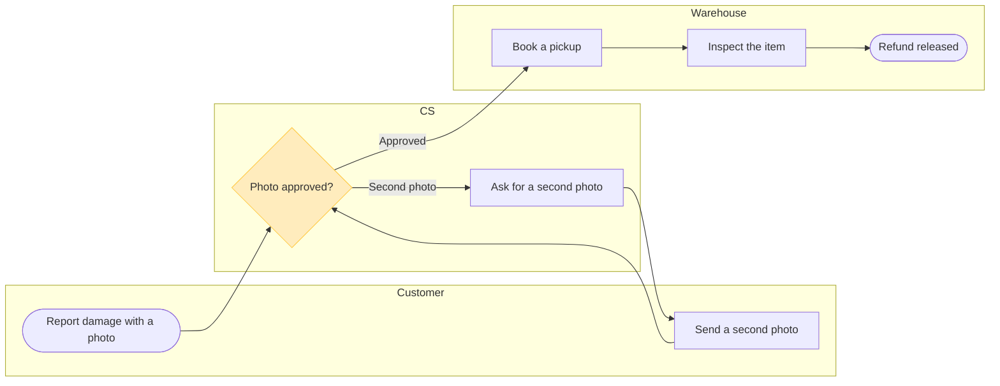

The model passed the pre-write check and composes. This message asks about the write only.

## Sketch

The checked model for the board is below. Nothing has been written to a board.

The check read it as a process with 7 nodes, 7 connectors, 2 decision exits, 3 lanes, a widest rank of 2, a longest path of 5 and 0 crossing pairs.

## Glance lines

- First glance: the Photo approved? decision, with the pink outline
- Second glance: the Approved exit to Book a pickup, and the second-photo loop that returns to the decision
- Last glance: Inspect the item and Refund released, which wait at the end of the Warehouse lane

## Four critique questions about the sketch

1. Where does the eye go first? To the outlined diamond in the CS lane. That is the node the board most needs read, because it is the only point where the claim loops or moves to the warehouse.
2. Does any node repeat another? No. Ask for and Send a second photo stay as two nodes because they belong to two owners.
3. Does every connector carry information? Yes. The two decision exits are labelled, and the other five are plain flow.
4. Does anything claim more than your sentence did? No. Rejection, a failed inspection and a limit on second photos are absent.

## What the write does

- File: `<draft-file-key>`. I read it once. It holds one section, "Loomlist block sync", and no section shares this board's title
- Written: one framed board titled "Fernhouse damaged-item refund", placed 400 pixels to the right of what is there, with the title, the subtitle, three lanes, the 7 steps and 7 connectors, a key and the source line. Nothing already on the file changes
- Plan: the file already exists, so the write creates no file and needs no plan. If it can't be written, the fallback is your Barter team plan, in drafts with no project, and I'd ask again before creating it
- Extensions: none
- Calls: one `use_figma` call to compose the board and one `get_figjam` read-back. So far the session has spent a session call and one `get_figjam` read. On a Starter plan or a View or Collab seat, Figma allows six tool calls a month and reads count against that, so this board takes most of what is left
- Rollback: delete the one board section the write returns. I'd ask first, by its title, and would not delete anything else
- Settings: detail Balanced, audience Mixed, reading distance Laptop, colour by kind with lanes for teams

Should I write this board to file `<draft-file-key>`?