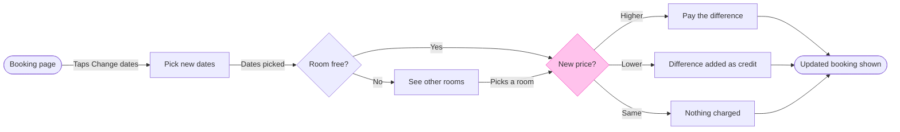

# FJ-036 turn 3 transcript

**User:** Yes, that reading is right.

**Tool call:** `Bash` `{"command": "cd /private/var/folders/3c/zfqcqsts0kn19cgblj82gqhm0000gn/T/devin-compare-bench/FJ-036/sk-create-figjam && python3 scripts/flow_check.py --help 2>&1 | head -30; python3 scripts/compose_board.py --help 2>&1 | head -30; sed -n 1,200p assets/examples/user-flow-fernhouse-return.md", "description": "Read check and composer usage and the worked example"}`

**Tool result:** `Bash`

```text
"mermaid_extract: --help: not a Mermaid file\nUNREADABLE --help: the extractor refused it\n\n  compose_board.py <model.md> [--diagram N] [--out path]  -> 0 the filled code is written, 1 the model fails\n                                                             the check, 2 unreadable or no such diagram\n  compose_board.py <model.md> --model                      -> print the MODEL as JSON instead of the code\n  compose_board.py --template                              -> print the compact code with its MODEL and THEME\n                                                             placeholders, the text the Project's composer\n                                                             Knowledge file carries\n  compose_board.py --design-check                          -> print the design a board is drawn in, what it\n                                                             changes, its measures and the THEME it sends: 0 the\n                                                             design reads with no warning, 1 one or more warnings\n  compose_board.py --self-test                             -> prove every shipped model composes, its counts\n                                                             match the check, the code fits one use_figma call and\n                                                             the board it draws keeps its geometry and its design\n---\ntitle: \"Example - User Flow - Fernhouse Return\"\ndescription: \"A worked user flow on the ficti
```

**Tool call:** `ToolSearch` `{"query": "select:mcp__figma-remote__create_session,mcp__figma-remote__get_figjam,mcp__figma-remote__use_figma,mcp__figma-remote__whoami,mcp__figma-remote__get_screenshot", "max_results": 5}`

**Tool result:** `ToolSearch`

```text
[{"type": "tool_reference", "tool_name": "mcp__figma-remote__create_session"}, {"type": "tool_reference", "tool_name": "mcp__figma-remote__get_figjam"}, {"type": "tool_reference", "tool_name": "mcp__figma-remote__use_figma"}, {"type": "tool_reference", "tool_name": "mcp__figma-remote__whoami"}, {"type": "tool_reference", "tool_name": "mcp__figma-remote__get_screenshot"}]
```

**Tool call:** `Bash` `{"command": "SCRATCH=$(mktemp -d) && echo \"$SCRATCH\" && cat > \"$SCRATCH/model.md\" <<'EOF'\n```mermaid\nflowchart LR\n    %% title: Change booking dates\n    %% subtitle: How a Roamstay guest changes the dates of a booking in the app, from the booking page to the updated booking\n    %% source: Sources: the product brief in the request, taken as current behavior. Left out: cancelling, a failed card payment, host approval.\n    %% zone: Find a room: bookingPage, pickDates, roomFree, otherRooms\n    %% zone: Settle the price: newPrice, payDifference, credit, noCharge, updated\n    %% focus: n`

**Tool result:** `Bash`

```text
"/var/folders/3c/zfqcqsts0kn19cgblj82gqhm0000gn/T/tmp.WyXJxQk3Ni\n  diagram 1, user flow: ok, 9 nodes and 11 connectors, widest rank 3 steps, longest path 7 steps, 1.2 connectors per step, labels average 16 characters, 0 crossing pairs\nPASSED 1 diagram(s) in model.md\nCOMPOSED diagram 1, 9 nodes and 11 connectors, widest rank 3 steps, longest path 7 steps, 1.2 connectors per step, labels average 16 characters, 0 crossing pairs: 9 nodes and 11 connectors to read back, 42590 characters in /var/folders/3c/zfqcqsts0kn19cgblj82gqhm0000gn/T/tmp.WyXJxQk3Ni/board.js, drawn in the design FigJam default\nexit 0\n   42590 /var/folders/3c/zfqcqsts0kn19cgblj82gqhm0000gn/T/tmp.WyXJxQk3Ni/board.js"
```

**Tool call:** `mcp__figma-remote__create_session` `{"fileKey": "<draft-file-key>", "description": "Add a \"Change booking dates\" user flow board as a new section in the existing Roamstay FigJam file"}`

**Tool result:** `mcp__figma-remote__create_session`

```text
"{\"sessionId\":\"8f3595ad-ca10-4dc6-a6e5-3bbe68372bbc\"}"
```

**Tool call:** `mcp__figma-remote__get_figjam` `{"fileKey": "<draft-file-key>", "nodeId": "0:1", "includeImagesOfNodes": false, "sessionId": "8f3595ad-ca10-4dc6-a6e5-3bbe68372bbc"}`

**Tool result:** `mcp__figma-remote__get_figjam`

```text
[{"type": "text", "text": "<canvas id=\"0:1\" name=\"Page 1\" x=\"0\" y=\"0\" width=\"0\" height=\"0\">\n  <section id=\"1:3\" name=\"Booking status\" x=\"0\" y=\"0\" width=\"2208\" height=\"1608\">\n    <text id=\"1:4\" name=\"Booking status\" x=\"80\" y=\"80\" width=\"470\" height=\"77\" />\n    <text id=\"1:5\" name=\"Every status a Roamstay booking passes through, and what moves it on\" x=\"80\" y=\"173\" width=\"1440\" height=\"34\" />\n    <section id=\"1:6\" name=\"Confirmed\" x=\"720\" y=\"320\" width=\"1360\" height=\"240\">\n      <text id=\"1:7\" name=\"Confirmed\" x=\"32\" y=\"32\" width=\"123\" height=\"29\" />\n      <shape-with-text id=\"1:15\" x=\"48\" y=\"128\" width=\"32\" height=\"32\" name=\"ELLIPSE\"></shape-with-text>\n      <shape-with-text id=\"1:18\" x=\"536\" y=\"96\" width=\"224\" height=\"96\" name=\"ROUNDED_RECTANGLE\">Upcoming</shape-with-text>\n      <connector id=\"1:79\" x=\"84.5\" y=\"144\" connectorStart=\"1:15\" connectorStartCap=\"NONE\" connectorEnd=\"1:18\" connectorEndCap=\"ARROW_LINES\">edge:__start_2-&amp;gt;Upcoming</connector>\n      <shape-with-text id=\"1:22\" x=\"896\" y=\"96\" width=\"224\" height=\"96\" name=\"ROUNDED_RECTANGLE\">In stay</shape-with-text>\n      <connector id=\"1:83\" x=\"764.5\" y=\"124.5\" connectorStart=\"1:18\" connectorStartCap=\"NONE\" connectorEnd=\"1:22\" connectorEndCap=\"ARROW_LINES\">edge:Upcoming-&amp;gt;InStay</connector>\n      <shape-with-text id=\"1:26\" x=\"1280\" y=\"128\" width=\"32\" height=
```

**Assistant:**

The model passed the check and composed. The file holds one board, "Booking status", and nothing on it shares this board's title.

### Sketch



```text
PASSED 1 diagram(s): 9 nodes and 11 connectors, widest rank 3 steps, longest path 7 steps, 1.2 connectors per step, labels average 16 characters, 0 crossing pairs
COMPOSED diagram 1: 9 nodes and 11 connectors to read back, 42590 characters, drawn in the design FigJam default
```

### Gate

- Question: how does a guest change the dates of a booking in the app?
- Outcome: a Roamstay product reviewer can see what a guest gets for every availability and price case. This was assumed in the playback.
- First glance: the New price? choice, in the pink outline.
- Second glance: the three outcomes under it, which are Pay the difference, Difference added as credit and Nothing charged.
- Last glance: the See other rooms detour and the source line.
- File: the existing FigJam file <draft-file-key>, with the board added as a new section.
  - "Booking status" stays untouched.
  - No new file is created.
  - The file's plan isn't checked. If the file turns out to be unwritable, I'll stop and ask before creating anything in the Barter plan's drafts.
- Writes: one composed board titled "Change booking dates".
  - 9 nodes, 11 connectors and 5 labelled decision exits in two zones, "Find a room" and "Settle the price".
  - It has a subtitle, a key and a source line, at Laptop reading distance.
  - It lands 400 pixels to the right of "Booking status".
- Extensions: none.
- Calls: one `use_figma` and one `get_figjam` read-back. The file read before this gate and the session setup are already spent. A Starter plan or a View or Collab seat is limited to six tool calls a month, so tell me if that applies here.
- Rollback: delete the one new board section the write returns. That delete runs only on its own yes to a question that names the board.
- Assumed, as in the playback:
  - "Dates picked" is the trigger into the availability check.
  - "Picks a room" is the step from the other rooms back to the price check.
  - Cancelling, a failed card payment and host approval are left out.

Write this board to the file?
