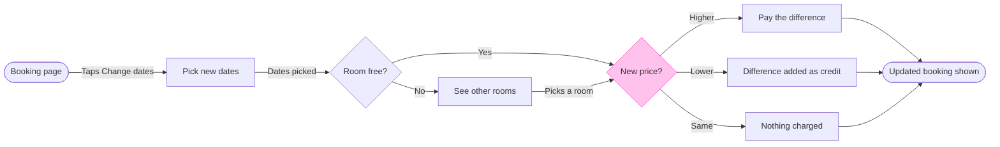

The model passed the check and composed. The file holds one board, "Booking status", and nothing on it shares this board's title.

### Sketch



```text
PASSED 1 diagram(s): 9 nodes and 11 connectors, widest rank 3 steps, longest path 7 steps, 1.2 connectors per step, labels average 16 characters, 0 crossing pairs
COMPOSED diagram 1: 9 nodes and 11 connectors to read back, 42590 characters, drawn in the design FigJam default
```

### Gate

- Question: how does a guest change the dates of a booking in the app?
- Outcome: a Roamstay product reviewer can see what a guest gets for every availability and price case. This was assumed in the playback.
- First glance: the New price? choice, in the pink outline.
- Second glance: the three outcomes under it, which are Pay the difference, Difference added as credit and Nothing charged.
- Last glance: the See other rooms detour and the source line.
- File: the existing FigJam file <draft-file-key>, with the board added as a new section.
  - "Booking status" stays untouched.
  - No new file is created.
  - The file's plan isn't checked. If the file turns out to be unwritable, I'll stop and ask before creating anything in the Barter plan's drafts.
- Writes: one composed board titled "Change booking dates".
  - 9 nodes, 11 connectors and 5 labelled decision exits in two zones, "Find a room" and "Settle the price".
  - It has a subtitle, a key and a source line, at Laptop reading distance.
  - It lands 400 pixels to the right of "Booking status".
- Extensions: none.
- Calls: one `use_figma` and one `get_figjam` read-back. The file read before this gate and the session setup are already spent. A Starter plan or a View or Collab seat is limited to six tool calls a month, so tell me if that applies here.
- Rollback: delete the one new board section the write returns. That delete runs only on its own yes to a question that names the board.
- Assumed, as in the playback:
  - "Dates picked" is the trigger into the availability check.
  - "Picks a room" is the step from the other rooms back to the price check.
  - Cancelling, a failed card payment and host approval are left out.

Write this board to the file?